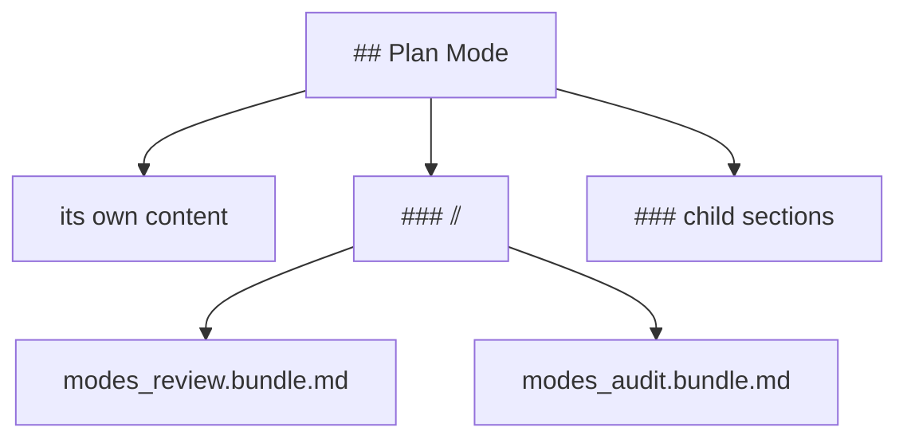
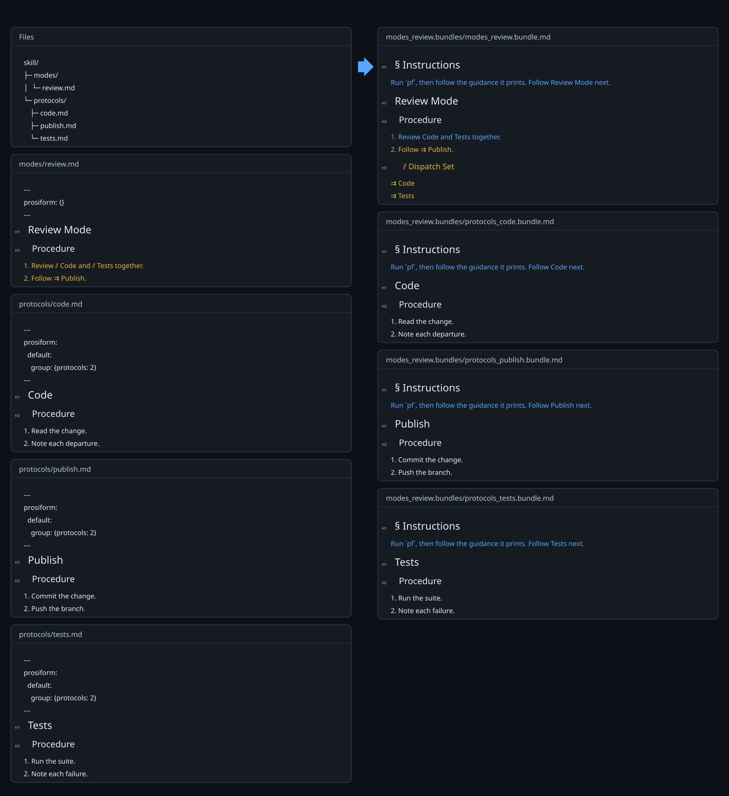

# Dispatch

Not every link points at material for the reader of the bundle. A guide might say "for the review pass, follow the review procedure" — and the review belongs to a different agent, run at a different time, with its own context.

Sending it anyway would pad the bundle with instructions nobody is about to follow. Leaving it out entirely would lose the procedure. A **dispatch** is the third option: the material is compiled as a bundle of its own, and the bundle that linked it says which one to hand over.

## What it looks like

One step of a procedure carries the mark. The run opens three files, and publishes two bundles: the entry's, which links the second, and the second on its own.

*Every panel is the build's own output: the left column is what the run read, the right what it wrote.*

The entry's bundle keeps the link where its author wrote it, with its mark, and points it at the file `Publish` was compiled to, as if it had been asked for on its own. A reader opens the file the link names, and an agent follows it as the [guide](../invocation.md#guide) states: give the linked file to a sub-agent and continue with its answer. A condition the author writes stays in the prose around the link.

## What a dispatch changes

A `⇉` or `⫽` link contributes nothing to the bundle that carries it: no content, no dependency through the link, no group membership. Its target is required to exist, to declare `prosiform` and to name the heading it names, because a sub-agent will follow it and the compilation must be able to succeed.

The run compiles each distinct effective selection once, transitively: a dispatched bundle's own dispatches are further bundles in the same run folder. The selection comprises the canonical document, fragment and matching named presets. Two dispatches of one destination selecting different named presets produce distinct bundles, even if their settings happen to agree; reordered, repeated, differently cased and unknown tags add no variant. Every dispatch names its selection's bundle file, whose deterministic preset qualifier [Bundles](bundles.md#derived-names) defines.

A dispatch is compiled up front, so a deferral mark has nothing to defer: `[¬⇉ the lift](lift.md)` and `[¬⫽ the lift](lift.md)` are refused, as [References](references.md#operators) states.

Each bundle is compiled under every rule an entry's is. Budgets hold per bundle, so `depth` counts hops from that bundle's entry and the others count what that bundle alone opens, reaches and publishes.

## Where the links point

A `⇉` link publishes in place with its mark and the one blank after it, pointing at its target's bundle file. A section gains no generated structure for it, and a dispatch in a level-6 section publishes like any other.

The `⫽` links in a section's own content are one **set**, and a child section's links form its own. A set of two or more distinct effective selections gains one dispatch-set sub-section, headed `⫽ <section title> dispatch set`, one level below the section, after the section's own content and any destination sections [composition](composition.md#where-it-lands) places there, and before its child sections. The set's links are published without their marks and point at it. A set of one distinct effective selection is a single dispatch: each of its links is published as a `⇉` link to the target's bundle file, and the section gains no sub-section.

*Figure 1. A Set's Sub-Section Sits Between a Section's Own Content and Its Child Sections.*

The sub-section's body is one line, `Give each of these to its own sub-agent at the same time, and continue when all have answered:`, and a list holding one item for each distinct effective selection, in the order its first link is written: `- [⇉ the lift](lift__do.bundle.md)`, the first link's text without its mark. A set states no order. A set above a group's first heading takes that heading's level.

A run carrying both kinds shows them together. Two `⫽` links form one set and publish one bundle each; a `⇉` link on its own publishes a third and stays where it was written:

*The entry's bundle links what to hand over; the three procedures are compiled as if each had been asked for on its own.*

A set in a level-6 section leaves no level for its sub-section, so the run fails rather than inventing one. A dispatched link with no text after its mark shows its reader nothing, and is refused too.

A dispatch in a heading the bundle emits as text alone has no link to publish, so the run publishes nothing and fails with `E_UNSUPPORTED_CONSTRUCT`, naming the link. Such a heading is a referenced document's title its file heading absorbs, a merged group member's title its subsection absorbs, or a title standing above the selection. The entry's own title heads its bundle, so a dispatch there publishes. Its author writes the dispatch in the body beneath the heading.

## The guide

The rules for following a bundle live in the guide `pf` prints with no arguments, as [Invocation](../invocation.md#guide) states, and in no bundle: what `↳`, `⇉` and `⫽` ask of an agent, and the inputs a sub-agent is given. How a sub-agent's question reaches the user is agent conversation rather than compiled form, so the guide states no marker and no protocol for it.

## The run-pf line

Every bundle a run writes opens with one line, whatever it holds, followed by one blank line: ``Run `pf`, then follow the guidance it prints.`` It is the bundle's first bytes, ahead of any preamble content and every heading, in wording the profile fixes. A bundle carries no protocol paragraph and no section that restates the guide, so a reader holds [the guide](#the-guide)'s rules before it meets a `↳` line, a `⇉` link or a dispatch-set sub-section.

## Depth and cycles

**Dispatch depth** is the number of dispatch hops along one chain, counted from the run's entry. A chain reaching a fourth hop warns: flattening the chain is the author's optimisation rather than a defect in the bundle, so the run publishes and says so.

A chain returning to a bundle already on it is a **cycle**, and the run fails with `E_DISPATCH_CYCLE`; a dispatch naming the run's own single selection closes the shortest one. Neither search follows a target already on its chain, so the analysis terminates on any graph of dispatches.

*Figure 2. A Chain Reaching a Fourth Hop Publishes and Warns; the Limit Is Fixed.*

A dispatched link naming the document that writes it warns where it closes no cycle: the sub-agent is being handed material the dispatching session's own document already carries. Its author moves the procedure to a document of its own, or links it without the operator.

## Generated headings

An authored heading whose text equals the dispatch-set heading pf emits in the same bundle would give two sections one name, so the run refuses it with `E_HEADING_COLLISION`, naming the heading and the text it equals.

The comparison is exact, and case-sensitive: an authored heading differs from the derived one in any character publishes, and takes the ordinal the renderer gives a repeated slug.

A heading the run does not emit in that bundle is the author's there: a bundle carrying no set may carry any heading, `In parallel` among them.

## Target shape

A dispatch hands a procedure to a sub-agent, and a target that carries no numbered step gives the sub-agent nothing to follow. The corpus treats that as a convention rather than a defect: it compiles with no diagnostic. The same holds for a `⫽` target holding a paragraph, a numbered list, or an item linking no document.
