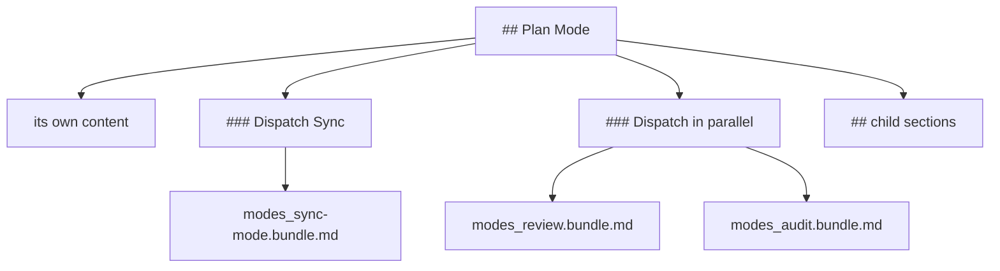

# Dispatch

A **dispatch** hands part of the work to a sub-agent. The run does not carry the dispatched material in the bundle holding the link; it compiles that material as a bundle of its own, and the bundle holding the link says which one to follow.

## What a dispatch changes

A `⇉` or `⫽` link contributes nothing to the bundle that carries it: no content, no dependency through the link, no group membership. Its target is required to exist and to name the heading it names, because a sub-agent will follow it and the compilation must be able to succeed.

The run compiles each distinct target once, transitively: a dispatched bundle's own dispatches are further bundles in the same run folder. Every dispatch naming one target names that one bundle.

Each bundle is compiled under every rule an entry's is. Budgets hold per bundle, so `-E` counts hops from that bundle's entry and the others count what that bundle alone opens, reaches and publishes.

## Sub-sections

A section that dispatches gains generated structure:

- one `Dispatch <link text>` sub-section for each target its own `⇉` links name
- one `Dispatch in parallel` sub-section for the set its `⫽` links form

Both sit one level below the section, after that section's own content and before its child sections. The dispatch sub-sections come first, then the parallel one. A dispatch in content above a group's first heading takes that heading's level.

A dispatch sub-section's body is one line naming the target's bundle file and linking the protocol it follows. A parallel dispatch sub-section's body lists each target's bundle file once, with the first link's visible text; a set states no order.

*Figure 1. The Generated Sub-Sections Sit Between a Section's Own Content and Its Child Sections.*

The links are published without their marks and point at these sub-sections. Links in one section naming one target share one sub-section, named by the first.

A dispatch in a level-6 section leaves no level for its sub-section, so the run fails rather than inventing one. A dispatched link with no text after its mark leaves its sub-section nothing to be named by, and is refused too.

## The Prosiform section

A bundle carrying a dispatch sub-section or a parallel dispatch sub-section opens with a **Prosiform section**: `# Prosiform`, then `## Dispatch` whenever the bundle dispatches, and `## Parallel dispatch` when it carries a set.

The section is the bundle's first heading, ahead of any file heading. A parallel dispatch is dispatch done together, so a bundle carrying only sets carries both protocols, the parallel protocol linking the Dispatch one.

Each protocol is one paragraph in wording the profile fixes, so the sub-section is byte-identical in every bundle that carries it. A bundle dispatching nothing carries no Prosiform section.

## Depth and cycles

**Dispatch depth** is the number of dispatch hops along one chain, counted from the run's entry. A chain reaching a fourth hop warns: flattening the chain is the author's optimisation rather than a defect in the bundle, so the run publishes and says so.

A chain returning to a bundle already on it is a **cycle**, and the run fails. Neither search follows a target already on its chain, so the analysis terminates on any graph of dispatches.

*Figure 2. A Chain Reaching a Fourth Hop Publishes and Warns; the Limit Is Fixed.*

A chain that returns to a bundle already on it is refused instead, and the walk stops at a target already seen, so the search ends on any graph of dispatches.

A dispatched link naming the document that writes it warns where it closes no cycle: the sub-agent is being handed material the dispatching session's own document already carries. Its author moves the procedure to a document of its own, or links it without the operator.

## Generated headings

An authored heading whose text equals one the run emits in the same bundle would give two sections one name. `Prosiform`, `Dispatch in parallel`, a protocol heading, and any dispatch sub-section's heading are all reserved where the bundle emits them, and a source using one of those names fails the run.

A heading the run does not emit in that bundle is the author's there: a bundle dispatching nothing may carry `Prosiform`, and one carrying no set may carry `Dispatch in parallel`.

## Target shape

A dispatch hands a procedure to a sub-agent, and a target that carries no numbered step gives the sub-agent nothing to follow. The corpus treats that as a convention rather than a defect: it compiles with no diagnostic. The same holds for a `⫽` target holding a paragraph, a numbered list, or an item linking no document.
