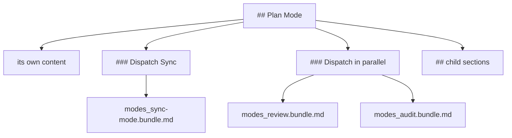

# Dispatch

Not every link points at material for the reader of the bundle. A guide might say "for the review pass, follow the review procedure" — and the review belongs to a different agent, run at a different time, with its own context.

Sending it anyway would pad the bundle with instructions nobody is about to follow. Leaving it out entirely would lose the procedure. A **dispatch** is the third option: the material is compiled as a bundle of its own, and the bundle that linked it says which one to hand over.

## What it looks like

One step of a procedure carries the mark. The run publishes two files: the entry's bundle, which names the second, and the second on its own.

| Written, in `modes/review.md` | Compiled into `modes_review.bundle.md` |
| --- | --- |
| `## Procedure`  `1. Read the [Rules](../rules.md#tests).` `2. Follow [⇉ Publish](../protocols/publish.md).` | `## Procedure`  `1. Read the [Rules](#tests).` `2. Follow [Publish](#dispatch-publish).`  `### Dispatch Publish`  `Dispatch protocols_publish.bundle.md to a sub-agent, as [Dispatch](#dispatch) states.` |

And beside it, `protocols_publish.bundle.md`, compiled from `protocols/publish.md` alone:

| Written, in `protocols/publish.md` | Compiled into `protocols_publish.bundle.md` |
| --- | --- |
| `# Publish`  `## Procedure`  `1. Commit the change.` `2. Push the branch.` | `# Publish`  `## Procedure`  `1. Commit the change.` `2. Push the branch.` |

*The bundle keeping the link is unchanged apart from the mark and the sub-section, and `Publish` is compiled as if it had been asked for on its own.*

That `#dispatch` needs a target, and the protocol it names is the bundle's first section. Every bundle that dispatches opens with it, in wording the profile fixes:

| The Prosiform section, opening `modes_review.bundle.md` | |
| --- | --- |
| `# Prosiform` | |
| `## Dispatch` | `Hand the named bundle to one sub-agent, with the inputs the invoking step names, to follow from its start, and continue with the result it returns. A dispatched run puts no question to the user: it returns each question, with its context paragraph and options, unanswered. The dispatching session puts each returned question to the user, or returns it in turn when itself dispatched, then dispatches again with the answers.` |

*The anchor resolves to the first heading to take that slug, and this section is the bundle's first heading. A later heading producing `dispatch` — an author's lowercase `## dispatch`, say — takes `dispatch-1` instead, so the protocol link keeps pointing at the protocol.*

## What a dispatch changes

A `⇉` or `⫽` link contributes nothing to the bundle that carries it: no content, no dependency through the link, no group membership. Its target is required to exist and to name the heading it names, because a sub-agent will follow it and the compilation must be able to succeed.

The run compiles each distinct target once, transitively: a dispatched bundle's own dispatches are further bundles in the same run folder. Every dispatch naming one target names that one bundle.

Each bundle is compiled under every rule an entry's is. Budgets hold per bundle, so `-E` counts hops from that bundle's entry and the others count what that bundle alone opens, reaches and publishes.

## Sub-sections

A section that dispatches gains generated structure:

- one `Dispatch <link text>` sub-section for each target its own `⇉` links name
- one `Dispatch in parallel` sub-section for the set its `⫽` links form

Both sit one level below the section, after that section's own content and before its child sections. The dispatch sub-sections come first, then the parallel one. A dispatch in content above a group's first heading takes that heading's level.

A dispatch sub-section's body is one line naming the target's bundle file and linking the protocol it follows. A parallel dispatch sub-section's body lists each target's bundle file once, with the first link's visible text; a set states no order.

*Figure 1. The Generated Sub-Sections Sit Between a Section's Own Content and Its Child Sections.*

The links are published without their marks and point at these sub-sections. Links in one section naming one target share one sub-section, named by the first.

A dispatch in a level-6 section leaves no level for its sub-section, so the run fails rather than inventing one. A dispatched link with no text after its mark leaves its sub-section nothing to be named by, and is refused too.

## The Prosiform section

A bundle carrying a dispatch sub-section or a parallel dispatch sub-section opens with a **Prosiform section**: `# Prosiform`, then `## Dispatch` whenever the bundle dispatches, and `## Parallel dispatch` when it carries a set.

These headings are what the generated links point at, so their slugs matter as much as their wording:

| Heading | Destination | Reached by |
| --- | --- | --- |
| `# Prosiform` | `#prosiform` | nothing; it names the section |
| `## Dispatch` | `#dispatch` | each dispatch sub-section's one line |
| `## Parallel dispatch` | `#parallel-dispatch` | each parallel dispatch sub-section's one line |

A parallel dispatch sub-section's own heading gives `#dispatch-in-parallel`, which its section's `⫽` links point at.

The section is the bundle's first heading, ahead of any file heading, and that position is what keeps the destinations unambiguous: a slug goes to the first heading to take it, so a later heading producing `dispatch` takes `dispatch-1`. A parallel dispatch is dispatch done together, so a bundle carrying only sets carries both protocols, the parallel protocol linking the Dispatch one.

Each protocol is one paragraph in wording the profile fixes, so the sub-section is byte-identical in every bundle that carries it. A bundle dispatching nothing carries no Prosiform section.

## Depth and cycles

**Dispatch depth** is the number of dispatch hops along one chain, counted from the run's entry. A chain reaching a fourth hop warns: flattening the chain is the author's optimisation rather than a defect in the bundle, so the run publishes and says so.

A chain returning to a bundle already on it is a **cycle**, and the run fails. Neither search follows a target already on its chain, so the analysis terminates on any graph of dispatches.

*Figure 2. A Chain Reaching a Fourth Hop Publishes and Warns; the Limit Is Fixed.*

A chain that returns to a bundle already on it is refused instead, and the walk stops at a target already seen, so the search ends on any graph of dispatches.

A dispatched link naming the document that writes it warns where it closes no cycle: the sub-agent is being handed material the dispatching session's own document already carries. Its author moves the procedure to a document of its own, or links it without the operator.

## Generated headings

An authored heading whose text equals one the run emits in the same bundle would give two sections one name. `Prosiform`, `Dispatch`, `Parallel dispatch`, `Dispatch in parallel`, and any dispatch sub-section's heading are refused where the bundle emits them, and the run names the heading and the text it equals.

The comparison is exact, and case-sensitive: `## dispatch` is not `## Dispatch`, so it publishes. It takes `dispatch-1` rather than `dispatch`, because the Prosiform section's heading is the earlier one — which is why the protocol links keep reaching the protocol.

A heading the run does not emit in that bundle is the author's there: a bundle dispatching nothing may carry `Prosiform`, and one carrying no set may carry `Dispatch in parallel`.

## Target shape

A dispatch hands a procedure to a sub-agent, and a target that carries no numbered step gives the sub-agent nothing to follow. The corpus treats that as a convention rather than a defect: it compiles with no diagnostic. The same holds for a `⫽` target holding a paragraph, a numbered list, or an item linking no document.
