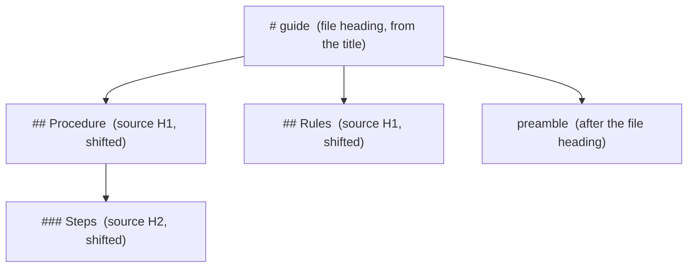
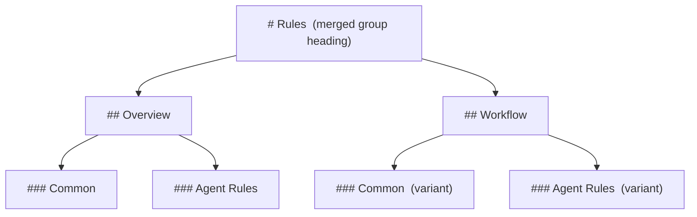

# Hierarchy

A bundle is one Markdown document, and a document is read from its headings. Whatever the run gathered has to arrive as a readable outline: one top-level heading per contributing document, and each document's own headings kept beneath it in the shape its author wrote them.

```
Guide                       ← the entry document's title
  Procedure                 ← its own first section
  Rules                     ← another contributing document
```

## File headings

Each contributing source becomes a **file heading**, an H1. Its text is the document's title where it has one: the document's first heading, if that is its only H1 and sits at the document level. A document with no title is headed by its path relative to the working directory, without the Markdown suffix, in title case.

The file heading carries the title, so the title is not emitted again beneath it. A self-reference to that title resolves to the file heading.

There is no heading above the file headings. A root names no division.



*Figure 1. One File Heading per Source, with Every Source Level Shifted Down One.*

## The level shift

Source headings move down one level beneath their file heading: H1 becomes H2, H2 becomes H3, and so on. Levels are shifted uniformly, not renormalized per selection, so the outline the author wrote keeps its shape.

A group whose title the file heading absorbed is the exception: the file heading has already taken the level the shift would make room for, so its source levels stay as written.

A source heading that would land beyond H6 fails the run. The run does not flatten it or write an H7 as though it were a heading.

Setext headings are converted to ATX when the shift requires it, keeping their visible text. Heading-like text inside a code block is untouched.

## Groups

A **group** is one top-level division. By default a group is one source document and its division is that document's file heading.

A document declaring `prosiform.group` and `prosiform.group-depth` joins a **merged group** instead, sharing one heading with every other contributor declaring the same name.

- The group's heading is the declared name in title case.
- Every member must declare the same depth. A disagreement fails the run and names both declarations.
- Membership is explicit. A declaration discovers no files, and an unannotated sibling keeps its own group.
- A deferred-only target is validated but joins no group.

Sections at the grouping depth are merged: each distinct heading text is emitted once, with every member's contribution beneath it. The level below the grouping depth becomes one level shallower relative to the merged heading, and so on.

Where two or more members contribute the same heading text, that section splits into **variants** — one heading per contributing document, carrying that document's text, lists and subheadings. Each item stays with its document.

## Member names

A member that contributes content above the grouping depth — its preamble, or a section shallower than the grouping depth — takes one subsection naming it.

That name is the shortest run of the member's path that distinguishes it from the group's other members, in title case, after dropping segments they all share and a trailing word the group's heading already states. `artifacts/epic-issue-body.md` contributes `Epic Issue Body` under `Artifacts`; `guides/alpha/notes.md` beside `guides/beta/notes.md` contributes `Alpha Notes`.

The same name serves the member's subsection and every variant heading it carries, so a reader meets each member named one way.

A member contributing nothing above the grouping depth takes no subsection; the merged sections it contributes to name it.

The member subsections sit beneath an `Overview` heading where the group also emits merged sections, and directly beneath the group heading where it does not.



*Figure 2. A Merged Group: Members Above the Grouping Depth, Merged Sections Split into Variants.*

## Two headings that read alike

Distinct file headings can coincide, as two documents with one title, or two untitled documents whose paths differ only by extension or capitalization. Both are published, the later taking an ordinal as any repeated heading does, and the run warns once naming the shared text and each source. A reader tells them apart by where they stand.

The same applies to two member headings of one merged group whose complete paths still yield one name. Repeated headings an author wrote inside one document are the author's own ambiguity, and are refused earlier, when a fragment selects one.

## Title case

Headings the run generates are written in **title case**: each word capitalized, the name's separators kept. A path keeps its slashes and hyphens, and each part of a hyphenated word is capitalized.

The convention covers what the run writes and nothing else. A heading an author wrote, a document title carried by a file heading, a dispatch sub-section's link text and a filesystem path a diagnostic names all keep their own spelling.
