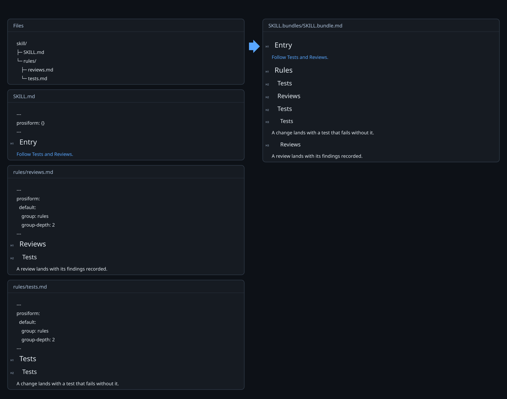
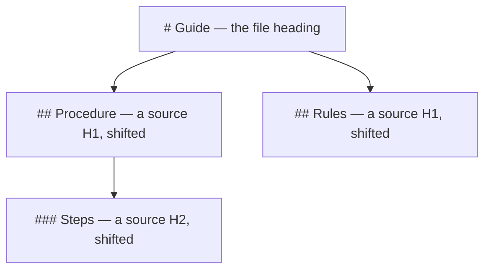
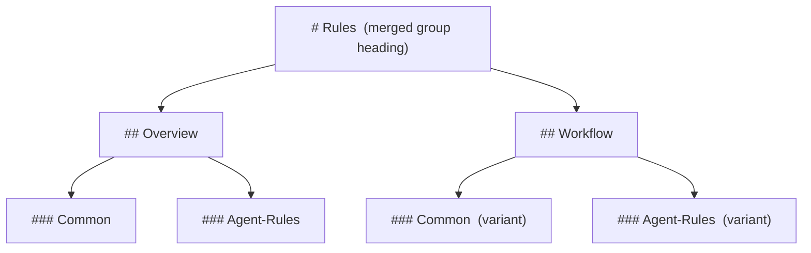

# Hierarchy

A bundle is one Markdown document, and a document is read from its headings. Whatever the run gathered has to arrive as a readable outline: one heading per document or group the run places, and each document's own headings kept beneath it in the shape its author wrote them.

```
Guide                       ← the entry document's title
  Procedure                 ← its own first section
  Rules                     ← a group the guide's link placed, inside the guide
```

A merged group is where this shows most: several files declaring one name share a heading, and their sections are pooled under it.



*One heading for the group, one subsection naming each member, and the `Tests` both files declare pooled into one section split by document.*

## File headings

Each contributing source becomes a **file heading**, an H1. Its text is the document's title where it has one: the document's first heading, if that is its only H1 and sits at the document level. A document with no title is headed by its path relative to the working directory, without the Markdown suffix, in title case. The heading is written as literal text, so punctuation in a title or a path opens no link, image or HTML.

The file heading carries the title, so the title is not emitted again beneath it. A self-reference to that title resolves to the file heading. A title is absorbed only where the bundle emits its section; where a selection leaves it out, the file heading still carries its text and the document's headings shift as below.

There is no heading above the file headings: a file heading stands at the top level of the bundle wherever its document is placed. A directory names no division.



*Figure 1. One File Heading per Source, with Every Source Level Shifted Down One.*

## The level shift

Source headings move down one level beneath their file heading: H1 becomes H2, H2 becomes H3, and so on. Levels are shifted uniformly, not renormalized per selection, so the outline the author wrote keeps its shape.

A group whose title the file heading absorbed is the exception: the file heading has already taken the level the shift would make room for, so its source levels stay as written.

A source heading that would land beyond H6 fails the run with `E_HEADING_DEPTH_OVERFLOW`. The run does not flatten it or write an H7 as though it were a heading.

Setext headings are converted to ATX when the shift requires it, keeping their visible text. Heading-like text inside a code block is untouched.

## Groups

A **group** is one division of the bundle. By default a group is one source document and its division is that document's file heading.

A document whose presets in force, as [Selection](selection.md#presets-in-force) states, name a group in `group` joins that **merged group** instead, sharing one heading with every other contributor declaring the same name. Each link places the document under the one pair its selection puts in force, so two links selecting different pairs place it in each of their groups, its selected content emitted once in each.

- The group's heading is the declared name in title case, so `harness-rules` heads `Harness-Rules`. A group is identified by its name exactly as declared, with no trimming or case folding.
- Every member must declare the same depth. A disagreement fails the run with `E_GROUP_CONFLICT`, naming both declarations.
- Membership is explicit. A declaration discovers no files, and an unannotated sibling keeps its own group.
- A deferred-only target is validated but joins no group.

Sections at the grouping depth are merged: each distinct heading text is emitted once, one level below the group's heading, with every member's contribution beneath it, and each deeper heading keeps its distance below it. A member's heading at the grouping depth is replaced by the merged one.

Where two or more members contribute the same heading text, that section splits into **variants** — one heading per contributing document, carrying that document's text, lists and subheadings, which move one level down beneath it. Each item stays with its document. A section one member alone contributes keeps that member's arrangement.

A pair places its own document's sections and no other's. A linked document is placed by its own pair wherever a parent bundles it, and is composed under that pair before the parent merges it, so it arrives with every group it placed already standing inside its division. A link a document writes and does not bundle — to a document that declares nothing, a withheld target, a remote address or a resource — places nothing and stays that document's content where it was written.

## Where a group stands

A merged group stands inside the division holding the document whose link placed its first member in that group, after everything that division carries of its own, so a document two links place under different pairs has each group standing where its own link was written. A group an entry places its first member in stands at the top level, and so does a group whose first member is placed by a document standing inside that group. A later member joins the group where it stands. The design's [Grouping](https://github.com/m2ux/prosiform/blob/96eb2b0f4/artifacts/planning/2026-10-17-prosiform-v1/design.md#grouping) carries the rule in full.

Each division enclosing a group moves every heading of the group one level deeper, so the group's heading takes the level below the heading of the division holding it:

```
Entry                       ← the entry's file heading, H1
  Notes                     ← the group the entry's link placed, H2
    Titled                  ← a member's subsection, H3
    Findings                ← a merged section, H3
```

Nesting spends depth. A heading a nested group pushes beyond H6 fails the run, as [the level shift](#the-level-shift) states; the run does not lift the group to the top level. A shared document linked from deep divisions is where this bites. The author places the group's first member through a shallower document, such as the entry, or keeps the members' headings shallow.

## Member names

A member that contributes content above the grouping depth — its preamble, or a section shallower than the grouping depth — takes one subsection naming it.

That name is the shortest run of the member's path that distinguishes it from the group's other members, in title case, after dropping segments they all share and a trailing word the group's heading already states. `artifacts/epic-issue-body.md` contributes `Epic-Issue-Body` under `Artifacts`; `guides/alpha/notes.md` beside `guides/beta/notes.md` contributes `Alpha/Notes`. A member whose name would carry no word, such as `rules/-.md`, is named by its path text instead: `Rules/-.md`.

The same name serves the member's subsection and every variant heading it carries, so a reader meets each member named one way.

A member's subsection absorbs the member's own title where the title's slug agrees with the file's stem, as a file heading absorbs a document's title: `notes/titled.md` titled `Titled` takes the subsection `Titled`, and the title is not emitted again. A member whose title is absorbed takes its subsection even where everything else it carries sits at the grouping depth, and so does a member the group emits nothing else from; either subsection is the heading alone. A whole-document reference to the member, and a reference to the title its subsection absorbed, resolve to that subsection. A title above the grouping depth whose slug does not agree with the stem is that member's content, emitted beneath the subsection.

A member whose content all sits at the grouping depth, with no title for a subsection to absorb, takes no subsection: the merged sections it contributes to name it, and a whole-document reference to it resolves to the first heading the group emits from it that no other member shares.

The first entry document is the group's **parent** where it is a member. The sections it carries at the grouping depth lead the group's merged sections in its own order, its contribution first where several members share one. Where it carries its title above the grouping depth, that title opens the group in place of the group's name, its other content above that depth follows at the levels its author wrote, the entry takes no subsection, and the other members' subsections follow the merged sections. A whole-document reference to a titled parent resolves to the heading carrying its title.

The member subsections sit beneath an `Overview` heading where the group also emits merged sections and a member carries content beneath its subsection. Where every subsection is the heading alone, or the group emits no merged section, they sit directly beneath the group heading.



*Figure 2. A Merged Group: Members Above the Grouping Depth, Merged Sections Split into Variants.*

## Composed sections

A composition directive places its target's section beneath the section writing it, not in a division of its own, and a `group` pair places no contribution. [Composition](composition.md#where-it-lands) states where a composed section lands and the levels it takes.

## Two headings that read alike

Distinct file headings can coincide, as two documents with one title, or two untitled documents whose paths differ only by extension or capitalization. Both are published, the later taking an ordinal as any repeated heading does, and the run warns once with `W_COINCIDENT_HEADING`, naming the shared text and each source. A reader tells them apart by where they stand.

The same applies to two member headings of one merged group whose complete paths still yield one name. Repeated headings an author wrote inside one document are the author's own ambiguity, and are refused earlier with `E_AMBIGUOUS_SOURCE_HEADING`, when a fragment selects one.

## Title case

Headings the run generates are written in **title case**: each word capitalized, the name's separators kept. A path keeps its slashes and hyphens, and each part of a hyphenated word is capitalized.

The convention covers what the run writes and nothing else. A heading an author wrote, a document title carried by a file heading, a dispatch-set item's link text and a filesystem path a diagnostic names all keep their own spelling.
