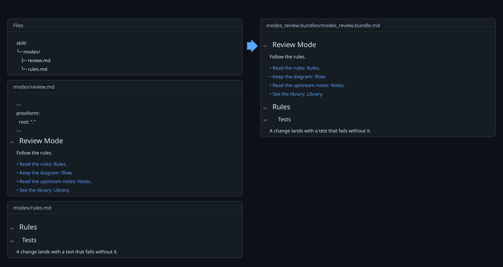
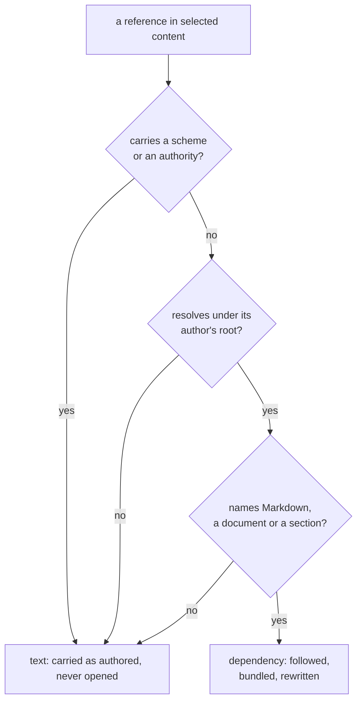
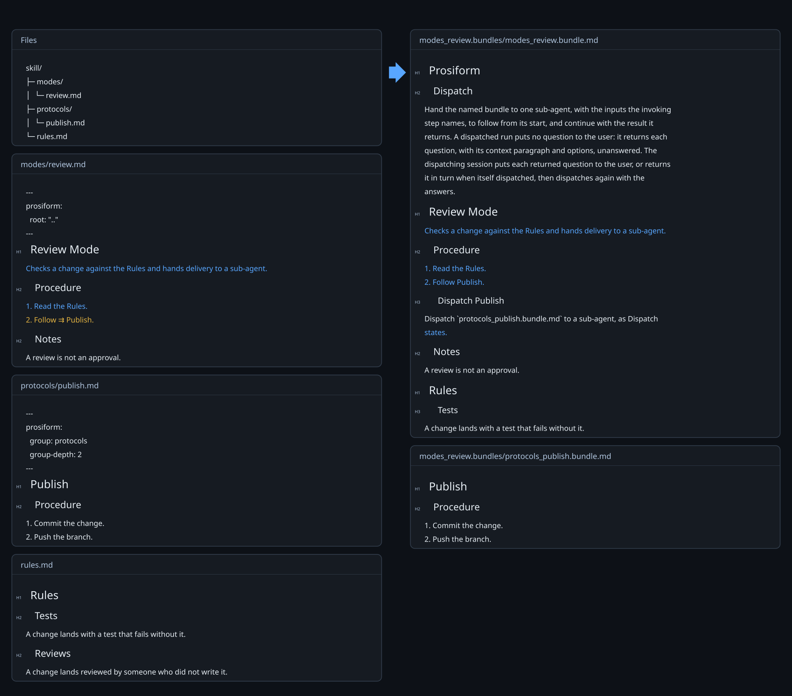
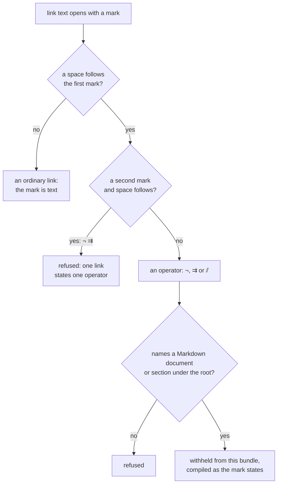

# References

Following a link is the whole of what a bundler does. A procedure says "adhering to the rules file", and the question is what that link means for the output: does the rules file travel inside the bundle, or is the sentence left as written?

Every link inside a source is a **reference**, and the run answers that question for each one before it compiles anything. Here one procedure carries four kinds of link, and only the first survives as a link into the bundle:

*The first link resolved and was rewritten. The other three are text, carried byte for byte, and the run warned once that the bundle names a resource.*

## Classification

A reference is a **dependency** when it carries no scheme and no authority, resolves under its author's root, and names a Markdown document or a section of one. A dependency is followed, its content included, and the link rewritten to the destination the bundle gives it.

Everything else is carried as text and never opened:

| Reference | What happens |
| --- | --- |
| A link to a remote address | emitted as authored; no scheme is fetched or judged |
| A link resolving outside its root | emitted as authored; the author cited the material rather than carrying it |
| An image, whatever it names | emitted as authored; image syntax embeds, so a document named that way is not bundleable |
| A link to a non-Markdown file | emitted as authored |

A bundle carrying any of these is still a successful run, and warns once that a resource it names may not be found where the bundle is read.

*Figure 1. Three Questions Decide What a Reference Becomes, and Text Is the Answer to Any of Them.*

## Selection by reference

A reference with no fragment, or an empty one, selects the whole document: its body, its preamble included, less frontmatter. A reference with a fragment selects one section — a document-level heading and its subsections, ending before the next heading of equal or higher level.

Only a heading names a section. A fragment is looked up in the original document's own heading index, exactly as spelled, so `#Run` and `#run` name different things.

## Operators

An operator is a mark opening a link's text, followed by a space. It states how the target is compiled, in place of the default.

| Mark | Name | States |
| --- | --- | --- |
| `¬` | **deferral** | the target is compiled by a run of its own |
| `⇉` | **dispatch** | a sub-agent follows the target |
| `⫽` | **parallel dispatch** | a sub-agent follows the target alongside the other `⫽` links of its section |

An operator withholds what the link would otherwise add: the target contributes no content, no dependency through that link, and no group membership. Its target must still exist and must still name the heading it names, because a compilation an agent will follow is one that can succeed.

A mark on its own changes nothing but the link's own text. Placing one on the same link turns it into a dispatch, and the run publishes a second bundle rather than carrying the rules file:

*The mark is gone, a sub-section the author never wrote names the bundle to follow, and `publish.md` contributes no content to the bundle that linked it.*

A mark with no space after it opens no operator. `[⇉Sync](sync.md)` is an ordinary link whose text happens to begin with an arrow, and the mark stays in the published text. Marks are read in order and the first one written without a space ends the reading, so `[¬⇉ Rules](rules.md)` is an ordinary link too.

One link states one operator. Text opening with two of them — `[¬ ⇉ Rules](rules.md)` — is refused, because each operator states how one compilation is carried out and a link stating two states two contradictory things. An operator naming anything but a Markdown document or section under the root is refused on the same ground.

A deferral publishes a destination spelled from the invocation working directory, so the same command line can be run from there. A dispatch and a parallel dispatch publish a link to the generated sub-section, which [Dispatch](dispatch.md) covers.

*Figure 2. How a Mark at the Start of Link Text Is Read, and Where It Is Refused.*

## Diagram links

Inside a fenced block whose info string opens with `mermaid`, the destinations a diagram's link lines name are references. Each is counted against the link budget and followed like any other.

The lines are:

- `click <node> href "<destination>"` and `click <node> "<destination>"`, in any diagram
- `link <class> "<destination>"` in a class diagram
- `link <actor>: <label> @ <destination>` in a sequence diagram, whose destination is the trimmed text after the first `@`
- `links <actor>: {…}` in a sequence diagram, whose each string value is one destination

The diagram's type is the word its text opens on, once front matter, `%%{…}%%` directives and `%%` comments are set aside. A line beginning `link` in any other diagram is carried as written. Keywords match in any letter case.

Two details follow from how Mermaid renders a link. A sequence diagram's destinations spell their anchor `#35;<slug>`, because Mermaid's sequence lexer reads a bare `#` as opening a comment. A Gantt task's `click` binds a click handler rather than drawing an anchor, so the rewritten destination is what the click opens.

A click naming a callback, a destination outside the root, a destination naming no document, and a C4 diagram's `$link` are carried as written and open nothing. A Kanban ticket's link and an HTML anchor in a node label are links Mermaid renders and the reader does not follow; one naming a local Markdown document is refused, so its author writes it as a `click`.

Every other byte of the fence is carried as written. A diagram link carries no operator, because a diagram gives it no link text to open with one.
