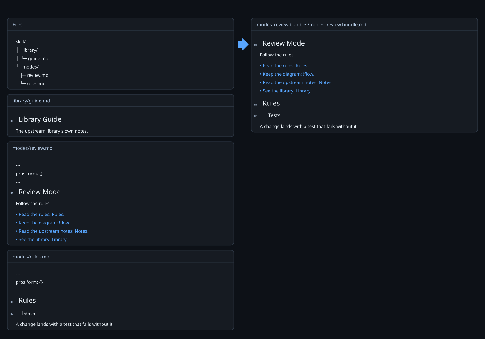
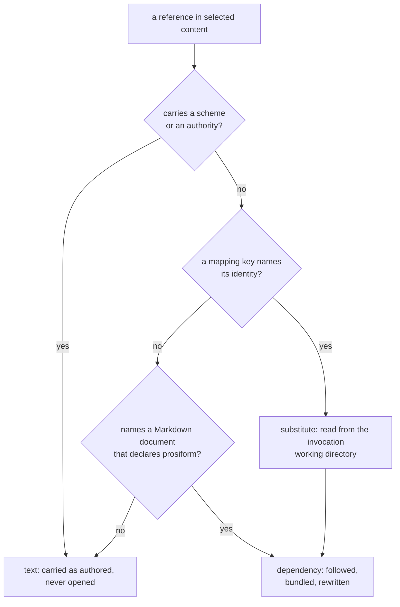
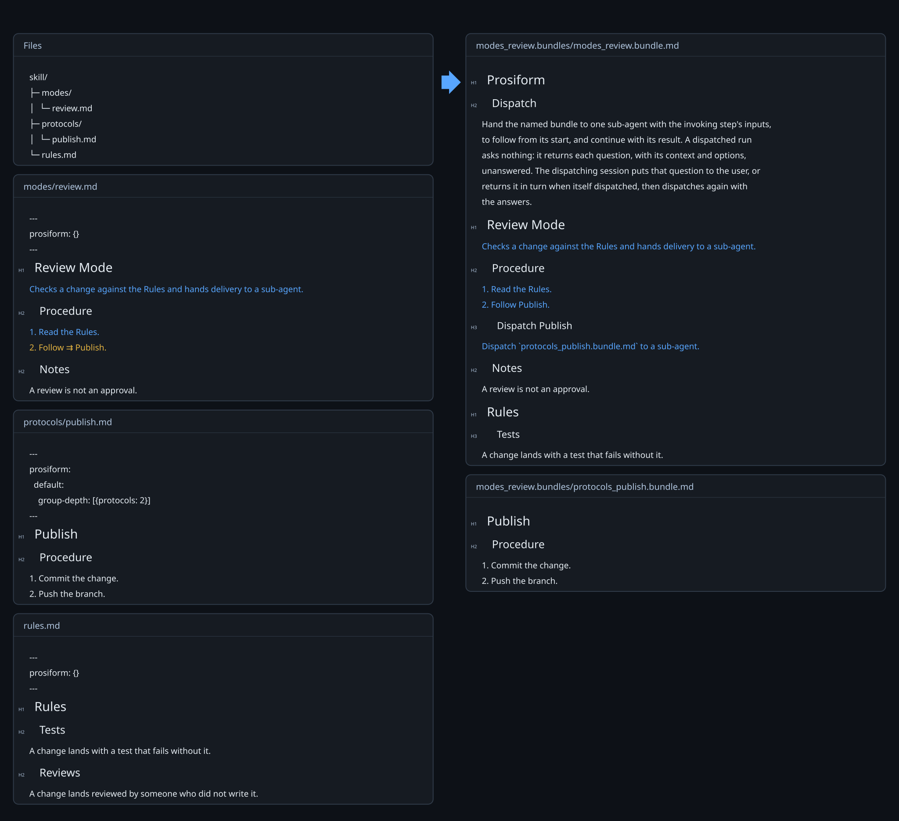
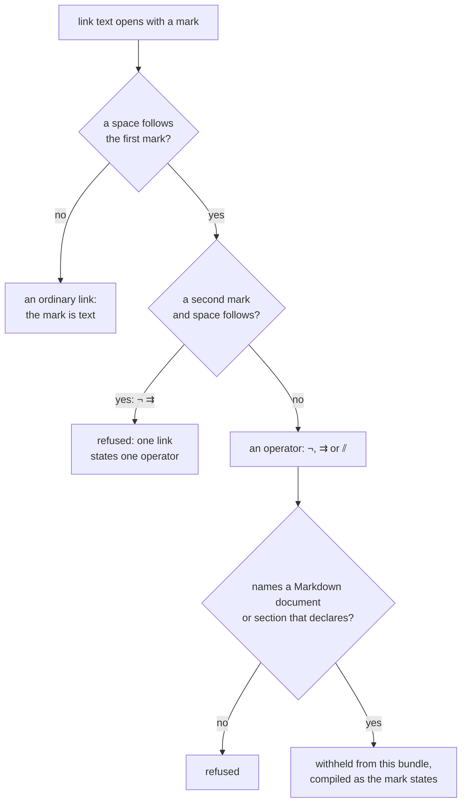

# References

Following a link is the whole of what a bundler does. A procedure says "adhering to the rules file", and the question is what that link means for the output: does the rules file travel inside the bundle, or is the sentence left as written?

Every link inside a source is a **reference**, and the run answers that question for each one before it compiles anything. Here one procedure carries four kinds of link, and only the first survives as a link into the bundle:

*The first link resolved and was rewritten. The other three are text, carried byte for byte, and the run warned once that the bundle names a resource.*

## Classification

A reference is a **dependency** when it carries no scheme and no authority and names a Markdown document, or a section of one, whose leading frontmatter declares `prosiform`. A dependency is followed, its content included, and the link rewritten to the destination the bundle gives it.

The question is asked of the target, not of the source that links it. Where either file sits decides nothing, so one document reached by two sources is one answer, and a link may name a declaring document anywhere, above the working directory included.

Everything else is carried as text and never opened:

| Reference | What happens |
| --- | --- |
| A link to a remote address | emitted as authored; no scheme is fetched or judged |
| A link to a document that declares nothing | emitted as authored; its frontmatter is read and nothing more, so it adds no content, no group and nothing to any budget |
| A link to a document that does not exist | emitted as authored; nothing states the bundle answers for it |
| An image, whatever it names | emitted as authored; image syntax embeds, so a document named that way is not bundleable |
| A link to a non-Markdown file | emitted as authored |

A bundle carrying any of these is still a successful run, and warns once that a resource it names may not be found where the bundle is read.

## The substitution mapping

`-m ORIGINAL=ALTERNATIVE` redirects a reference, so a bundle can be built against stand-in material without the tree under test being edited. It is given once per pairing. A `subst` pair of a document's presets in force, as [Sources](sources.md) states, redirects the links that document writes by the same lookup, and holds over a command-line key naming the same identity for those links. A pair no link names warns with `W_SUBST_UNUSED`, naming its document. An entry reference is written by no document, so no pair redirects it: the run compiles the document it names and is named for the path the caller wrote.

A key is the identity a reference normalized to, so `./rules.md` and `rules.md` name one key. A key carrying a fragment redirects that section alone and takes precedence over a key naming the whole document, which covers the document and every fragment of it. Both sides resolve from the working directory, as a positional entry does, so a substitute kept beside the invocation is reachable wherever the writing source sits — which is the case the parameter exists for.

The substitute is the target outright: its title, its group and depth, its own declaration and its own links are the ones the run uses, and the bundle reads as if the author had written its path in the link.

The mapping is consulted on the identity a reference normalized to, before the target is asked whether it declares. A reference naming a document that declares nothing, or none at all, is text the bundle carries — unless a key names it, in which case the run reads the substitute and compiles it like any dependency.

*Figure 1. A Mapping Key Is Asked First, Then the Target's Declaration Decides What a Reference Becomes.*

## Selection by reference

A reference with no fragment, or an empty one, selects the whole document: its body, its preamble included, less frontmatter. A reference with a fragment selects one section — a document-level heading and its subsections, ending before the next heading of equal or higher level.

Only a heading names a section. A fragment is looked up in the original document's own heading index, exactly as spelled, so `#Run` and `#run` name different things.

## Operators

An operator is a mark opening a link's text, followed by a space. It states how the target is compiled, in place of the default.

| Mark | Name | States |
| --- | --- | --- |
| `¬` | **deferral** | the target is compiled by a run of its own |
| `⇉` | **dispatch** | a sub-agent follows the target |
| `⫽` | **parallel dispatch** | a sub-agent follows the target alongside the other `⫽` links of its section |

An operator withholds what the link would otherwise add: the target contributes no content, no dependency through that link, and no group membership. Its target must still exist and must still name the heading it names, because a compilation an agent will follow is one that can succeed.

A mark on its own changes nothing but the link's own text. Placing one on the same link turns it into a dispatch, and the run publishes a second bundle rather than carrying the rules file:

*The mark is gone, a sub-section the author never wrote names the bundle to follow, and `publish.md` contributes no content to the bundle that linked it.*

A mark with no space after it opens no operator. `[⇉Sync](sync.md)` is an ordinary link whose text happens to begin with an arrow, and the mark stays in the published text. Marks are read in order and the first one written without a space ends the reading, so `[¬⇉ Rules](rules.md)` is an ordinary link too.

One link states one operator. Text opening with two of them — `[¬ ⇉ Rules](rules.md)` — is refused, because each operator states how one compilation is carried out and a link stating two states two contradictory things. An operator naming anything but a Markdown document or section that declares `prosiform` is refused on the same ground, and one naming a document that does not exist fails with `E_TARGET_NOT_FOUND`.

A deferral publishes a destination spelled from the invocation working directory, so the same command line can be run from there. A dispatch and a parallel dispatch publish a link to the generated sub-section, which [Dispatch](dispatch.md) covers.

*Figure 2. How a Mark at the Start of Link Text Is Read, and Where It Is Refused.*

## Diagram links

Inside a fenced block whose info string opens with `mermaid`, the destinations a diagram's link lines name are references. Each is counted against the link budget and followed like any other.

The lines are:

- `click <node> href "<destination>"` and `click <node> "<destination>"`, in any diagram
- `link <class> "<destination>"` in a class diagram
- `link <actor>: <label> @ <destination>` in a sequence diagram, whose destination is the trimmed text after the first `@`
- `links <actor>: {…}` in a sequence diagram, whose each string value is one destination

The diagram's type is the word its text opens on, once front matter, `%%{…}%%` directives and `%%` comments are set aside. A line beginning `link` in any other diagram is carried as written. Keywords match in any letter case. A line may hold several statements, each ended by a `;` outside a quoted string, as Mermaid reads them, and each `click` or class `link` statement among them is followed.

Two details follow from how Mermaid renders a link. A sequence diagram's destinations spell their anchor `#35;<slug>`, because Mermaid's sequence lexer reads a bare `#` as opening a comment. A Gantt task's `click` binds a click handler rather than drawing an anchor, so the rewritten destination is what the click opens.

A click naming a callback, a destination naming a document that declares nothing, a destination naming no document, and a C4 diagram's `$link` are carried as written and open nothing. A `links` value that is an array, or that holds a value that is no string, is refused: Mermaid renders the first as a menu whose entries are named by their positions, and the second as a link opening nothing.

A Kanban ticket's link and an HTML anchor Mermaid draws in a label are links Mermaid renders and the reader does not follow; one naming a local Markdown document is refused, so its author writes it as a `click`. Mermaid draws no anchor in a `click` tooltip or a class diagram's `link` tooltip, nor in a sequence, pie, timeline, journey, Gantt, quadrant, Git, XY, Sankey, packet, radar, treemap or C4 diagram, whose labels it draws as text, so an anchor written there is carried as written.

Every other byte of the fence is carried as written. A diagram link carries no operator, because a diagram gives it no link text to open with one.
