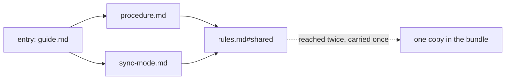
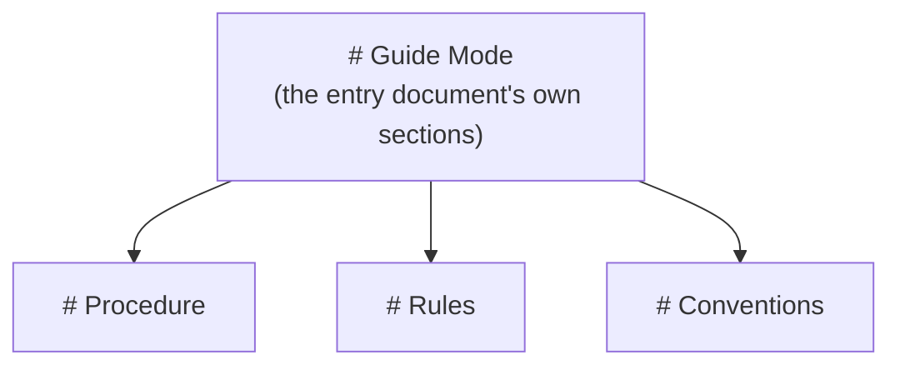
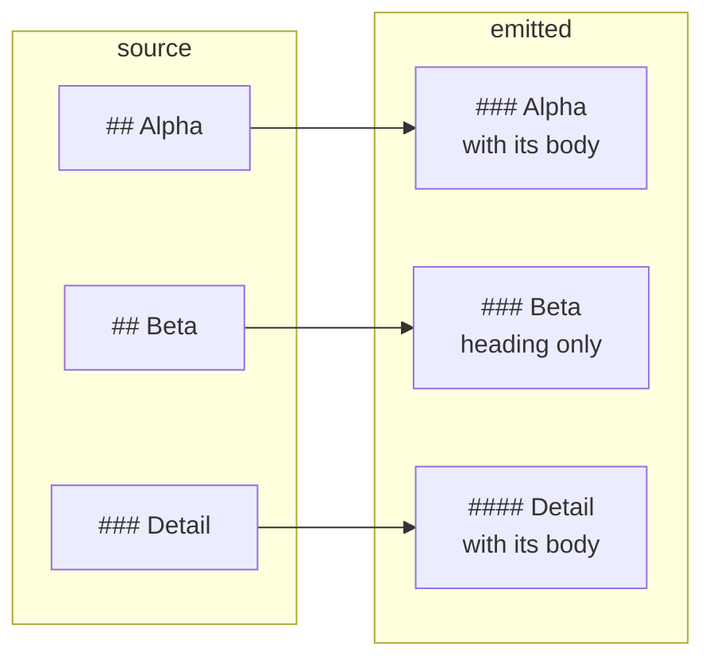

# Selection

Following the links answers which files belong in the bundle. It does not yet answer what to take from each one, or where each piece goes.

The command line asks for a document, or a section of one — that is the start, not the whole. Following its links adds more, which add more again, and two routes can arrive at the same section. The run settles all of that before arranging anything, and the settled result is the **selection**.

An entry naming one section takes that section and nothing above it, so a heading that held it arrives with no body of its own:

| Written | Compiled |
| --- | --- |
| **`SKILL.md`**<br>`# Entry`<br><br>`The detail is in [Detail](rules.md#detail).`<br><br>**`rules.md`**<br>`# Rules`<br><br>`## Alpha`<br><br>`Alpha's own instructions.`<br><br>`## Beta`<br><br>`Beta's own instructions.`<br><br>`### Detail`<br><br>`The detail a reader may need.` | `# Entry`<br><br>`The detail is in [Detail](#detail).`<br><br>`# Rules`<br><br>`### Beta`<br><br>`#### Detail`<br><br>`The detail a reader may need.` |

*Two sections were reached and the one between them was not, so `Beta` arrives as its heading alone. `Alpha` is not in the bundle at all.*

## Closure

The run starts at the **entry references**, the arguments on the command line, and follows each dependency the selected content carries. It repeats until nothing new is reachable. The result is the **closure**: everything the bundle will contain.

Fragment-only references resolve against their own source document wherever that source sits, including outside its own root. A link to a sibling section of the same document is an ordinary reference; it is not a self-reference unless it names the region it sits in.

A reference back to material the closure already holds resolves to that material's destination. It expands nothing twice.



*Figure 1. Two Paths to One Target Carry It Once, and Both Links Point at It.*

## Consolidation

Selections overlap. Asking for a section and then for its parent document would otherwise emit the section twice.

**Consolidation** unions the overlaps, so each region appears once and the larger region wins. A child selection is satisfied by its parent. Destinations are assigned from the target a reference resolved to, not from the region the reference sits in, so consolidating a child into a larger region leaves every destination as it was.

Reachability is settled before any output is arranged. A source newly included by an expansion has its own dependencies followed before the run declares the closure complete.

## Placement order

Sources are placed in the order the first reference names them: the entry references in command-line order, then each placed source's selected content in turn, in source order.

That order is the author's, not the discovery's. A preamble reading

```markdown
Follow the [Procedure](#procedure), adhering to [Rules](../rules.md) and [Conventions](../conventions.md).
```

places Rules and then Conventions directly after the entry document's own sections. Writing the links in a different order writes a different bundle.



*Figure 2. Siblings Stand in the Order the Author Wrote the Links In.*

A group stands where its first source is placed.

## Structural ancestors

Selecting `Detail` from an outline of `## Alpha`, `## Beta`, `### Detail` leaves `Beta` with no content to contribute. The bundle keeps `Beta` as a heading and nothing else:

```markdown
### Alpha

Selected Alpha content.

### Beta

#### Detail

Selected Detail content.
```

That heading is a **structural ancestor**: generated structure, not a dependency. Its body is not included, its own links are not followed, and it is not a substitute for selecting its section.



*Figure 3. A Structural Ancestor Holds the Outline, and Nothing Else of Its Section.*

Two rules keep ancestors honest:

- Each is emitted once. If discovery later selects it as content, the heading is replaced by the real one with its body rather than published twice.
- An ancestor the generated file heading already names is not emitted at all, since the file heading stands in its place.

## Boundaries

Selected regions are separated by blank lines, and the candidate is reparsed. A boundary that would absorb content into an unintended code fence, list, block quote or HTML block is refused rather than repaired. The run does not close a fence its author left open.

## What is not a dependency

Only linked material is included. A shared rule reaches a bundle because a procedure links it; it is not inferred from a filename, a heading, or a document's position in a directory tree.

Inclusion makes material available. It does not authorize executing every procedure the bundle now contains, and the run makes no claim about whether an agent obeys it.
