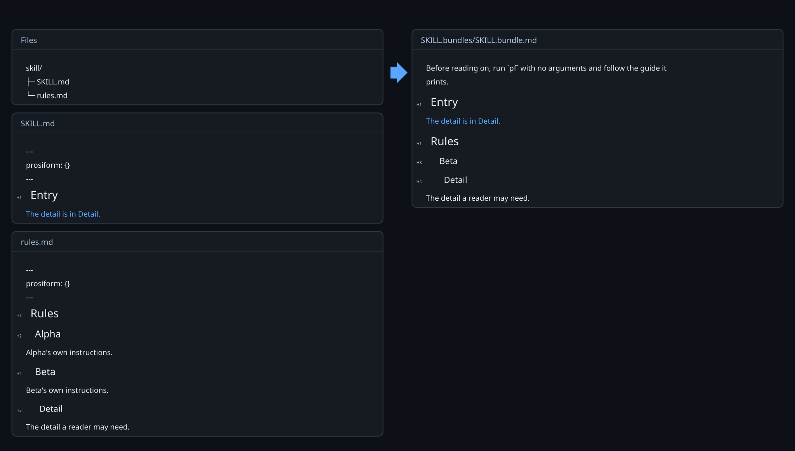
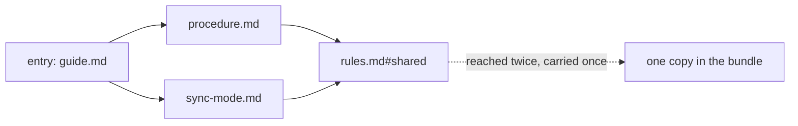
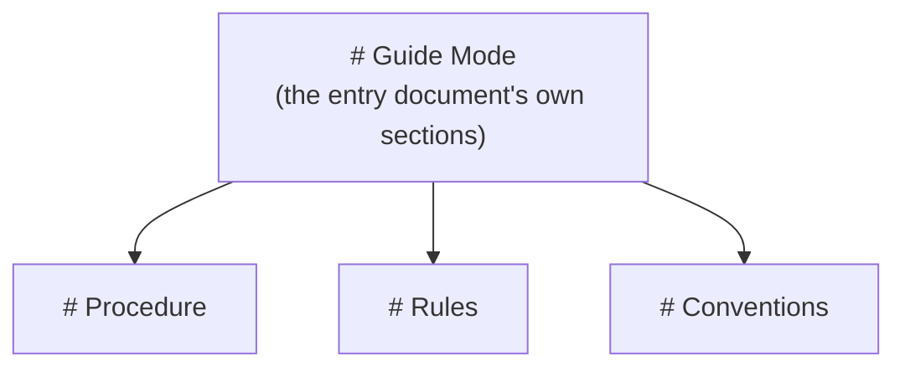
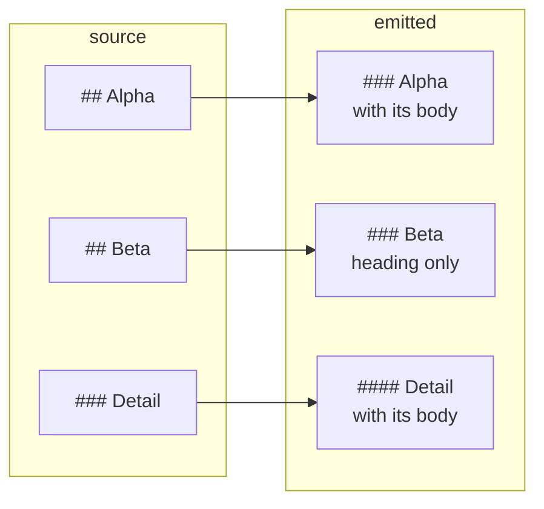

# Selection

Following the links answers which files belong in the bundle. It does not yet answer what to take from each one, or where each piece goes.

The command line asks for a document, or a section of one — that is the start, not the whole. Following its links adds more, which add more again, and two routes can arrive at the same section. The run settles all of that before arranging anything, and the settled result is the **selection**.

An entry naming one section takes that section and nothing above it, so a heading that held it arrives with no body of its own.



*Two sections were reached and the one between them was not, so `Beta` arrives as its heading alone. `Alpha` is not in the bundle at all.*

## Closure

The run starts at the **entry reference**, supplied through `--entry`, and follows each dependency the selected content carries. It repeats until nothing new is reachable. The result is the **closure**: everything the bundle will contain.

Fragment-only references resolve against their own source document wherever that source sits. A link to a sibling section of the same document is an ordinary reference; it is not a self-reference unless it names the region it sits in.

A reference back to material the closure already holds resolves to that material's destination. It expands nothing twice.



*Figure 1. Two Paths to One Target Carry It Once, and Both Links Point at It.*

A link an operator withholds is not followed: a deferred or dispatched target contributes nothing to this closure, as [References](references.md#operators) states. A composition directive is followed, and its target lands beneath the section writing it, as [Composition](composition.md) states.

## Presets in force

A document declares its presets, as [Sources](sources.md#frontmatter) states, and each reference reaching it decides which of them are in force.

- **`default` always applies.** A document's `default` preset is in force wherever it is compiled. The tag `default` selects no named preset.
- **A link title selects complete names.** `[Plan](guide.md#plan "checks,draft")` selects the destination's `checks` and `draft` presets. Split the title on literal commas, trim surrounding Unicode whitespace, compare without case, and ignore empty, repeated and unknown names. Matching follows declaration order. Headings and visible labels supply no selection; a preamble link selects by its title like any other link.
- **An entry reads the file it names.** `pf --entry guide.md#plan --presets checks,draft` supplies the same selection. Omitting `--presets` selects no named preset.
- **Selected presets layer over `default`.** A selected preset's `group` pair holds over `default`'s, and its alternative for a `subst` key holds over `default`'s for that key. The presets one tag list selects union their settings, and two of them stating different `group` pairs, or mapping one `subst` key to two alternatives, fail the run with `E_INVALID_USAGE` and exit status 2, naming both presets.
- **A preset governs its own document.** The presets in force decide the group a document's selected content joins, as [Hierarchy](hierarchy.md#groups) states, and the target each link it writes resolves to. A document it links is governed by that document's own presets, as its incoming link title selects them, and a dispatched or deferred target by its own when it is compiled.
- **Each link selects for itself.** Two links reaching one document may put different presets of it in force, and one run then places that document under each `group` pair they select.
- **A preset nothing selected warns.** A preset of a document the run's bundles carry that no reference reaching it selected, in any bundle of the run, raises `W_PRESET_UNUSED`, naming the document and the preset, and the run publishes at exit status 0. `default` is never unused. A document reached only through a deferral raises none: the run compiling the deferral reads its presets.

## The substitution mapping

A `subst` pair states that a link names something else, so a bundle can be built against stand-in material without the tree under test being edited. A preset's `subst` is the only channel a substitution has, and a document whose presets in force state none compiles its links as authored.

A document's links are written once, so they resolve through the `subst` pairs of every preset in force for it, by whichever reference reached it: a pair one reference selects redirects a link in content another reference bundled. Two of those presets mapping one key to two alternatives fail the run with `E_INVALID_USAGE` and exit status 2. The pairs reach only the links that document writes; a document it links, a substitute and a dispatched target each resolve their links under their own presets, so a substitute's fragment-only link names a section of that substitute.

A key is the identity a reference normalized to, so `./rules.md` and `rules.md` name one key. A key carrying a fragment redirects that section alone and takes precedence over a key naming the whole document, which covers the document and every fragment of it. Both sides resolve from the declaring document's directory, as every other path it writes does, so one declaration reads the same wherever the run starts, and a side carrying `..` reaches a substitute above the working directory.

The mapping is consulted before the target is asked whether it declares, so a key naming a document that declares nothing, or none at all, makes the reference a dependency on the substitute. The substitute is the target outright: its title, its group and depth, its own declaration and its own links are the ones the run uses, and the bundle reads as if the author had written its path in the link. A pair redirects a deferred, dispatched or composing link as it does any other.

An entry reference is written by no document, so no pair redirects it: the run compiles the document it names and is named for the path the caller wrote. A pair is used only by a link in content the run selected. A pair a link used warns with `W_SUBST_USED` once, at the first link that used it, naming that link, the identity it would have resolved to and the substitute. A pair no link used, a pair whose only link sits in a heading outside the selection included, warns with `W_SUBST_UNUSED`, naming its document.

## Consolidation

Selections overlap. Asking for a section and then for its parent document would otherwise emit the section twice.

**Consolidation** unions the overlaps, so each region appears once and the larger region wins. A child selection is satisfied by its parent. Destinations are assigned from the target a reference resolved to, not from the region the reference sits in, so consolidating a child into a larger region leaves every destination as it was.

Reachability is settled before any output is arranged. A source newly included by an expansion has its own dependencies followed before the run declares the closure complete.

## Placement order

Sources are placed in the order the first reference names them: the entry, then each placed source's selected content in turn, in source order.

That order is the author's, not the discovery's. A preamble reading

```markdown
Follow the [Procedure](#procedure), adhering to [Rules](../rules.md) and [Conventions](../conventions.md).
```

places Rules and then Conventions directly after the entry document's own sections. Writing the links in a different order writes a different bundle.



*Figure 2. Siblings Stand in the Order the Author Wrote the Links In.*

A group stands where its first source is placed, a merged group inside the division of the document whose link placed its first member in it, as [Hierarchy](hierarchy.md#where-a-group-stands) states. A reference reaching a document already placed under the pair it puts in force places nothing more and resolves to the document where it stands; one putting another pair in force places the document in that pair's group too.

## Structural ancestors

Selecting `Detail` from an outline of `## Alpha`, `## Beta`, `### Detail` leaves `Beta` with no content to contribute. The bundle keeps `Beta` as a heading and nothing else:

```markdown
### Alpha

Selected Alpha content.

### Beta

#### Detail

Selected Detail content.
```

That heading is a **structural ancestor**: generated structure, not a dependency. Its body is not included, its own links are not followed, and it is not a substitute for selecting its section.



*Figure 3. A Structural Ancestor Holds the Outline, and Nothing Else of Its Section.*

Two rules keep ancestors honest:

- Each is emitted once. If discovery later selects it as content, the heading is replaced by the real one with its body rather than published twice.
- An ancestor the generated file heading already names is not emitted at all, since the file heading stands in its place.

## Boundaries

Selected regions are separated by blank lines, and the candidate is reparsed. A boundary that would absorb content into an unintended code fence, list, block quote or HTML block is refused rather than repaired. The run does not close a fence its author left open.

## What is not a dependency

Only linked material is included. A shared rule reaches a bundle because a procedure links it; it is not inferred from a filename, a heading, or a document's position in a directory tree.

Inclusion makes material available. It does not authorize executing every procedure the bundle now contains, and the run makes no claim about whether an agent obeys it.
