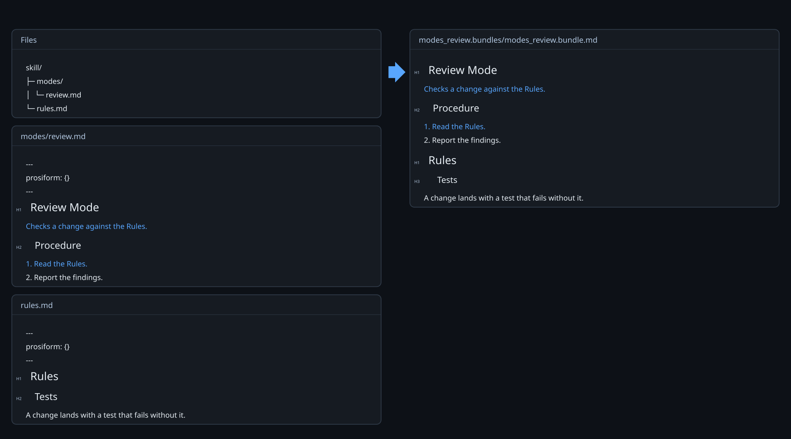
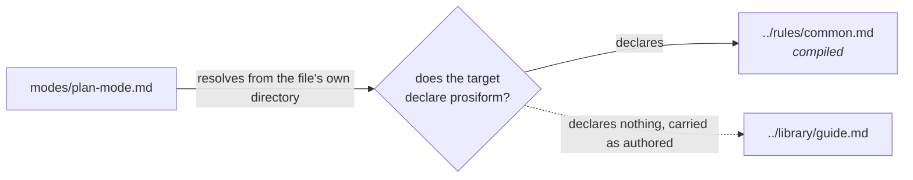

# Sources

A run's raw material is Markdown files on disk: a skill's entry point, the procedures it links to, the rules those procedures cite. Every one of them is a **source**, and the run's answer can only be as good as the bytes it read.

Each file is opened once, and everything the run decides about it is decided from that one reading: whether it declares itself part of a bundle, which parts of it the bundle takes, and where its links lead.

Both files below declare `prosiform` in leading frontmatter, and the first links the second in the directory above. The run reads each declaration and drops it, and resolves the `..` before the link is rewritten:

*Each declaration is read and dropped, and the `..` in the link is resolved before it disappears.*

## Capture

The run opens each distinct source once and keeps its path, bytes, hash and metadata together. Before publication it rechecks each one. A source that changed, disappeared or now resolves elsewhere fails the run, because the bytes that were validated are no longer the bytes the path names. A failed run writes nothing rather than publishing a bundle built from a file that has since moved.

Only files are sources. A directory, a symbolic link, or a path that cannot be read fails the run rather than being worked around.

## The declaration

A document is compiled because it says so. A document whose leading frontmatter carries a `prosiform` mapping **declares**, an empty `prosiform: {}` included, and a link naming it is a dependency the bundle carries. A document carrying no `prosiform` mapping declares nothing: a link naming it is text, emitted as authored, and the run reads its frontmatter and no further byte of it. A link naming a document that does not exist is text on the same ground, because nothing states the bundle answers for it.

Each path-bearing link resolves from the directory of the file that wrote it — the path a reader would follow in an editor — and the target's own declaration then decides whether it is compiled. Nothing about where either file sits decides it, so one document reached by two sources is one answer, and a link may name a declaring document anywhere, above the working directory included.

*Figure 1. A Link Resolves from Its Own File, and the Target's Declaration Decides Whether It Is Compiled.*

Every entry reference names a document that declares. One naming a document that declares nothing fails with `E_TARGET_NOT_FOUND` before any source is read.

## The boundary

A document's **boundary** is the deepest directory holding every local Markdown path its own links name, normalised from the document's directory; a document naming none has its own directory. `modes/plan-mode.md` above links `../rules/common.md` and `../library/guide.md`, so its boundary is the skill's directory, the deepest one holding both. The boundary is derived from the links, so it admits every link its author wrote and is never stated beside them.

What confines a run is the invocation working directory, captured once at the start. An entry reference resolves from it, and every path a diagnostic names is written from it.

## Frontmatter

Leading YAML frontmatter is read for metadata and excluded from the body. It opens on the first physical line with exactly `---` and closes at the next line exactly `---` or `...`. A byte-order mark may precede the opener.

The block is one YAML 1.2 Core mapping. Duplicate keys, aliases, merge keys and custom tags are invalid. An opener with no closer fails the run.

`prosiform` holds the conversion settings, and its presence is the declaration. The keys in `prosiform` are `group` and `group-depth`; a key outside them fails the run. `root` fails with `E_INVALID_CONVERSION_METADATA`, naming the field: a boundary is derived from a document's links, so a declared one states nothing a run reads.

| Key | Holds |
| --- | --- |
| `group` | a group name, containing neither `:` nor `/` |
| `group-depth` | an integer from `1` to `6` |

`group` and `group-depth` are declared together or not at all. Other top-level fields, `name` and `description` among them, are skill metadata and carry no conversion meaning. A file declaring no group keeps a group of its own.

Frontmatter counts toward the byte budgets and obeys the nesting budget independently of Markdown containers. It supplies no headings, links or rendered content.

## The profile

Sources are parsed under one versioned grammar, `skill-markdown-v4`, reported by `-v`. It is CommonMark with pipe tables and double-tilde strikethrough, and task-list markers are preserved as written rather than rendered as checkboxes.

Sources must be valid UTF-8 — a byte sequence that is not fails rather than being decoded with replacement characters. One leading byte-order mark is tolerated and removed. `.md` and `.markdown` are recognized case-insensitively.

Raw HTML in selected content is refused: the bundle is Markdown and nothing else. Constructs the profile does not support — footnotes, wiki links, heading attributes — are refused where they would name a dependency or a section.

## Text that is not a source

Two things inside a source look like local Markdown and are not followed.

- A link written inside a code span, a fenced block or an indented block is an example. The one exception is a diagram's own link lines, which [References](references.md#diagram-links) covers.
- A bare path in prose is text. The run does not infer a dependency from it.

## Why a source is read whole

The run parses the complete file even when only one section was selected. It needs the heading index of the whole document to resolve a fragment, and the definitions of the whole document to resolve a reference-style link. What the file contains therefore fails the run only where the run needed it: an unselected sibling may carry a broken link, and the run passes.

A file can still fail for a reason that is about the file rather than about the selection — an unreadable encoding, or a nesting depth beyond the budget. That is reported as an inability to index the source safely.
