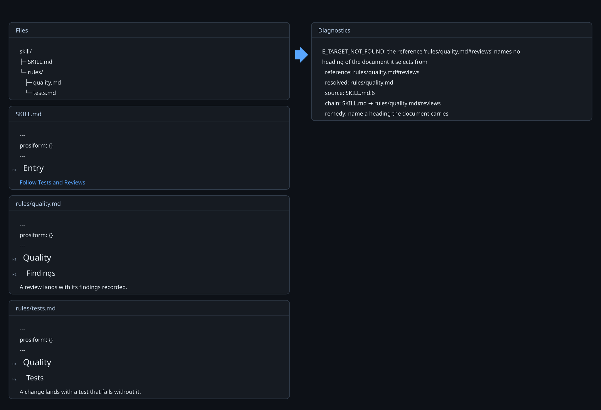
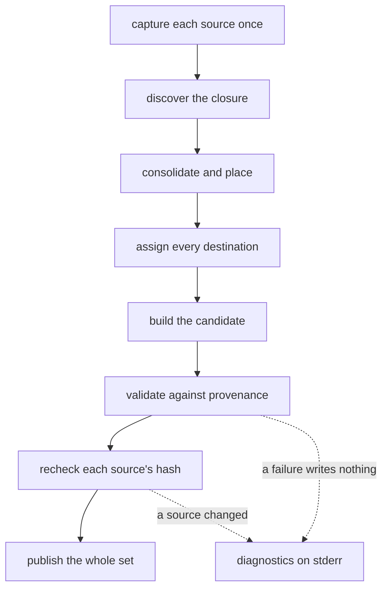

# Validation

A bundle is handed to an agent that will follow it as if it were correct. If a link is broken, a section was silently dropped, or two headings ended up with the same name, the agent has no way to notice — it will simply act on the mistake.

So the run checks its own work before anyone sees it, and publishes nothing unless every check passes. The check is called **validation**.

What a check catches is easiest to see in the failure:

*A link naming a heading that does not exist is refused before anything is written. The run names the link, the document it resolved to, the line it was written on and what to do about it — and publishes nothing, so the reader never sees a broken link.*

## The invariants

Validation compares the finished document with the provenance the run recorded while building it — which source region produced which span of output — rather than with its surface syntax alone.

| Invariant | Holds when |
| --- | --- |
| Resolution | every supported reference resolves to a known document or section |
| Target integrity | every rewritten link reaches the destination its own target was assigned |
| Uniqueness | each destination occurs once and resolves in the renderer that reads the bundle |
| Boundaries | combining sections has absorbed nothing into an unintended container |
| Preservation | selected wording and code survive the declared transformations unchanged |
| No new content | the bundle carries no link and no link-reference definition its sources did not write |
| Coverage | each selected region appears exactly once, and the closure is complete |
| Expansion | the only unselected content emitted is a required structural ancestor's heading |
| Group isolation | each group opens on one heading at the level it stands at and each source sits beneath its own group's heading |
| Outline | each selected heading keeps its ancestor chain and relative depth |
| Depth | no emitted heading exceeds H6 |

Coverage is checked against provenance ranges, not by counting strings. Repeated identical prose in different regions is not duplication, and neither a file heading nor a structural ancestor counts as selected body content.

These establish named syntax, reference and coverage properties. They do not establish that an instruction was obeyed.

What an author's sources can break is refused while the bundle is built, under the codes [below](#what-a-run-refuses). Of the invariants, only Boundaries is an author's to break once the candidate is built: a region the reparse finds inside the container above it fails with `E_UNSAFE_BUNDLE_BOUNDARY`, naming the regions either side and the container that absorbed one. A candidate failing any other invariant is a defect of the build rather than of its sources, and reports `E_UNEXPECTED_INTERNAL_ERROR` with exit `4`.

## Two modes

Source validation and candidate validation share one grammar but not one policy.

- **Source mode** enforces the declaration rules, resolves fragments against one document's headings and checks the self-references a source owns. A source fragment names one heading and carries no ordinal.
- **Candidate mode** accepts the generated headings, shifted levels and structural ancestors, and checks destinations, coverage and boundaries against the recorded provenance.

The candidate is never fed back through source frontmatter stripping or dependency discovery.

*Figure 1. The Steps in Order, and the Two That End the Run Before Anything Is Written.*

## Failure

A failing run writes no bundle and publishes nothing. A run validates every bundle it produces before it writes any, so a failure in one writes none.

Each diagnostic carries a stable code, the source location or reference it concerns, the identity that reference resolved to where there is one, the chain of references that reached it, and a remedy where one can be stated accurately.

The [exit statuses](../invocation.md#diagnostics) say what kind of failure a run reported. Exit `4` names the run, not any document it read, so a caller reading it is not sent to look at its sources. Every failing outcome the contract names carries a code; a diagnostic without one reports a defect the contract does not define.

Warnings accompany a successful run and exit `0`. Each carries a `W_` code and states the condition that raised it.

Diagnostics go to standard error. `-d json` emits one JSON object per line, and never mixes an object with prose. `pf -C` lists every code the build reports.

## What a run refuses

Each check below ends the run before anything is written, under the code it names. The fixture corpus's [catalogues](../fixtures/README.md#the-catalogues) state the design clause behind each code.

| Check | Code | Exit |
| --- | --- | --- |
| A command line the grammar does not admit, a preset disagreement, a `subst` rule within one preset | `E_INVALID_USAGE` | `2` |
| An entry outside the profile's suffixes | `E_UNSUPPORTED_ENTRY_SUFFIX` | `1` |
| An entry written as an absolute or drive path, or with a scheme or authority | `E_SOURCE_OUTSIDE_ROOT` | `1` |
| A symbolic link on a source's path | `E_SOURCE_SYMLINK` | `1` |
| A source that cannot be opened or read | `E_SOURCE_ACCESS` | `1` |
| A source that is not UTF-8 | `E_INVALID_ENCODING` | `1` |
| Frontmatter that is not one safe YAML mapping, or has no closer | `E_INVALID_FRONTMATTER`, `E_UNTERMINATED_FRONTMATTER` | `1` |
| A `prosiform` declaration outside its grammar | `E_INVALID_CONVERSION_METADATA` | `1` |
| Two depths for one group | `E_GROUP_CONFLICT` | `1` |
| A target, or a fragment's heading, that does not exist | `E_TARGET_NOT_FOUND` | `1` |
| A fragment naming a heading two headings share, or one inside a container | `E_AMBIGUOUS_SOURCE_HEADING`, `E_NESTED_SECTION_TARGET` | `1` |
| Raw HTML in selected content | `E_RAW_HTML` | `1` |
| A construct the profile does not support, an operator or directive refused, a composition cycle | `E_UNSUPPORTED_CONSTRUCT` | `1` |
| A parser limit suppressing a reference lookup | `E_PARSER_REFERENCE_LIMIT` | `1` |
| A heading beyond H6 | `E_HEADING_DEPTH_OVERFLOW` | `1` |
| An authored heading equal to one the run generates | `E_HEADING_COLLISION` | `1` |
| A chain of dispatches returning to a bundle already on it | `E_DISPATCH_CYCLE` | `1` |
| A budget crossed, or a numeric scalar beyond its ceiling | `E_RESOURCE_LIMIT` | `1` |
| A boundary that absorbs one region into another | `E_UNSAFE_BUNDLE_BOUNDARY` | `1` |
| A source that changed before publication | `E_SOURCE_CHANGED` | `1` |
| A bundle that cannot be written | `E_PUBLICATION_FAILED` | `3` |
| A failure of the run itself | `E_UNEXPECTED_INTERNAL_ERROR` | `4` |

A run that publishes may warn: `W_COINCIDENT_HEADING`, `W_COMPOSE_SELF`, `W_DISPATCH_DEPTH`, `W_DISPATCH_SELF`, `W_EARLIER_SET_RETAINED`, `W_PRESET_UNUSED`, `W_RESOURCE_PORTABILITY`, `W_SUBST_UNUSED` and `W_SUBST_USED`, each stating the condition the catalogue names.

## Budgets

Each budget is a deterministic limit that fails the run rather than truncating a bundle. Every budget holds per bundle, because each bundle is read by one agent from its own entry.

The [budgets table](../invocation.md#budgets) names each budget, its default and what it counts, and [Output budget](output-budget.md#the-named-budgets) what each bounds. Crossing one fails with `E_RESOURCE_LIMIT`, naming the budget and the figure the run had counted when it crossed it, so an `output-bytes` refusal names the bundle as far as the part that crossed it rather than the whole.

The remedies are the same either way — restructure the sources or raise the number — so one code covers them all. Overrides are positive decimal integers: zero does not mean unlimited.

A byte budget bounds bytes, and it bounds the work those bytes can ask for only where that work is bounded on its own. Read, parse and render cost one pass over the content, but canonicalising a numeric scalar is not a pass: a base-prefixed integer converts through a binary value and a float's exponent accumulates digit by digit, and both cost time quadratic in the digits. A source of one megabyte holds one scalar of a million digits, which canonicalises in seconds while crossing no budget at all.

One scalar of either notation therefore carries at most 65,536 characters, and a longer one fails with `E_RESOURCE_LIMIT`. The ceiling is part of what a byte budget means rather than an option of its own, so it is stated here and in the diagnostic rather than in the [options table](../invocation.md#options). Within it every scalar costs a pass over its own digits, so a source's bytes bound the work the run performs and the byte budget is the bound it reads as.

## The corpus

The corpus under [`fixtures/`](../fixtures/README.md) is the behavioural contract. Each fixture declares a source tree, an invocation and an expected result, and names no language, package or module, so it binds any implementation rather than describing one.

A fixture may declare behaviour a build does not yet meet, marking it `awaiting` the work that delivers it. The corpus stays green, and the change that delivers the work fails until the marker goes.
