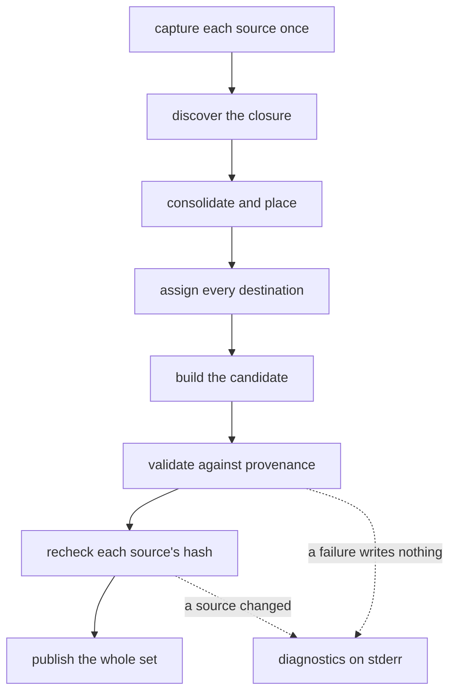

# Validation

A bundle is handed to an agent that will follow it as if it were correct. If a link is broken, a section was silently dropped, or two headings ended up with the same name, the agent has no way to notice — it will simply act on the mistake.

So the run checks its own work before anyone sees it, and publishes nothing unless every check passes. The check is called **validation**.

What a check catches is easiest to see in the failure:

| A source that will not compile | What the run says |
| --- | --- |
| **`SKILL.md`** `# Entry`  `Follow [Tests](rules/tests.md#tests) and [Reviews](rules/quality.md#reviews).`  **`rules/quality.md`** `# Quality`  `## Findings`  `A review lands with its findings recorded.` | `E_TARGET_NOT_FOUND: the reference` `'rules/quality.md#reviews' names no heading` `of the document it selects from` `  reference: rules/quality.md#reviews` `  resolved: rules/quality.md` `  source: SKILL.md:3` `  chain: SKILL.md → rules/quality.md#reviews` `  remedy: name a heading the document carries` |

*A link naming a heading that does not exist is refused before anything is written. The run names the link, the document it resolved to, the line it was written on and what to do about it — and publishes nothing, so the reader never sees a broken link.*

## The invariants

Validation compares the finished document with the provenance the run recorded while building it — which source region produced which span of output — rather than with its surface syntax alone.

| Invariant | Holds when |
| --- | --- |
| Resolution | every supported reference resolves to a known document or section |
| Target integrity | every rewritten link reaches the destination its own target was assigned |
| Uniqueness | each destination occurs once and resolves in the renderer that reads the bundle |
| Boundaries | combining sections has absorbed nothing into an unintended container |
| Preservation | selected wording and code survive the declared transformations unchanged |
| Coverage | each selected region appears exactly once, and the closure is complete |
| Expansion | the only unselected content emitted is a required structural ancestor's heading |
| Group isolation | each group has one H1 and each source sits beneath its own group's heading |
| Outline | each selected heading keeps its ancestor chain and relative depth |
| Depth | no emitted heading exceeds H6 |

Coverage is checked against provenance ranges, not by counting strings. Repeated identical prose in different regions is not duplication, and neither a file heading nor a structural ancestor counts as selected body content.

These establish named syntax, reference and coverage properties. They do not establish that an instruction was obeyed.

## Two modes

Source validation and candidate validation share one grammar but not one policy.

- **Source mode** resolves fragments against one document's headings and refuses a path leaving the author's root. A source fragment names one heading and carries no ordinal.
- **Candidate mode** accepts the generated headings, shifted levels and structural ancestors, and checks destinations, coverage and boundaries against the recorded provenance.

The candidate is never fed back through source frontmatter stripping or dependency discovery.

*Figure 1. The Steps in Order, and the Two That End the Run Before Anything Is Written.*

## Failure

A failing run writes no bundle and publishes nothing. A run validates every bundle it produces before it writes any, so a failure in one writes none.

Each diagnostic carries a stable code, the source location or reference it concerns, the identity that reference resolved to where there is one, the chain of references that reached it, and a remedy where one can be stated accurately.

The [exit statuses](../invocation.md#diagnostics) say what kind of failure a run reported. Exit `4` names the run, not any document it read, so a caller reading it is not sent to look at its sources. Every failing outcome the contract names carries a code; a diagnostic without one reports a defect the contract does not define.

Warnings accompany a successful run and exit `0`. Each carries a `W_` code and states the condition that raised it.

Diagnostics go to standard error. `-d json` emits one JSON object per line, and never mixes an object with prose.

## Budgets

Each budget is a deterministic limit that fails the run rather than truncating a bundle. Every budget holds per bundle, because each bundle is read by one agent from its own entry.

The [options table](../invocation.md#options) names each budget and what it counts. Crossing one fails with a diagnostic naming the budget and the figure that crossed it.

The remedies are the same either way — restructure the sources or raise the number — so one code covers them all. Overrides are positive decimal integers: zero does not mean unlimited.

## The corpus

The corpus under [`fixtures/`](../fixtures/README.md) is the behavioural contract. Each fixture declares a source tree, an invocation and an expected result, and names no language, package or module, so it binds any implementation rather than describing one.

A fixture may declare behaviour a build does not yet meet, marking it `awaiting` the work that delivers it. The corpus stays green, and the change that delivers the work fails until the marker goes.
