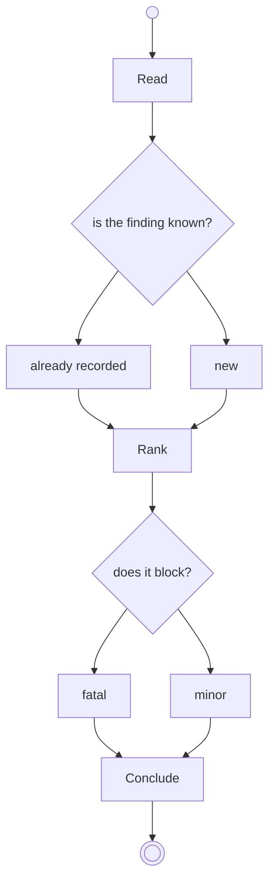

# Review

## Rule

A finding is a defect the source shows and a test does not cover.

## Source

Read the source, and record what it does.

## Tests

Read the tests, and record what they cover.

## Notes

Background for a later run.

## Appraise

## Repair

Rewrite the defective line, and return what changed.
