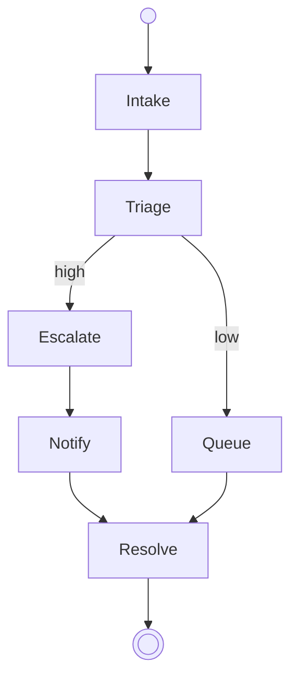

# Incident

The workflow starts at [Intake](states/intake.md). Each state's section says what to do in that state and which state comes next.

The diagram is the one statement of the edges; a decision names the document stating which of its edges applies.

