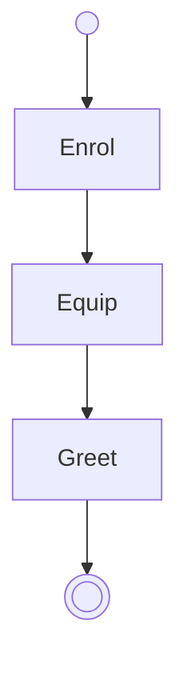

# Handbook

The team's procedures, one section each.

## Onboarding

The diagram is the workflow. Each state's section says what to do in that state and which transition to take out of it.

## Upkeep

The [maintainers' notes](upkeep/notes.md) say who keeps this handbook current.
