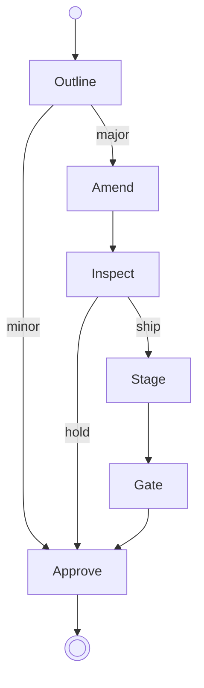

---
prosiform:
  default:
    subst:
      - {states/approve.md: alternates/approve.md}
---
# Release

The diagram is the workflow. Each state's section says what to do in that state and which transition to take out of it.

The release uses the [Stage](states/stage.md "release") preset selection.

