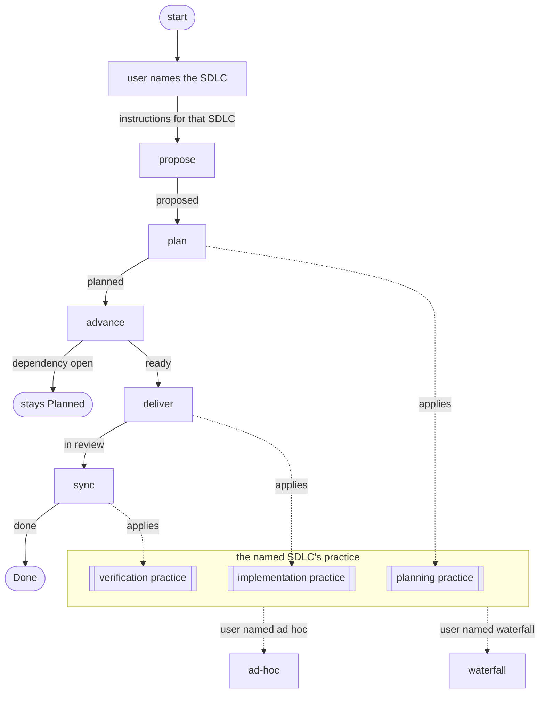
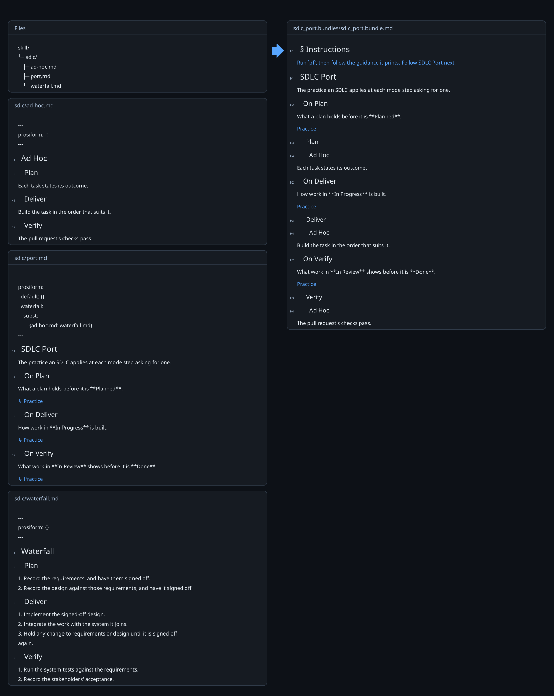

# Project Lifecycle Example

A skill whose project lifecycle and engineering lifecycle are independent of each other. The project lifecycle moves issues across a board, one [mode](modes/) per transition. The engineering lifecycle, the SDLC, decides how the work inside an issue is planned, implemented and verified.

The user names the SDLC as they invoke the skill. That one choice is made once, in the skill's entry, and yields the instructions the agent follows: the board's modes and that SDLC's practice, with nothing of any other SDLC. The agent never weighs an SDLC. How the skill does that is under [Ports and adapters](#ports-and-adapters).

This file declares nothing, so no bundle carries it.

## Graph

*Solid edges are board transitions, each labelled with the outcome that takes it. Dotted edges are the practice a stage applies, which comes from the SDLC the user named.*

## Stages

### Name the SDLC

The user names the SDLC as they invoke the skill: ad hoc or waterfall. The skill's entry, [`SKILL.md`](SKILL.md), turns that name into the instructions the agent follows, and those instructions hold that SDLC's practice and no other. A different SDLC is a different set of instructions, not a choice the agent makes along the way.

### Propose

A proposal enters the board in **Proposed**, as [Propose Mode](modes/propose-mode.md) states.

### Plan

A proposal is broken into epics and tasks, and the SDLC's planning practice states what that plan holds before it is **Planned**: under waterfall, signed-off requirements and design. The transition is [Plan Mode](modes/plan-mode.md), and the practice is [Planning Practice](lifecycle.md#planning-practice).

### Advance

Planned work moves to **Ready** once each dependency is **Done** and it carries a priority. Work with a dependency still open stays **Planned**. The transition is [Advance Mode](modes/advance-mode.md).

### Deliver

Ready work moves to **In Progress**, is implemented as the SDLC prescribes, and moves to **In Review** with its pull request. Under waterfall it is implemented to the signed-off design and integrated, and any change to requirements or design waits for sign-off. The transition is [Deliver Mode](modes/deliver-mode.md), and the practice is [Implementation Practice](lifecycle.md#implementation-practice).

### Sync

Reviewed work shows what the SDLC's verification practice asks, merges, and moves to **Done**. Under waterfall, that is passing system tests and the stakeholders' acceptance. The transition is [Sync Mode](modes/sync-mode.md), and the practice is [Verification Practice](lifecycle.md#verification-practice).

## Ports and adapters

The skill follows the ports and adapters pattern, with prosiform's link operators as the language it is written in. Every decision the pattern needs is made once, in the skill's entry, so none of it reaches the agent.

| Pattern | Here | prosiform |
| --- | --- | --- |
| core | the board transitions in [`modes/`](modes/) | documents gathered by `group: {modes: 2}` |
| port | the practices of [`lifecycle.md`](lifecycle.md), one section each | a document whose presets each name an adapter |
| call through the port | a mode step applying a practice | a link to that practice's section of the lifecycle |
| adapter | [`sdlc/ad-hoc.md`](sdlc/ad-hoc.md), [`sdlc/waterfall.md`](sdlc/waterfall.md) | documents carrying `## Plan`, `## Deliver` and `## Verify` |
| binding an adapter | the lifecycle's `waterfall` preset | `subst: [{sdlc/ad-hoc.md: sdlc/waterfall.md}]` |
| selecting a binding | the SDLC the user names, once, in the entry | the entry's link tagged with the preset, `[↳ Waterfall](lifecycle.md "waterfall")` |
| default binding | ad hoc | the entry's untagged link, `[↳ Ad Hoc](lifecycle.md)`, under the `default` preset |
| the adapter's practice in the port | each practice's section | composition, `[↳ Practice](sdlc/ad-hoc.md#deliver)` |
| an adapter missing a practice | a build failure | `E_TARGET_NOT_FOUND` on the composed section |
| which adapter was bound | the run's diagnostics | `W_SUBST_USED` |

The SOLID principles follow from that shape:

- **Single responsibility.** A mode moves an issue between stages, an adapter states one SDLC's practice, the lifecycle binds one to the other, and the entry selects the binding.
- **Open–closed.** An SDLC is added as one adapter, one preset in the lifecycle and one link in the entry. No mode changes.
- **Liskov substitution.** Every adapter carries every section the lifecycle composes, so any one stands in for ad hoc; a missing section fails its SDLC's build.
- **Interface segregation.** A mode step names the one practice it applies, and each practice composes the one section of the adapter it needs.
- **Dependency inversion.** Modes name the lifecycle's practices and never an adapter; the entry's tagged link supplies the adapter.

## What the agent follows

The agent reads one instruction set: the lifecycle compiled for the SDLC the user named. It holds the modes and that SDLC's practice, and the modes read the same under every SDLC.

*What the agent follows when the user names ad hoc.*

*What it follows when the user names waterfall.*

## Adding an SDLC

1. Write `sdlc/<name>.md` with `## Plan`, `## Deliver` and `## Verify` sections.
2. Add a `<name>` preset to [`lifecycle.md`](lifecycle.md) substituting `sdlc/ad-hoc.md` with `sdlc/<name>.md`.
3. Offer it in [`SKILL.md`](SKILL.md) as `[↳ <Name>](lifecycle.md "<name>")`.
