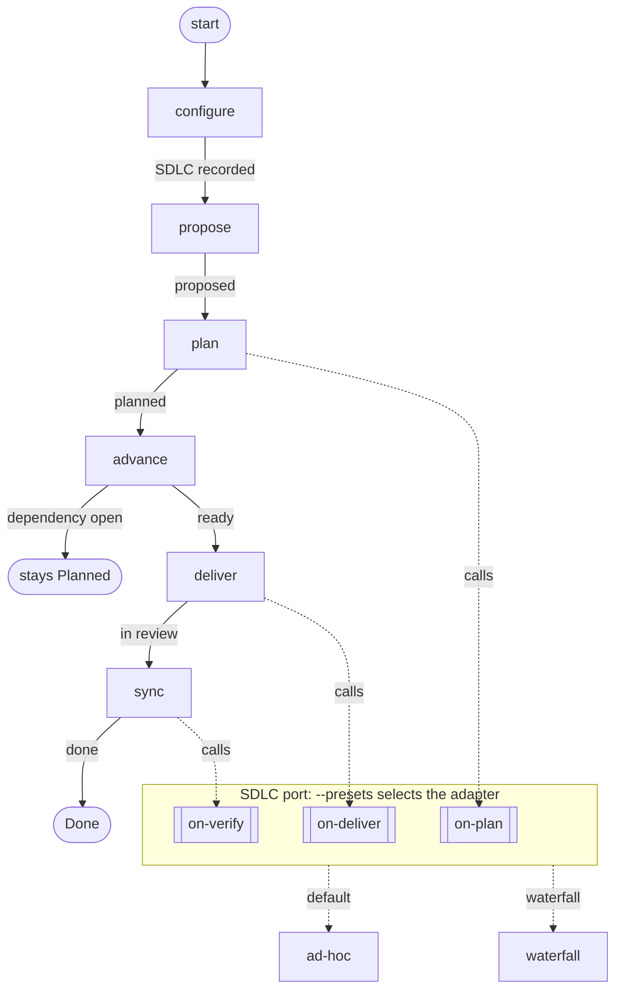
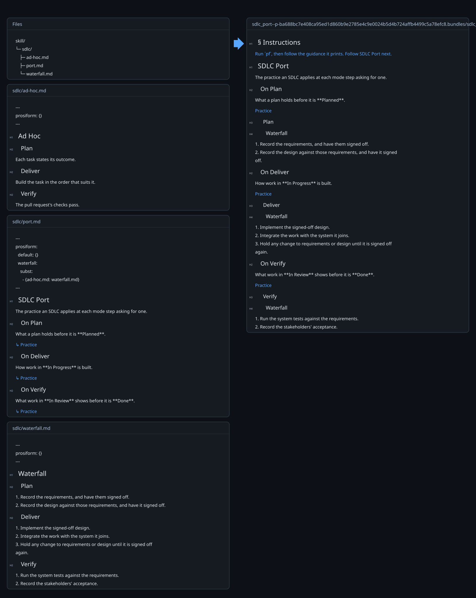

# Project Lifecycle Example

A skill whose project lifecycle and engineering lifecycle are independent of each other. The project lifecycle moves issues across a board, one [mode](modes/) per transition. The engineering lifecycle, the SDLC, decides how the work inside an issue is planned, delivered and verified, and the board's owner selects it. No mode names an SDLC: a mode calls a hook in the [port](sdlc/port.md), and the hook's build binds the SDLC the board records.

This file declares nothing, so no bundle carries it.

## Graph

*Solid edges are board transitions, each labelled with the outcome that takes it. Dotted edges are hook calls and the adapter a hook's build binds.*

## Stages

### Configure

The board records the SDLC it follows, asked of the user the first time the skill runs on it. A board recording none follows `ad-hoc`. The rule is [Configure](SKILL.md#configure).

### Propose

A proposal enters the board in **Proposed**, as [Propose Mode](modes/propose-mode.md) states.

### Plan

A proposal is broken into epics and tasks, and the `on-plan` hook states what that plan holds before it is **Planned**. The transition is [Plan Mode](modes/plan-mode.md), and the hook is [On Plan](sdlc/port.md#on-plan).

### Advance

Planned work moves to **Ready** once each dependency is **Done** and it carries a priority. Work with a dependency still open stays **Planned**. The transition is [Advance Mode](modes/advance-mode.md).

### Deliver

Ready work moves to **In Progress**, is built as the `on-deliver` hook states, and moves to **In Review** with its pull request. The transition is [Deliver Mode](modes/deliver-mode.md), and the hook is [On Deliver](sdlc/port.md#on-deliver).

### Sync

Reviewed work shows what the `on-verify` hook asks, merges, and moves to **Done**. The transition is [Sync Mode](modes/sync-mode.md), and the hook is [On Verify](sdlc/port.md#on-verify).

## Ports and adapters

The skill follows the ports and adapters pattern, with prosiform's link operators as the language it is written in.

| Pattern | Here | prosiform |
| --- | --- | --- |
| core | the board transitions in [`modes/`](modes/) | documents gathered by `group: {modes: 2}` |
| port | the hook sections of [`sdlc/port.md`](sdlc/port.md) | sections a mode reaches by fragment, as `port.md#on-deliver` |
| call through the port | a mode step naming a hook | a deferral, `[¬ Deliver Practice](../sdlc/port.md#on-deliver)`, compiled by a run of its own |
| adapter | [`sdlc/ad-hoc.md`](sdlc/ad-hoc.md), [`sdlc/waterfall.md`](sdlc/waterfall.md) | documents carrying `## Plan`, `## Deliver` and `## Verify` |
| binding an adapter | the port's `waterfall` preset | `subst: [{ad-hoc.md: waterfall.md}]` |
| selecting a binding | the board's recorded SDLC | `pf sdlc/port.md#on-deliver --presets waterfall` |
| default binding | `ad-hoc` | the `default` preset, which substitutes nothing |
| the adapter's practice in the step | the hook's result | composition, `[↳ Practice](ad-hoc.md#deliver)` |
| an adapter missing a hook | a build failure | `E_TARGET_NOT_FOUND` on the composed section |
| which adapter was bound | the run's diagnostics | `W_SUBST_USED` |

The SOLID principles follow from that shape:

- **Single responsibility.** A mode moves an issue between stages, an adapter states one SDLC's practice, and the port binds one to the other.
- **Open–closed.** An SDLC is added as one adapter and one preset in the port. No mode changes.
- **Liskov substitution.** Every adapter carries every section the port composes, so any one stands in for `ad-hoc`; a missing section fails the hook's build.
- **Interface segregation.** A mode step names the one hook it calls, and the hook composes the one section of the adapter it needs.
- **Dependency inversion.** Modes name the port and never an adapter; the preset selected at the hook's build supplies the adapter.

## Building it

From this folder:

| Command | Bundle |
| --- | --- |
| `pf SKILL.md` | the skill: the board stages, the modes and the hook links |
| `pf sdlc/port.md#on-deliver` | the delivery practice of a board recording no SDLC |
| `pf sdlc/port.md#on-deliver --presets waterfall` | the delivery practice of a waterfall board |

A hook built without `--presets waterfall` warns `W_PRESET_UNUSED` for the preset it left unselected, and publishes.

*The `on-deliver` hook built with `--presets waterfall`.*

## Adding an SDLC

1. Write `sdlc/<name>.md` with `## Plan`, `## Deliver` and `## Verify` sections.
2. Add a `<name>` preset to [`sdlc/port.md`](sdlc/port.md) substituting `ad-hoc.md` with `<name>.md`.
