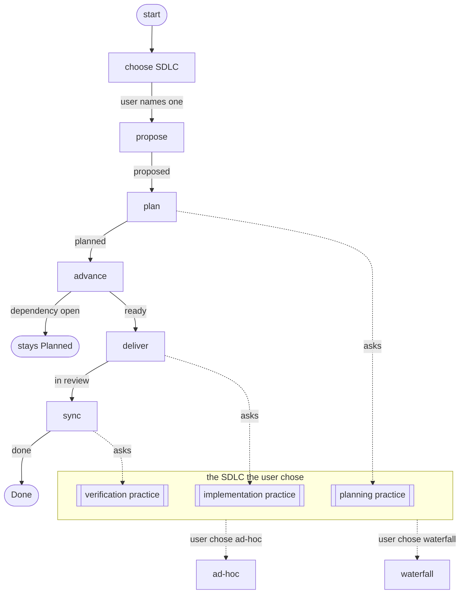

# Project Lifecycle Example

A skill whose project lifecycle and engineering lifecycle are independent of each other. The project lifecycle moves issues across a board, one [mode](modes/) per transition. The engineering lifecycle, the SDLC, decides how the work inside an issue is planned, built and verified. The user tells the skill which SDLC the board follows, and each stage needing engineering practice takes it from that SDLC. How the skill does that is under [Ports and adapters](#ports-and-adapters).

This file declares nothing, so no bundle carries it.

## Graph

*Solid edges are board transitions, each labelled with the outcome that takes it. Dotted edges are the practice a stage takes from the SDLC the user chose.*

## Stages

### Choose SDLC

The first time the skill works on a board, it asks the user which SDLC the board follows and offers the ones it knows: `ad-hoc` and `waterfall`. The user answers in their own words, such as "we run waterfall", and the board keeps that choice. The user changes it by asking. A name the skill does not know is refused with the choices listed, and a board whose user has named none follows `ad-hoc`. The rule is [Configure](SKILL.md#configure).

### Propose

A proposal enters the board in **Proposed**, as [Propose Mode](modes/propose-mode.md) states.

### Plan

A proposal is broken into epics and tasks, and the board's SDLC states what that plan holds before it is **Planned**: under waterfall, signed-off requirements and design. The transition is [Plan Mode](modes/plan-mode.md), and the practice is [On Plan](sdlc/port.md#on-plan).

### Advance

Planned work moves to **Ready** once each dependency is **Done** and it carries a priority. Work with a dependency still open stays **Planned**. The transition is [Advance Mode](modes/advance-mode.md).

### Deliver

Ready work moves to **In Progress**, is built as the board's SDLC prescribes, and moves to **In Review** with its pull request. Under waterfall it is implemented to the signed-off design and integrated, and any change to requirements or design waits for sign-off. The transition is [Deliver Mode](modes/deliver-mode.md), and the practice is [On Deliver](sdlc/port.md#on-deliver).

### Sync

Reviewed work shows what the board's SDLC asks, merges, and moves to **Done**. Under waterfall, that is passing system tests and the stakeholders' acceptance. The transition is [Sync Mode](modes/sync-mode.md), and the practice is [On Verify](sdlc/port.md#on-verify).

## Ports and adapters

The skill follows the ports and adapters pattern, with prosiform's link operators as the language it is written in.

| Pattern | Here | prosiform |
| --- | --- | --- |
| core | the board transitions in [`modes/`](modes/) | documents gathered by `group: {modes: 2}` |
| port | the hook sections of [`sdlc/port.md`](sdlc/port.md) | sections a mode reaches by fragment, as `port.md#on-deliver` |
| call through the port | a mode step naming a hook | a deferral, `[¬ Deliver Practice](../sdlc/port.md#on-deliver)`, compiled by a run of its own |
| adapter | [`sdlc/ad-hoc.md`](sdlc/ad-hoc.md), [`sdlc/waterfall.md`](sdlc/waterfall.md) | documents carrying `## Plan`, `## Deliver` and `## Verify` |
| binding an adapter | the port's `waterfall` preset | `subst: [{ad-hoc.md: waterfall.md}]` |
| selecting a binding | the SDLC the user named | the agent's `pf sdlc/port.md#on-deliver --presets waterfall` |
| default binding | `ad-hoc` | the `default` preset, which substitutes nothing |
| the adapter's practice in the step | the hook's result | composition, `[↳ Practice](ad-hoc.md#deliver)` |
| an adapter missing a hook | a build failure | `E_TARGET_NOT_FOUND` on the composed section |
| which adapter was bound | the run's diagnostics | `W_SUBST_USED` |

The SOLID principles follow from that shape:

- **Single responsibility.** A mode moves an issue between stages, an adapter states one SDLC's practice, and the port binds one to the other.
- **Open–closed.** An SDLC is added as one adapter and one preset in the port. No mode changes.
- **Liskov substitution.** Every adapter carries every section the port composes, so any one stands in for `ad-hoc`; a missing section fails the hook's build.
- **Interface segregation.** A mode step names the one hook it calls, and the hook composes the one section of the adapter it needs.
- **Dependency inversion.** Modes name the port and never an adapter; the preset selected at the hook's build supplies the adapter.

## What the agent follows

The user asks for board work in their own words, and the agent reads the skill from its entry point, [`SKILL.md`](SKILL.md). Each stage's engineering practice is left as a link there, and the agent fetches it once the board's SDLC is known.

*The skill as the agent reads it. No SDLC's practice is in it until the user has named one.*

*What the agent follows at Deliver on a board whose user has named no SDLC.*

*What it follows at the same step once the user has said "we run waterfall".*

## Adding an SDLC

1. Write `sdlc/<name>.md` with `## Plan`, `## Deliver` and `## Verify` sections.
2. Add a `<name>` preset to [`sdlc/port.md`](sdlc/port.md) substituting `ad-hoc.md` with `<name>.md`.
