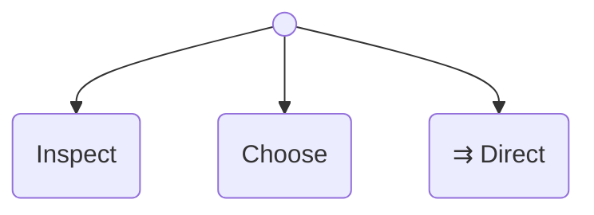

# § Instructions

Run `pf`, then follow the guidance it prints. Follow [Guide](#guide) next.

# Guide

## Work

### Inspect

Read the supplied input.

[⇉ Inspect](read.bundle.md)

### Dispatch Pick

[⇉ Choose](kinds--p-eb1d12732c6e8bbcf128bfab87f94903c8cbcac397518fc02a3fa5b9eea8adca.bundle.md) — One short read.
[⇉ Choose](kinds--p-3bcbdbfeabe66919ef169526ed028d2172dda37348ee1e2e7ea3a45e7727d1b3.bundle.md) — A detailed read.
