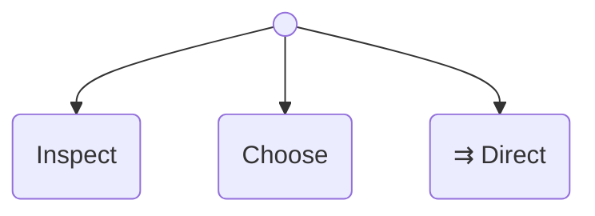

# § Instructions

Run `pf`, then follow the guidance it prints. Follow [Guide](#guide) next.

# Guide

## Work

### Inspect

Read the supplied input.

[⇉ Inspect](read.bundle.md)

### Choose

[⇉ Choose](kinds-fast.bundle.md) — One short read.
[⇉ Choose](kinds-deep.bundle.md) — A detailed read.
