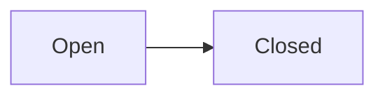

# Lifecycle

An example of the click syntax, written in a fence holding no diagram:

```text
click Open href "states/open.md"
click Closed "states/closed.md"
```

A diagram whose clicks call script rather than naming a destination:


