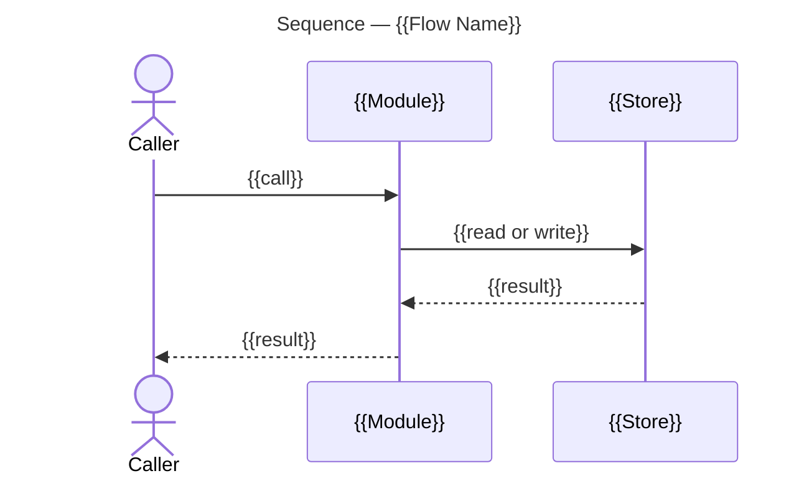

# Understand Mode

Explains the named pull request's changes through a measured architecture overview and publishes that overview for its reviewer.

Follow the [Procedure](#procedure), adhering to [Rules](#rules) and [Conventions](#conventions) and ensure all [Outcomes](#outcomes) are met.

## Procedure

### 1. Select the Change

Require the pull request number or URL.

- Ask and stop when none is supplied. Do not infer it from the current branch.
- For several supplied pull requests, complete one overview per pull request. An initiative has no overview of its own.

### 2. Explain Each Change

Follow [Change Overview](#change-overview) for each selected pull request, with its repository, that repository's checkout and the pull request number, resuming with what it returns.

### 3. Report

Report the pull request, record folder, diagrams and References row of each overview.

## Outcomes

- **The change explained.**
  The engineer reviewing the pull request has its structure and its flows, read at the head commit under review.
- **The pull request named.**
  The account is of the pull request the request names, of the open pull request a task in review names, or of each base an epic in review delivers. An initiative has none of its own.
- **One account.**
  The same pull request yields one account, and a later run replaces it with the current change.

# Rules

- **Decisions.**
  A question the user must decide is put as an interview, one question at a time. A decision the run's [allowance](#allowance) covers is taken with its recommended option rather than asked. Record each decision in the affected issues and, when there is one, the planning record.
  - A plain-language paragraph before the question gives the context the user needs to answer it.
  - The question offers more than one choice. The recommended choice is marked on its option.
  - Wait for the user's answer. An unanswered question stays pending. A recommendation or elapsed time supplies no answer.
  - The user can select Other and specify a response beyond the options.
  - Use the native tool for presenting the question when one is available.
- **Layers.**
  Modes, protocols, artifacts. A mode aggregates protocol calls, as an application calls services; a protocol applies artifact operations and follows other protocols; an artifact does neither. A call goes down the stack, never up. A mode reaches an artifact operation directly only where no protocol owns that change.
- **Execution.**
  A call passes its named inputs. A protocol is one change that lands in several artifacts together, and is followed whole. Follow another mode, a protocol or a named procedure subsection, and apply an artifact operation, only where the procedure calls for it; finish that call and return its result before continuing. Calls run in order. A step's `⇉` call runs in a sub-agent, and its `⫽` calls run in sub-agents together, as the bundle's Prosiform section states; those together never write to the same object.

# Conventions

- **Session.**
  Once per session, before the first `gh` call, unset `GH_TOKEN` and `GITHUB_TOKEN` so `gh` uses its keyring login. Where shell state does not persist between commands, confirm instead that neither is set in the shell profile.
- **Repository.**
  `gh` resolves `{owner}/{repo}` from the git remote of the directory it runs in, so run `gh` commands inside a checkout of the repository that holds the issues. `{other}` is a further repository the board's issues live in.
- **Bodies.**
  - Bodies, long comments and commit messages always go through a file (`-F body=@file`), never inline, which avoids quoting. The file holds the exact intended text.
  - Keep these files in a working directory outside the repository.
- **Helper invocation.**
  A helper is a script in `<workspace>`, the checkout holding this skill. It runs from `<workspace>`, or the directory within it that its command names, under the sandbox invoked by its absolute path, `<workspace>/scripts/sbx`. A file kept outside `<workspace>`, such as a body file, is passed by its absolute path.
- **Write confirmation.**
  Only a fresh re-read confirms a write: read the written object again and compare it with the intended state. The write's own output confirms nothing. A re-read that fails, or shows another state, leaves the write uncertain; that uncertainty returns to the caller, and the write is never retried as a different write.
- **Boards.**
  A project board sits under `users/{owner}`, or `orgs/{owner}` when `gh api repos/{owner}/{repo} --jq .owner.type` is `Organization`.
- **Example values.**  Substitute the real ones:
  - `936` an initiative issue, `943` and `937` its epics, `637` a task issue, `874` an orphan, `946` an initiative off the board, `960` a proposal;
  - `950` a pull request, `I07` and `I08` initiative numbers;
  - board `9` a theme board, and `419167630` its Status field id;
  - `1` the Initiative Template board, `13` a board copied from it;
  - `14` the Proposals Template, `15` the Proposals board;
  - `m2ux` the user.
  - `<checkout>` any checkout of the project, a linked worktree included.

# Protocols

## Change Overview

The published architecture overview, planning record and pull request link that explain one pull request's change.

Follow the [Procedure](#procedure-1), adhering to [Rules](#rules) and [Conventions](#conventions).

### Procedure

#### 1. Prepare the Evidence

Apply [Read Pull Request State](#read-pull-request-state) with the supplied repository and pull request number for its identity, title, base and head.

- Apply [Create Pull Request Worktree](#create-pull-request-worktree) with the repository, its checkout, the pull request number and that head.
- Return a changed-head finding to the caller.
- Apply [Measure Repository Change](#measure-repository-change) with the returned worktree, its head and the pull request's base.
- Return a freshness blocker to the caller before writing the overview.

#### 2. Locate the Record

Apply [Locate Planning Record](#locate-planning-record) with the pull request number.

- **Record found.**
  - Take the returned folder path and its record identity.
- **No record.**
  - Take a new overview record's identity and folder path, meeting [Layout](#layout), from the pull request's number and title.
- Apply [Populate Planning Record](#populate-planning-record) with that record identity and folder path.

#### 3. Write the Overview

Apply [Populate Architecture Overview](#populate-architecture-overview) with the measured structure and flows, the head from [1. Prepare the Evidence](#1-prepare-the-evidence), pinned code permalinks and an overview path in the record's folder.

#### 4. Register the Overview

Apply [Populate Planning Record](#populate-planning-record) with the record identity, folder path, the returned overview file and the pull request link, meeting [Artifacts](#artifacts-1), and a commit message file naming that folder, asking it to publish.

- Return a publication discrepancy to the caller.

#### 5. Link the Pull Request

Apply [Link Architecture Overview](#link-architecture-overview) with the current body, the published overview URL and an output body path.

- Apply [Publish Pull Request](#publish-pull-request) with the repository, pull request number and returned body file.
- Return the pull request, record folder, published overview, diagrams and References row to the caller.

# Artifacts

## Plan Change

### Fields

#### Allowance

The caller names the change kinds its run applies without asking. A run the user drives directly is supplied none.

## Pull Request

### Operations

#### Access Development Links

The observed or updated Development relation for a pull request.

**Inputs:** [Pull request](#pull-request-identity), [Link request](#link-request), [Delivery issue](#issue-record), [Auto-close setting](#auto-close-setting)

**Outputs:** [Development links](#issue-links)

##### 1. Read the Pull Request Development Links

Run [Read Development Links](#read-development-links) for the actual field, including every page and state. A missing tool or inaccessible field is a blocker, not an empty link set.

##### 2. Return the Read-Only Relation

Return the complete relation for a read-only request.

##### 3. Edit the Development Links

For a link edit:

- Take the supplied repository prerequisite from [Confirm Repository Auto-Close](#confirm-repository-auto-close); an unconfirmed setting blocks the edit.
- Meet the applicable preconditions in [Close Tracker Issue](#close-tracker-issue).
- For an addition, run [Set Development Link](#set-development-link) with the pull request and issue identities.
- For removal of an abandoned or incorrect link:
  - Require the supplied user decision.
  - Run [Remove Development Link](#remove-development-link) with those identities.

##### 4. Re-Read the Pull Request Development Links

Run [Read Development Links](#read-development-links) again for the same pull request, as [Write confirmation](#conventions) states.

##### 5. Compare the Field with the Edit

Compare the field with the intended edit.

##### 6. Return the Verified Link Relation

Return the verified relation or discrepancy.

#### Fetch Pull Request Issue Links

The complete issue-link snapshot for a supplied set of pull requests.

**Inputs:** [Pull request records](#pull-request-records), [Link snapshot path](#issue-link-snapshot)

**Outputs:** [Issue-link snapshot](#issue-link-snapshot)

##### 1. Read Links for Each Pull Request

For every pull request in the current records, `prs.json`, apply [Access Development Links](#access-development-links) with a read-only request and its identity. An observed empty field supplies an empty array; an unreadable field leaves the fetch incomplete.

##### 2. Re-Read Links After a Change

Repeat that read after a link changes, as [Write confirmation](#conventions) states.

##### 3. Return an Incomplete Link Fetch

If any relation is unreadable, return the incomplete result.

##### 4. Write the Links Snapshot

Run [Write Pull Request Links](#write-pull-request-links) with the observed complete relations and destination `links.json`, including one entry per pull request and every linked issue's repository and number.

##### 5. Return the Links Snapshot

Return the snapshot for the scripts' `--links` input.

#### Link Pull Request to Issue

The verified delivery-issue relation for a pull request.

**Inputs:** [Pull request](#pull-request-identity), [Delivery issue](#issue-record), [Pull request records](#pull-request-records), [Link snapshot path](#issue-link-snapshot), [Auto-close setting](#auto-close-setting)

**Outputs:** [Development links](#issue-links), [Issue-link snapshot](#issue-link-snapshot)

##### 1. Add the Development Link

Apply [Access Development Links](#access-development-links) with the supplied identities, requested link addition and the repository prerequisite confirmed as [Close Tracker Issue](#close-tracker-issue) documents.

##### 2. Stop on an Unverified Link Edit

Stop on a blocker or an unverified edit.

##### 3. Refresh the Links Snapshot

Apply [Fetch Pull Request Issue Links](#fetch-pull-request-issue-links) with the current records and destination after the edit.

##### 4. Return the Verified Link and Snapshot

Return the verified relation and refreshed snapshot.

#### Read Pull Request State

One current pull request and its requested supporting records.

**Inputs:** [Pull request](#pull-request-identity), [Requested records](#pull-request-snapshot), [Snapshot paths](#pull-request-snapshot)

**Outputs:** [Pull request snapshot](#pull-request-snapshot)

##### 1. Fetch the Pull Request Snapshot

Run [Fetch Pull Request](#fetch-pull-request) or [Save Pull Request Snapshot](#save-pull-request-snapshot) for current identity, state, head and base.

##### 2. Fetch Requested Files or Reviews

Run [Fetch Pull Request Files](#fetch-pull-request-files) or [Fetch Pull Request Reviews](#fetch-pull-request-reviews) when the caller requests those records.

##### 3. Return the Pull Request Snapshots

Return the snapshots or missing evidence.

#### Publish Pull Request

One pull request created or updated from supplied content and metadata.

**Inputs:** [Pull request](#pull-request-identity), [Kind](#pull-request-kind), [Pull request content](#pull-request-content), [Delivery issue](#issue-record), [Auto-close setting](#auto-close-setting), [Link snapshot path](#issue-link-snapshot)

**Outputs:** [Pull request snapshot](#pull-request-snapshot), [Issue-link snapshot](#issue-link-snapshot)

##### 1. Open a New Pull Request

For creation, run [Open Task Pull Request](#open-task-pull-request), [Open Epic Pull Request](#open-epic-pull-request) or [Open Discussion Pull Request](#open-discussion-pull-request) for the supplied kind, body, title, head and base, preserving epic and discussion draft state.

- For a task or epic pull request with a delivery issue, require the confirmed auto-close setting and snapshot destination, then apply [Link Pull Request to Issue](#link-pull-request-to-issue) with them, meeting [Issue Links](#issue-links). A row task without its own issue supplies no delivery issue, auto-close setting or link snapshot for publication.

##### 2. Update the Existing Pull Request

For an existing pull request, run [Patch Pull Request Body](#patch-pull-request-body), [Retitle Pull Request](#retitle-pull-request) or [Retarget Pull Request](#retarget-pull-request) for the supplied changes, preserving other fields.

##### 3. Re-Read the Published Pull Request

Re-read through [Read Pull Request State](#read-pull-request-state), as [Write confirmation](#conventions) states.

##### 4. Return the Published State

Return the saved state or discrepancy, and the issue-link snapshot when the creation path linked a delivery issue. Other publication paths return no issue-link snapshot.

### Fields

#### State

A pull request is open, draft, ready for review, merged or closed without merge. A merged result identifies the verified head, target and merge commit.

- An epic's review pull request is published as a draft when the first task merges into its epic base, and an unmerged epic base with work merged into it has one.
- The review stays draft, and its epic open, until the epic is complete and the user marks it ready.

#### Scope

A task pull request delivers one task, or a set of tasks that name each other in Joins. It targets the epic base for the long-lived branch its work changes.

#### Issue Links

- GitHub shows the link in the pull request's Development field and in the issue's Linked pull requests field, which the project board reads.
- A task pull request links the task's issue, and a review pull request links its epic's issue.
- The link is addressed by issue, so a pull request whose work carries no issue links nothing. A task pull request delivering rows that have no issue of their own is the whole of what stays unlinked.
- The link is stored on the pull request. It holds on any base branch and on a pull request that has merged, and a later body edit leaves it standing.
- A linked issue remains open until its criteria and delivery requirements hold and every Development-linked pull request is merged.
- The field is the whole of the relation: neither body links the other. The pull request's References carry its sources, and the issue it delivers is not among them.
- A pull request with a delivery issue but no Development link is uncited.

#### Pull Request Identity

A pull request's [repository](#repository) and number. A pull request yet to be created has its repository alone.

#### Pull Request Kind

Task, epic or planning discussion. A delivery pull request is a task or an epic one: a task pull request meets [Scope](#scope), and an epic's review pull request has an epic base as its head.

#### Verified Head

The literal head commit SHA whose checks, reviews and target requirements were read. Verification applies to that exact SHA.

#### Pull Request Content

The fields a publication writes: a body file at its path, meeting [Template](#template-2), its title, head and base. A change to an existing pull request names only the fields it changes.

#### Pull Request Snapshot

One pull request's REST record as a local JSON file at its path, with its identity, state, head SHA, base and mergeable state. Its requested supporting records are its changed paths and its reviews, each in a file of its own.

#### Pull Request Records

A local JSON-lines file at its path, one pull request's REST record per line. An initiative's records hold every pull request whose title carries its prefix, in all states, across its repositories; a failed fetch leaves them incomplete.

#### Issue-Link Snapshot

A local JSON file (`links.json`) at its path holding an array of pull request entries. Each entry has `repo` as its owner/repository string, `number` as its integer pull request number, and `closingIssuesReferences` as an array of objects with `repo` and integer `number` for each Development-linked issue. An observed empty field is an empty array. The snapshot is complete only when every relation was read.

#### Link Request

A read, an addition or a removal of one pull request's Development link. An edit names the issue; a removal carries the user's decision naming the abandoned or incorrect link.

### Commands

#### Open Discussion Pull Request

Opens a draft for the supplied planning branch and body.

**Inputs:** Repository owner and name, title, planning branch, target branch and body file.

```bash
gh api --method POST 'repos/<owner>/<repository>/pulls' -f title='<title>' -f head='<planning-branch>' -f base='<target-branch>' -F body=@'<body-file>' -F draft=true
```

**Example:**

```bash
gh api --method POST repos/m2ux/workflow-server/pulls -f title='Queue Planning: Scope and Delivery' -f head=planning/queue -f base=engineering -F body=@discussion.md -F draft=true
```

#### Retarget Pull Request

Points a pull request at another base branch, such as its epic's base branch.

**Inputs:** Repository, pull request number and target branch.

```bash
gh api --method PATCH 'repos/<owner>/<repo>/pulls/<pull-request-number>' -f base='<target-branch>' --jq .base.ref
```

**Example:**

```bash
gh api --method PATCH 'repos/<owner>/<repo>/pulls/950' -f base='i07/e00/main' --jq .base.ref
```

#### Fetch Pull Request

Appends one pull request, as one JSON line, to the supplied file.

**Inputs:** Repository, pull request number and destination JSON-lines file.

```bash
gh api 'repos/<owner>/<repo>/pulls/<pull-request-number>' --jq . >> '<pull-request-records-file>'
```

**Example:**

```bash
gh api 'repos/<owner>/<repo>/pulls/439' --jq . >> prs.json
```

#### Retitle Pull Request

Replaces a pull request's title.

**Inputs:** Repository, pull request number and complete title.

```bash
gh api --method PATCH 'repos/<owner>/<repo>/pulls/<pull-request-number>' -f title='<title>' --jq .title
```

**Example:**

```bash
gh api --method PATCH 'repos/<owner>/<repo>/pulls/950' -f title='[I07:E00] Purpose' --jq .title
```

#### Open Task Pull Request

Creates a pull request from a unit's branch to its epic base.

**Inputs:** Repository, title, task head, epic base and populated body file.

- Supply the epic prefix and purpose as title, the task branch as head, the epic base as base, and the complete body file.

```bash
gh api --method POST 'repos/<owner>/<repo>/pulls' -f title='<title>' -f head='<task-branch>' -f base='<epic-base>' -F 'body=@<body-file>' --jq .html_url
```

**Example:**

```bash
gh api --method POST 'repos/<owner>/<repo>/pulls' -f title='[I07:E00] Purpose' -f head='i07/e00/w01-purpose' -f base='i07/e00/main' -F body=@body.md --jq .html_url
```

#### Open Epic Pull Request

Creates the draft pull request from an epic base to its long-lived target.

**Inputs:** Repository, title, epic head, long-lived base and populated review body file.

- Supply the epic prefix and name as title, the epic base as head, its long-lived branch as base, and the populated review body file.
- `draft` is true, including when the work is already complete.

```bash
gh api --method POST 'repos/<owner>/<repo>/pulls' -f title='<title>' -f head='<epic-base>' -f base='<long-lived-base>' -F draft=true -F 'body=@<body-file>' --jq .html_url
```

**Example:**

```bash
gh api --method POST 'repos/<owner>/<repo>/pulls' -f title='[I07:E00] Name' -f head='i07/e00/main' -f base='main' -F draft=true -F body=@body.md --jq .html_url
```

#### Patch Pull Request Body

Replaces a pull request's body.

**Inputs:** Repository, pull request number and complete populated body file.

- The file is the whole body. The issue a pull request delivers is linked on the pull request itself, so this call leaves that link standing.

```bash
gh api --method PATCH 'repos/<owner>/<repo>/pulls/<pull-request-number>' -F 'body=@<body-file>' --jq .html_url
```

**Example:**

```bash
gh api --method PATCH 'repos/<owner>/<repo>/pulls/950' -F body=@pr-950.md --jq .html_url
```

#### Read Development Links

Returns the complete Development relation through authenticated GitHub or an available supported tool.

**Inputs:** Pull request identity and authenticated access.

Read the actual field across every page and state, recording repository and number for each linked issue. Return the links and whether the field was fully readable.

#### Set Development Link

Adds one pull request to an issue's Development relation.

**Inputs:** Pull request identity, issue identity, authenticated access and confirmed repository prerequisite.

Use [GitHub's sidebar linking procedure](https://docs.github.com/en/issues/tracking-your-work-with-issues/using-issues/linking-a-pull-request-to-an-issue): in the issue's Development selector, select the pull request's repository and pull request, including a different repository when required. Return the edit result.

#### Remove Development Link

Removes one selected Development relation.

**Inputs:** Pull request and issue identities, authenticated access and the user's decision authorizing removal of the abandoned or incorrect link.

Deselect the supplied relation in the authenticated Development selector and save the edit. Return the edit result.

#### Write Pull Request Links

Saves complete observed Development-linked issues as a JSON array.

**Inputs:** One complete relation per pull request, with all repository and number pairs, and destination link-snapshot file.

Write the supplied relations in this shape. Substitute numbers as JSON integers. Include each pull request and all its linked issues; use an empty array for a complete relation with no linked issues. Each repository is the one belonging to that pull request or issue.

```text
[
  {
    "repo": "<pull-request-owner>/<pull-request-repo>",
    "number": <pull-request-number>,
    "closingIssuesReferences": [{"repo": "<issue-owner>/<issue-repo>", "number": <issue-number>}]
  }
]
```

**Example payload:**

```json
[
  {
    "repo": "owner/repo",
    "number": 950,
    "closingIssuesReferences": [{"repo": "owner/repo", "number": 637}]
  }
]
```

#### Save Pull Request Snapshot

Saves one complete pull request response, replacing the destination file.

**Inputs:** Repository, pull request number and destination JSON file.

```bash
gh api 'repos/<owner>/<repo>/pulls/<pull-request-number>' > '<pull-request-json-file>'
```

**Example:**

```bash
gh api 'repos/<owner>/<repo>/pulls/980' > epic-pr.json
```

#### Fetch Pull Request Reviews

Saves every review on one pull request.

**Inputs:** Repository, pull request number and destination file.

```bash
gh api --paginate 'repos/<owner>/<repo>/pulls/<pull-request-number>/reviews?per_page=100' > '<reviews-file>'
```

**Example:**

```bash
gh api --paginate 'repos/<owner>/<repo>/pulls/980/reviews?per_page=100' > reviews.json
```

#### Fetch Pull Request Files

Saves the paths a pull request changes.

**Inputs:** Repository, pull request number and destination path-list file.

```bash
gh api --paginate 'repos/<owner>/<repo>/pulls/<pull-request-number>/files' --jq '.[].filename' > '<changed-paths-file>'
```

**Example:**

```bash
gh api --paginate 'repos/<owner>/<repo>/pulls/950/files' --jq '.[].filename' > changed-files.txt
```

## Delivery Branches

### Operations

#### Create Pull Request Worktree

The detached worktree where the graph reads the reviewed change.

**Inputs:** [Pull request](#pull-request-identity), [Project checkout](#project-checkout), [Verified head](#verified-head)

**Outputs:** [Review worktree](#review-worktrees), [Verified head](#verified-head)

##### 1. Fetch the Review Head

Run [Fetch Review Head](#fetch-review-head) in the checkout of the repository the pull request changes, passing its number; stop on failure.

##### 2. Read the Fetched Revision

Run [Read Checkout Revision](#read-checkout-revision) in the repository checkout for `FETCH_HEAD`.

##### 3. Recheck a Differing Fetched Head

If it differs from the verified head:

- Apply [Read Pull Request State](#read-pull-request-state) for the same pull request, and take its head as the verified head.
- Repeat [1. Fetch the Review Head](#1-fetch-the-review-head) and [2. Read the Fetched Revision](#2-read-the-fetched-revision) once.
- If the fetched head still differs, return a changed-head finding before creating a worktree.

##### 4. Derive the Review Worktree Path

Take the worktree path from the pull request number, meeting [Review Worktrees](#review-worktrees).

##### 5. Check an Existing Review Worktree

If that worktree already exists:

- Run Read Checkout Revision there for `HEAD`.
- Run [Read Checkout Status](#read-checkout-status) there.
- Reuse it only at the verified head and when its status reports detached HEAD with no tracked or untracked changes.
- Otherwise retain it and select an unused path suffixed with the verified commit.

##### 6. Add the Review Worktree

For an unused path, run [Add Review Worktree](#add-review-worktree) with that path and the verified commit.

##### 7. Confirm the Review Worktree Head

Confirm its HEAD through Read Checkout Revision.

##### 8. Return the Review Worktree

Return the selected detached worktree path and head, or the discrepancy before measuring.

### Fields

#### Branches

A project states its long-lived branches in `config/branches` at its root, one name per line. A run from a linked worktree reads the statement its main working tree holds.

- **Example.**
  workflow-server's `config/branches` names `docker`, `main`, `workflows` and `workspace`.

#### Review Worktrees

A reviewed pull request is read in a detached worktree, named by its number under the worktree directory of the repository's main working tree.

- **Example.**
  Pull request 950 is read at `.worktrees/pr-950`.

#### Project Checkout

A checkout of the repository whose branches are delivered. Its main working tree holds the [Branches](#branches) statement, and its worktree directory holds every epic-base, task and review worktree.

### Commands

#### Fetch Review Head

Fetches one pull request head into FETCH_HEAD.

**Inputs:** Repository checkout and pull request number.

```bash
git fetch origin 'pull/<pull-request-number>/head'
```

**Example:**

```bash
git fetch origin pull/950/head
```

#### Add Review Worktree

Creates a detached worktree at the fetched review head.

**Inputs:** Repository checkout, worktree path and fetched head commit.

- The path resolves against the directory the command runs in, so supply it as [Review Worktrees](#review-worktrees) anchors it rather than relative to a linked worktree.

```bash
git worktree add --detach '<worktree-path>' '<head-commit>'
```

#### Read Checkout Revision

Resolves one revision to its commit in the selected checkout.

**Inputs:** Checkout and revision, such as HEAD or FETCH_HEAD.

```bash
git -C '<checkout>' rev-parse '<revision>^{commit}'
```

#### Read Checkout Status

Reports branch or detached-HEAD state and tracked and untracked changes in one checkout.

**Inputs:** Checkout path.

```bash
git -C '<checkout>' status --porcelain --branch
```

## Repository Graph

### Operations

#### Measure Repository Change

Current graph evidence for the supplied change.

**Inputs:** [Worktree](#revision), [Verified head](#revision), [Base branch](#revision)

**Outputs:** [Changed symbols](#changed-symbols), [Symbol relationships](#symbol-relationships), [Flow traces](#flow-traces)

##### 1. Check the Graph Index Status

Run [Index Status](#index-status) in the supplied worktree. Every graph command runs in that worktree.

##### 2. Refresh a Stale Graph Index

If the repository is unindexed or behind the verified head:

- Run [Index Repository](#index-repository).
- Confirm freshness.

##### 3. Measure the Change Surface

Run [Change Surface](#change-surface) against the supplied base using `--base-ref`.

##### 4. Read Each Changed Symbol Context

For each changed symbol, run [Symbol Context](#symbol-context).

##### 5. Trace Each Reported Flow

For each reported flow, run [Flow Trace](#flow-trace).

##### 6. Re-Measure on a Stale Index

Inspect the staleness block on every response. For a behind index:

- Discard its measurements.
- Run [Index Repository](#index-repository).
- Repeat [1. Check the Graph Index Status](#1-check-the-graph-index-status) through [5. Trace Each Reported Flow](#5-trace-each-reported-flow) once with the updated index.
- If a response is still behind, return a freshness blocker.

##### 7. Return the Current Graph Evidence

Return only evidence current with the supplied head, meeting [Fields](#fields-3), or a freshness blocker.

### Fields

#### Revision

The graph identifies its worktree and indexed commit. Measurements describe the supplied pull request head and its difference from the supplied base branch.

#### Freshness

Graph responses carry a JSON `staleness` block. A behind index is not current with the requested head; measurements from it are invalid.

#### Changed Symbols

The surface identifies symbols touched by the diff and the flows containing them. It compares with the supplied base branch, rather than the branch's whole history.

#### Symbol Relationships

Each changed symbol has callers, callees, containing flows and file locations. Files group into component areas; their measured relationships determine edges between areas.

#### Flow Traces

Each flow contains symbols in step order. Each `process_symbols` entry includes `step_index`, file and lines. Those ordered measurements supply sequence-diagram participants and interactions. A manually inferred call order does not establish a graph trace.

### Commands

#### Index Status

Reports whether the repository is indexed, and how far behind the index sits.

**Inputs:** Repository worktree and requested revision.

```bash
gitnexus status
```

#### Index Repository

Indexes the repository, which an unindexed or behind repository needs before any measurement.

**Inputs:** Repository worktree and requested revision.

```bash
gitnexus analyze
```

#### Change Surface

Reports the symbols a pull request's diff touches and the flows they sit in, against the base branch.

**Inputs:** Current indexed worktree and comparison base branch.

- `--base-ref` is the pull request's base, so the surface is the change rather than the branch's whole history.

```bash
gitnexus detect-changes --scope compare --base-ref '<base-branch>'
```

**Example:**

```bash
gitnexus detect-changes --scope compare --base-ref main
```

#### Symbol Context

Reports one symbol's callers, its callees and the flows it sits in, each with the file it sits in.

**Inputs:** Symbol identity from the supplied change surface and the current graph worktree.

```bash
gitnexus context '<symbol-identity>'
```

**Example:**

```bash
gitnexus context reserveRow
```

#### Flow Trace

Reports one flow's symbols in step order, the structure a sequence diagram is drawn from.

**Inputs:** Flow identity from the supplied change surface and the current graph worktree. The result meets [Flow Traces](#flow-traces).

```bash
gitnexus query --query '<flow-identity>' --limit 1
```

**Example:**

```bash
gitnexus query --query "Queue Placement" --limit 1
```

## Planning Record

### Operations

#### Populate Planning Record

One planning directory and its artifact inventory.

**Inputs:** [Record identity](#record-folder), [Folder path](#record-folder), [Artifact files](#artifacts-1), [External links](#links), [Removed artifacts](#artifacts-1), [Commit message](#commit-message)

**Outputs:** [Folder path](#record-folder), [Publication](#publication)

##### 1. Prepare the Selected Planning Record

Prepare the selected record:

- For a new record:
  - Create the folder with [Add Planning Record](#add-planning-record).
  - Populate README.md from the [Template](#template).
- For an existing record:
  - Read its README, retaining its creation date, other artifacts and links.
  - Update only the supplied content.
- The folder must meet [Layout](#layout).
- All populated README fields must meet [Fields](#fields-4).

##### 2. Register the Supplied Artifact Files

Register the artifact files supplied by the caller, using their chosen names.

- Each file must have a row meeting [Layout](#layout) and [Artifacts](#artifacts-1).
- File content remains supplied by the caller; this operation does not author that artifact's content.
- Delete each artifact the caller names as removed, with its row.

##### 3. Publish the Populated Planning Record

When the caller asks to publish, apply [Publish Planning Record](#publish-planning-record) with the folder path, the files this call wrote and the commit message file.

##### 4. Return the Planning Record Folder

Return the folder path, and the publication result when it published.

#### Publish Planning Record

The record's folder committed and pushed, so every link into it resolves for a reader.

**Inputs:** [Folder path](#record-folder), [Record files](#layout), [Commit message](#commit-message)

**Outputs:** [Publication](#publication)

##### 1. Find the Publishing Worktree

Run [Find Engineering Worktree](#find-engineering-worktree) for the path the record is written on, with the [engineering branch](#engineering-branch) name.

##### 2. Commit the Planning Record Folder

Run [Commit Planning Record](#commit-planning-record), which stages and commits that folder in one call.

- Confirm the commit holds the files this record wrote, meeting [Shared Worktree](#shared-worktree).

##### 3. Push the Engineering Branch

Run [Push Engineering Branch](#push-engineering-branch).

- Report a push that will not fast-forward rather than rewriting the branch.

#### Locate Planning Record

The existing planning folder whose reference is one issue or pull request number.

**Inputs:** [Reference](#record-folder)

**Outputs:** [Folder paths](#record-folder)

##### 1. Find the Engineering Worktree

Run [Find Engineering Worktree](#find-engineering-worktree) with the [engineering branch](#engineering-branch) name.

##### 2. List the Matching Planning Records

Run [List Planning Records](#list-planning-records) in that worktree with its [records folder](#engineering-branch) and the number as the reference.

- Return each folder path it lists.
- When it lists none, return that no record has that reference.

### Fields

#### Template

```markdown
# [Descriptive name] — [Month Year]

> [Classifier] · Created [YYYY-MM-DD]

## Executive Summary

[Two paragraphs on the purpose of this work and why it matters.]

## Artifacts

| Artifact | What it holds |
| --- | --- |
| [Name](file.md) | What this artifact holds |

## Links

| Resource | Link |
| --- | --- |
| [External reference] | [link] |
```

#### Shared Worktree

The engineering branch has one worktree and every session writes its records there, so they share one index. A commit therefore names the folder it is for, and a session confirms its own files landed in its own commit rather than assuming the index held only its staging.

#### Layout

README.md is the one file the folder must hold. Any file beyond README.md is added as the work needs it.

```text
./
├── README.md
└── …
```

Each file beyond README.md is a row in the README's Artifacts.

An overview record explains one pull request's change. Its folder's reference is the pull request number and its slug comes from the pull request's title. A pull request has one overview record, and a later overview of it reuses that folder.

#### Header

One blockquote: the classifier, the day the record was created, and a revised date when the README is updated after the work is done.

#### Executive Summary

Two paragraphs: the purpose of this work, and why it matters.

#### Artifacts

- One row for every artifact in the record other than README.md, added when the file is produced and removed with it.
- The link sits on the artifact's name. The row says what the artifact holds, and the artifact is the home of that content.
- In an overview record, the architecture overview is the one row, and its pull request is under Links.

#### Dependency Check

`dependencies.md`, an Artifacts row: the longest chains, contending pairs and proposed epic priority map the initiative's latest dependency check printed. A later check replaces it.

#### Goal Trace

`goal-trace.md`, an Artifacts row: the trace table of the initiative's latest goal review. A later review replaces it.

#### Links

External references only: a tracker issue, a parent epic, a pull request. An artifact of this plan is an Artifacts row.

#### Record Folder

One planning record's folder, at `<records-folder><yyyy-mm-dd>[-<ref>]-<slug>/` under the [records folder](#engineering-branch). The date is the day the record opened. The reference is the bare number of the issue or pull request the record is for, absent for ad hoc work. The slug is lowercase hyphenated words naming the work. The folder's name is the record identity.

#### Commit Message

A file holding the message of the commit that publishes the record, as [Bodies](#conventions) states.

#### Publication

The engineering-branch commit holding the record's folder, pushed to its remote.

### Commands

#### Find Engineering Worktree

Prints the checkout holding the engineering branch, which is where every planning record is written.

**Inputs:** Any checkout of the project and the [engineering branch](#engineering-branch) name.

- The engineering branch has one long-lived worktree and takes no further one.

```bash
git worktree list | grep '\[<engineering-branch>\]'
```

#### Commit Planning Record

Stages and commits one planning folder on the engineering worktree.

**Inputs:** Engineering worktree, planning-folder path and a commit message file.

- Staging and committing are one call, and the commit names its folder, so a concurrent session's staged work cannot ride along. See [Shared Worktree](#shared-worktree).
- Pass the message as [Bodies](#conventions) states. The worktree is a linked one, so git writes here run unsandboxed.

```bash
cd '<engineering-worktree>' && git add '<planning-folder-path>' && git commit -F '<message-file>' -- '<planning-folder-path>'
```

**Example:**

```bash
cd .engineering && git add artifacts/planning/2026-10-15-950-queue-plan && git commit -F msg.txt -- artifacts/planning/2026-10-15-950-queue-plan
```

#### Push Engineering Branch

Publishes the engineering branch so a record's links resolve.

**Inputs:** Engineering worktree.

- Planning records go straight to the branch; they take no pull request.

```bash
cd '<engineering-worktree>' && git push
```

#### List Planning Records

Prints each planning folder whose reference is one issue or pull request number.

**Inputs:** Engineering worktree, its [records folder](#engineering-branch) and the reference number.

- The pattern places the reference directly after the date, as the [planning-folder path](#add-planning-record) does, so a number inside the date does not match.

```bash
cd '<engineering-worktree>' && ls -d '<records-folder>'????-??-??-'<reference>'-*/
```

**Example:**

```bash
cd .engineering && ls -d artifacts/planning/????-??-??-950-*/
```

#### Add Planning Record

Adds the folder for one planning record on the long-lived engineering worktree.

**Inputs:** Engineering worktree and planning-folder path composed from the date, optional issue or pull request number, and slug.

- `<planning-folder-path>` is `<records-folder><yyyy-mm-dd>[-<ref>]-<slug>/`, under the [records folder](#engineering-branch). The date is the day the record is opened.
- `<ref>` is the bare number of the issue or the pull request the record is for. A record for ad hoc work, which has neither, has no ref segment.
- The slug is lowercase words separated by hyphens, a short name of the work.
- The folder's files are the [planning layout](#layout).
- Edits are made on that worktree. The engineering branch takes no further worktree and no branch.

```bash
mkdir -p '<planning-folder-path>'
```

**Example:**

```bash
mkdir -p artifacts/planning/2026-10-15-950-queue-plan
```

## Architecture Overview

### Operations

#### Populate Architecture Overview

One architecture overview from supplied measurements.

**Inputs:** [Measured structure](#measured-structure), [Head commit](#code-references), [Code permalinks](#code-references), [Overview path](#location)

**Outputs:** [Architecture overview](#template-1)

##### 1. Check the Proposed Diagrams

Take the graph measurements supplied by the caller and check the proposed diagrams.

- The diagrams must meet [Measured Structure](#measured-structure) and [Diagrams](#diagrams).

##### 2. Populate the Overview Template

Populate the overview from the [Template](#template-1) at the supplied output path.

- All populated fields must meet [Fields](#fields-5), including the required [Sections](#sections).

##### 3. Pin Each Code Reference

Pin each code reference.

- Each reference must meet [Code References](#code-references).

##### 4. Return the Overview File

Return the file for the caller to register in its planning record.

### Fields

#### Location

The overview's local Markdown path and, after publication, its URL on the [engineering branch](#engineering-branch).

#### Template

````markdown
# Architecture Overview — {{Change Name}}

> architecture-overview · [{{owner/repo#950}}]({{pull request URL}}) · {{YYYY-MM-DD}}

## Summary

{{Three sentences at most: what the change does, which part of the system it lands in, and what it makes possible.}}

## Structure

{{One paragraph placing the change: the areas it reaches and what each is for.}}

```mermaid
---
title: Components — {{Change Name}}
---
flowchart LR
    Caller([Caller])

    subgraph Area [{{Area Name}}]
        Entry[{{Module}}]
        Store[({{Store}})]
    end

    Caller -->|{{interaction}}| Entry
    Entry -->|{{interaction}}| Store

    style Entry fill:#c8e6c9,stroke:#2e7d32
    style Store fill:#f5f5f5,stroke:#9e9e9e
```

### {{Area Name}}

- **{{Element}}.**
  {{What it is responsible for, and what the change gives it.}}

## Behaviour

{{One sentence naming the flows below.}}

### {{Flow Name}}

{{One sentence: what starts this flow and what it yields.}}



- **{{Step}}.**
  {{What happens here, and the condition it rests on.}}

## What Changed

### {{Area Name}}

- **{{Element}}.**
  {{The behaviour it now has.}}

## Reading Order

1. **[{{file}}]({{permalink}})** — {{why the diff starts here}}.

## Risks and Watch Points

- **{{Risk}}.**
  {{What can go wrong, and where the reviewer sees it.}}

## References

- **R1.** [{{Title}}]({{URL}}) — {{what the reader finds there}}.
````

#### Ownership

One overview explains one pull request, and a reviewer meets it on that pull request. The run that integrates an epic base owns that epic's overview. Any other run writes an overview only for a task or epic entering review that no integration explained. An overview already written is kept: the pull request it explains is the one already reviewed. An initiative has no overview of its own.

#### Diagrams

Every overview carries one structural diagram and one functional diagram. A further diagram is carried when the change warrants it, and displaces prose rather than adding to it.

| Diagram | Notation | Shows | Carried |
| --- | --- | --- | --- |
| Component | `flowchart` with subgraphs | The areas the change reaches and the dependencies between them | Always, as the structural diagram |
| Class | `classDiagram` | The types the change adds or alters, their members and their relations | In place of the component diagram when the change sits in one area and lands in its types |
| Sequence | `sequenceDiagram` | One flow's ordered interactions between components | Always, one per flow the change runs through, as the functional diagram |
| State | `stateDiagram-v2` | One subject's states and the transitions between them | When the change alters a lifecycle |
| Before and After | A pair in the notation of the structure they show | The arrangement the change replaces beside the one it establishes | When the change rearranges structure or reorders a flow |

Component node shapes: `[text]` a module, `[(text)]` a store, `[[text]]` a process boundary, `([text])` an actor.

#### Register

The reader is an engineer meeting this codebase for the first time. A component, type or function carries the name the diff carries, so the document and the diff name one thing once. A term the codebase coins is defined where it first appears.

#### Code References

A reference is a permalink pinned to the pull request's head commit with its line anchors, on the words it supports, as the code references rule states. A link resolved against a branch moves under the reader.

#### Measured Structure

A component diagram's areas and edges, and a sequence's step order, are the ones measured over the graph. A boundary taken from the directory layout, and a call order traced by hand, are each a defect.

#### One Concept Per Diagram

Five to ten elements. A diagram that needs more splits by concept, and relationships between areas carry it rather than the internals of one.

#### Highlight

An element the change adds or alters carries a distinct fill, and untouched context is grey. A name and its fill hold across every diagram in the overview.

#### Labelled Edges

Every edge names its interaction, and its direction is the direction data or control travels.

#### Collections

Items of one kind go in a bulleted list, never packed into a paragraph. Each opens with a bold lead naming the item, and its body is the line beneath.

#### What Changed

What Changed states the behaviour each area now has. The change-by-change listing is the pull request's Changes section, which the overview links rather than reproduces.

#### Reading Order

One numbered entry per file the reviewer opens, ordered so the change reads from its entry point outward to what it calls. Each entry links the file at the head commit and gives one line on why it comes there. A file the change touches incidentally is left out.

#### Length

About two hundred lines, diagrams counted.

#### Sections

Summary, Structure, Behaviour, What Changed and Reading Order are always present. Risks and Watch Points, and References, are deleted when they have nothing to say.

## Pull Request Body

### Operations

#### Link Architecture Overview

One pull request body referencing its published overview.

**Inputs:** [Pull request body](#body-file), [Overview URL](#location), [Output body file](#body-file)

**Outputs:** [Pull request body](#body-file)

##### 1. Add the Overview Reference

Add the Architecture Overview reference to the body's References section, creating that section in its [Template](#template-2) position when absent.

##### 2. Preserve an Existing Overview Row

Preserve an existing row already naming the overview. The link's base URL is the [records folder](#engineering-branch) on the engineering branch, so later files resolve from the same record.

   ```markdown
   - **R1.** [Architecture Overview](https://github.com/{owner}/{repo}/tree/engineering/artifacts/planning/2026-10-08-950-queue-placement/architecture-overview.md) — the change's structure, its flows, and the order to read the diff.
   ```

##### 3. Return the Linked Pull Request Body

Return the complete updated body file for publication.

### Fields

#### Template

````markdown
## Overview

{{One paragraph: what this pull request delivers and why.}}

## Changes

{{One sentence on what changed and why it was needed. Then one heading per area the changes sit in. A heading is two to five words, in title case, such as Queue Placement or Task Readiness. Under each heading, one bullet per functional change in that area. The bullet opens with a bold lead, as the scheme's Bold leads rule lays one out. The change is at most two lines, the lead included: the lead names what it does, and the behavior is the single line under it.}}

### {{Queue Placement}}

- **{{What it does.}}**
  {{The behavior as it is.}}

## Test Plan

| Test | Description | Coverage | Pass |
| --- | --- | --- | --- |
| T1 | {{Check name, per [Test Plan](#test-plan).}} | {{Observed criteria, if any.}} | [{{Result}}]({{Planning document URL#test-section}}) |

## Open Questions

- {{An undecided point. Resolve it, then delete the section.}}

## References

- **R1.** [{{Title}}]({{URL}}) — {{What the reader finds there. The issue this pull request delivers is not a reference: the Development field carries that link, as [Issue Links](pull-request.md#issue-links) state. Delete the section when there is none.}}
````

#### Body File

A local Markdown file at a given path holding one pull request body that meets [Template](#template-2).

## Issue

### Operations

#### Close Tracker Issue

Verified completion of an issue and its linked delivery.

**Inputs:** [Issue identity](#issue-identity), [Completion result](#completion-result), [Issue record](#issue-record), [Development snapshot](#development-snapshot), [Auto-close setting](#auto-close-setting), [Linked pull request records](#linked-pull-request-records)

**Outputs:** [Closed issue](#issue-state)

##### 1. Capture the Issue Development

Apply [Capture Issue Development](#capture-issue-development) for the issue's complete links and confirmed repository setting.

##### 2. Take Fresh Pull Request Records

Take the caller's fresh records for every linked pull request, across repositories and states; return missing evidence to the caller.

- Return a repository setting that is unconfirmed or fails [Auto-Close Setting](#auto-close-setting) to the caller as a blocker.
- Take the records only from a fresh destination file, so an earlier snapshot cannot supply membership.
- Use the issue's entire Development field to establish membership. Titles, branch names, body mentions and a list filtered to one initiative do not establish completeness. An explicitly empty field adds no pull request requirement.

##### 3. Run the Closure Check

Run [Check Issue Closure](#check-issue-closure) with `--issue`, `--development`, and `--prs` for those fresh records.

##### 4. Require the Closure Gate

Require the supplied completion result to be complete, normal delivery checks to pass, every criterion to be verified and ticked, and every currently linked pull request to be merged.

- Keep the issue open for an open, draft, closed without merge, or unreadable linked pull request.
- Obtain the user's decision before removing an abandoned or incorrect Development link. A replacement pull request does not remove the requirement on a link still present.

##### 5. Close the Issue as Completed

Apply [Close as Completed](#close-as-completed), which repeats the gate immediately before the write. A changed link set requires another capture and check.

#### Close as Completed

An issue closed after its final evidence check.

**Inputs:** [Issue identity](#issue-identity), [Auto-close setting](#auto-close-setting), [Completion result](#completion-result), [Issue record](#issue-record), [Development snapshot](#development-snapshot), [Linked pull request records](#linked-pull-request-records)

**Outputs:** [Completed issue](#issue-state)

##### 1. Capture Development Before Closure

Require absolute paths for the issue, Development and linked pull request evidence files.
Apply [Capture Issue Development](#capture-issue-development) immediately before closure with the issue identity, authenticated access, confirmed repository setting and evidence paths.

##### 2. Compare the Development Links

Compare its links with the supplied fresh pull request records; return a changed link set or missing evidence to the caller for refresh.

##### 3. Run the Completion Gate

Run [Check Issue Closure](#check-issue-closure) with the current issue, Development and linked pull request files, using absolute evidence paths when changing directory.

##### 4. Require the Completion Gate to Pass

Require exit 0 and passing normal delivery checks; a sync report of closable does not permit skipping this gate.

##### 5. Set the Completed State

Immediately after the gate passes, run [Set Completed State](#set-completed-state) with the issue's repository and number and the passing evidence.

##### 6. Return the Completed State

Return the saved state or failure.

#### Capture Issue Development

The issue's current content and complete Development snapshot.

**Inputs:** [Issue identity](#issue-identity), [Auto-close setting](#auto-close-setting), [Record path](#issue-record), [Snapshot path](#development-snapshot)

**Outputs:** [Development snapshot](#development-snapshot), [Issue record](#issue-record)

##### 1. Read the Development Field

Apply [Read Issue Development](#read-issue-development) for the entire field across repositories and states. An inaccessible field returns incomplete evidence; an empty array means the field was checked and empty.

##### 2. Write the Development Snapshot

Run [Write Development Snapshot](#write-development-snapshot) with the issue identity, observed link set, completeness result and repository setting, saving `development-943.json` or the supplied path.

- Set `complete` true only after the full read, and `auto_close_issues` false only after the repository setting is confirmed disabled.

##### 3. Fetch the Issue Snapshot

Run [Fetch Tracker Issue](#fetch-tracker-issue) into `issue-943.json` or the supplied path.

##### 4. Return the Development Files

Return both files and any incomplete evidence. The caller supplies fresh linked pull request records in `development-prs-943.json`.

#### Read Issue Development

The Development links observed for one issue through authenticated GitHub.

**Inputs:** [Issue identity](#issue-identity)

**Outputs:** [Observed links](#observed-development-links)

##### 1. Read Every Development Link

Read every page and state, across repositories, recording each linked pull request's identity.

##### 2. Return the Observed Development Links

Return the observed links and whether the entire field was readable.

#### Confirm Repository Auto-Close

Whether the repository auto-closes issues whose linked pull requests merge, established for this session.

**Inputs:** [Repository](#tracker-repository)

**Outputs:** [Auto-close setting](#auto-close-setting)

##### 1. Read the Auto-Close Setting

Read the setting where the authenticated API exposes it, and take a read value as the answer.

##### 2. Ask the User for Auto-Close

Where no API field carries it, put the setting to the user and take their explicit answer, meeting [Auto-Close Setting](#auto-close-setting).

##### 3. Return the Confirmed Auto-Close Setting

Return the confirmed value. An unconfirmed setting is a blocker, and an enabled one leaves the caller to obtain authorization before the repository is reconfigured.

### Fields

#### Observed Development Links

Every linked pull request URL in an issue's Development field, across repositories and states, and whether the entire field was readable.

#### Tracker Repository

The repository whose tracker holds the issues: its owner and name, written `<owner>/<repo>`.

#### Issue Identity

One issue's [repository](#tracker-repository), number and URL. An issue yet to be created has its repository alone. An unresolved identity names the repository and the title prefix that matched no issue.

#### Issue Content

An issue's title, body and labels. The title meets [Titles](#titles), the body is a [body file](#body-file-1), and each label is a [repository label](#label-identity). The saved title, body and labels equal the supplied values.

#### Issue Record

One issue as the tracker returns it, saved as JSON at a local path: its [identity](#issue-identity), [content](#issue-content), [state](#issue-state) and kind, which its [tracker prefix](#tracker-prefix) and [kind label](#kind-labels) give. A body-only record is the issue's body alone, saved as markdown.

#### Issue State

The issue is open, or closed with its reason: completed or not planned. Completed work satisfies its criteria and delivery checks; transferred work, closed as not planned, identifies the issue tracking it.

#### Tracker Prefix

The bracketed prefix a planned issue's title opens with: for each level, its kind's prefix letter and a two-digit number, levels separated by colons, as `[I07]`, `[I07:E00]` and `[I07:E00:W01]`. A tracker number is the two-digit number of one level.

#### Development Snapshot

One issue's Development field as observed, saved as JSON at a local path: the issue's repository and number, whether the whole field was read, the repository's [auto-close setting](#auto-close-setting) as confirmed or `null` when unknown, and every linked pull request URL across repositories and states. An empty list in a complete snapshot means the field holds no link; an incomplete snapshot is incomplete evidence.

#### Linked Pull Request Records

A fresh record of every pull request a [Development snapshot](#development-snapshot) names, across repositories and states, saved as JSON lines at a local path, each with its [state](#state) and merge result.

#### Completion Result

The normal delivery result of one task, epic or initiative: complete, or incomplete with each unmet condition. A task's comes from its [task delivery result](#task-delivery-result), an epic's from its [delivery state](#delivery-state), and an initiative's from its [delivery state](#delivery-state-1).

#### Auto-Close Setting

GitHub's **Auto-close issues with merged linked pull requests** repository setting, which must be disabled before a delivery pull request is linked or merged, so that closure follows the criteria rather than the merge.

- The setting is confirmed per repository and holds for the session; it is not inferred from an issue that stayed open.
- No REST field and no GraphQL field of `gh` 2.46 carries it, so on such a host the user's explicit answer is the only source.
- An enabled setting closes issues on merge whatever their criteria. Where it cannot be disabled, each affected issue's state is read after every merge and reopened where its criteria are unmet.

### Commands

#### Fetch Tracker Issue

Saves an issue whole, as JSON, for the scripts that read issues.

**Inputs:** Repository, issue number and destination JSON file.

```bash
gh api 'repos/<owner>/<repo>/issues/<issue-number>' > '<issue-json-file>'
```

**Example:**

```bash
gh api 'repos/<owner>/<repo>/issues/943' > issue-943.json
```

#### Check Issue Closure

Checks the issue criteria, the complete link snapshot and every linked pull request.

**Inputs:** Current issue JSON, complete Development snapshot and fresh linked pull request records.

- `--issue`, `--development`, and `--prs` are the fresh issue JSON, Development snapshot, and linked pull request records.
- Exit 0 means the closure gate passes; normal delivery checks must also pass. Exit 1 reports blockers. The command performs no network calls or writes.

Runs as [Helper invocation](#conventions) states.

```bash
cd "<workspace>" && "<workspace>/scripts/sbx" python3 skills/work-planner/scripts/closure.py --issue '<issue-json-file>' --development '<development-snapshot-file>' --prs '<linked-pull-request-records-file>'
```

**Example:**

```bash
cd "<workspace>" && "<workspace>/scripts/sbx" python3 skills/work-planner/scripts/closure.py --issue issue-943.json --development development-943.json --prs development-prs-943.json
```

#### Set Completed State

Sets an issue to closed with the completed reason and returns its state.

**Inputs:** Repository, issue number, passing normal delivery checks and an immediately preceding successful closure gate on current evidence.

```bash
gh api --method PATCH 'repos/<owner>/<repo>/issues/<issue-number>' -f state=closed -f state_reason=completed --jq .state
```

**Example:**

```bash
gh api --method PATCH 'repos/<owner>/<repo>/issues/943' -f state=closed -f state_reason=completed --jq .state
```

#### Write Development Snapshot

Saves an observed Development field and repository setting as JSON.

**Inputs:** Repository and issue number, observed links, completeness result, confirmed or unknown auto-closing setting and destination file.

Write the supplied values in this shape. Substitute the issue number as a JSON integer, completeness as a boolean, and the auto-closing setting as a boolean or `null` when unknown. Supply every observed pull request URL, or an empty array when there are none. Preserve incomplete evidence as incomplete.

```text
{
  "repo": "<owner>/<repo>",
  "number": <issue-number>,
  "complete": <complete>,
  "auto_close_issues": <auto-close-issues>,
  "pull_requests": ["<pull-request-url>"]
}
```

**Example payload:**

```json
{
  "repo": "owner/repo",
  "number": 943,
  "complete": true,
  "auto_close_issues": false,
  "pull_requests": ["https://github.com/owner/repo/pull/980"]
}
```

## Repository Labels

### Fields

#### Repository

One repository, written `<owner>/<repo>`.

#### Label Identity

Each label has a name, colour and description. Issue assignments use labels that exist in the repository.

## Issue Body

### Fields

#### Titles

- **Titles.**
  - A title is a short name, a colon, and a subtitle stating the outcome.
  - The name is two or three words and the subtitle a succinct summary of at most ten, in title case.
  - A prefixed title separates its levels with colons, then the name.
- **Bodies.**
  - Every body keeps the section order of its kind template and the columns of that kind's table.
  - Fill each `{{…}}` and delete a section the template marks as optional when it has nothing to say.
- **Code references.**
  A body references code as a link on the words it supports, a permalink pinned to a commit with its line anchors, never a bare `path:line`: `the [extrinsic type](…/blob/<sha>/runtime/src/lib.rs#L1231-L1232)`.
- **Succinct items.**
  Each Problem and Proposal item, and each of its sub-bullets, is at most two lines. A bold opener does not count toward the two. Several distinct points go in a bulleted list, never packed into those two lines.
- **Bold leads.**
  - A Problem or Proposal item that opens with a bold statement puts its body on the next line, indented under the bullet:

    ```markdown
    - **Length is the only check on entry.**
      The data source decodes the key and never checks its value.
    ```

  - A bulleted item with sub-bullets keeps the line introducing them on its bold statement's line:

    ```markdown
    - **Framing is undocumented.** Nothing describes:
      - the runtime's extrinsic type;
    ```
- **Labels.**
  - Add `enhancement`, `bug` and `tech-debt` as they apply.
  - **Example.**  workflow-server adds `workflows`.
  - Only labels that exist are applied.

#### Body File

One issue body as a local markdown file at a given path, in its kind's template section order and table columns.

## Task Body

### Fields

#### Task Delivery Result

One task's delivery as recorded: the body with its delivering pull request and verified criteria ticked, a comment file reading `Delivered by #<pull-request-number>.`, and the eligibility findings stating whether the task is closable.

## Epic

### Fields

#### Delivery State

The epic is identified by its repository and issue number. Its state contains task delivery findings, criterion verification and ticks, open questions, expected delivery bases and their merges, and the revisions supporting the evidence. Integration readiness and completion are separate results, each with its unresolved conditions. An epic may be ready to integrate while one or more bases await merging.

## Initiative

### Fields

#### Delivery State

The state records every linked epic's completion, each initiative criterion's verification and tick, and the complete Development-linked pull request set and merge states. Each finding retains its source identity and evidence revision.

An epic is delivered when its issue is closed as completed. A missing, open or cancelled epic remains undelivered, including when all initiative criteria are ticked. Criterion readiness and premature ticks are [Delivery Findings](#delivery-findings); delivery alone does not verify a criterion.

Initiative completion requires every linked epic to be closed as completed, every criterion verified and ticked, and every Development-linked pull request merged. Incomplete evidence leaves completion unconfirmed. The result names each missing condition.

#### Delivery Findings

| Finding | Condition in the Supplied Initiative and Epic Records |
| --- | --- |
| Ready to verify | The initiative criterion is unticked and every epic whose Coverage cites it is delivered. |
| Ticked early | The initiative criterion is ticked and an epic whose Coverage cites it is undelivered. |

Epic delivery follows [Delivery State](#delivery-state-1). Each finding names the criterion and the supporting or missing epic evidence.

# Configuration

### Labels

#### Kind Labels

The label naming an agent-engineering issue's kind.

| Kind | Label |
| --- | --- |
| Proposal | `type:proposal` |
| Initiative | `type:initiative` |
| Epic | `type:epic` |
| Task | `type:task` |

### Planning Records

#### Engineering Branch

The long-lived branch holding every planning record, named `engineering`, checked out in one worktree.

- **Records folder.**  `artifacts/planning/`, relative to that worktree.
