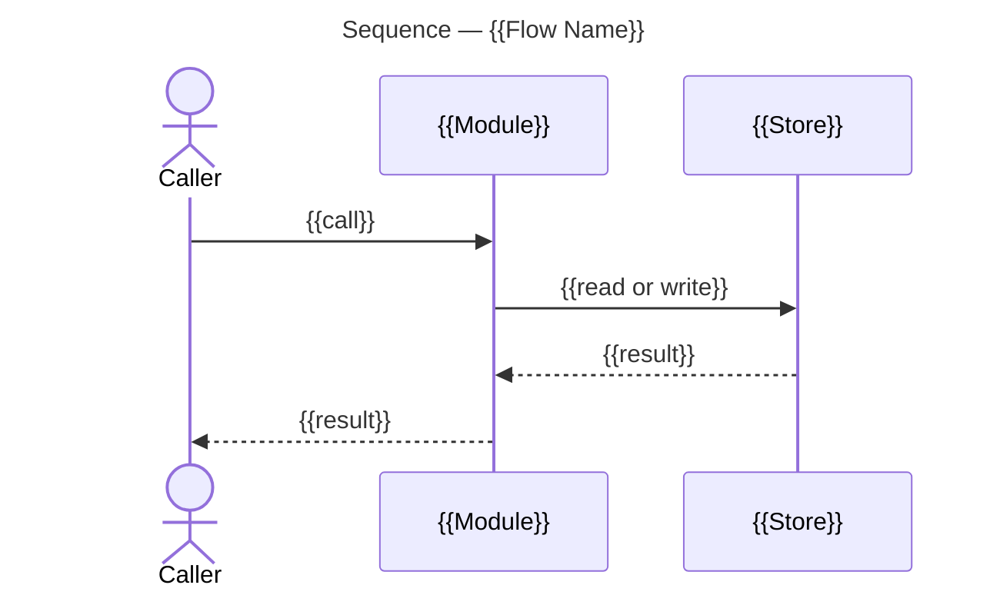

# Protocols

## Epic Closure

An epic whose delivery is recorded carried through review and integration of its bases to its closure, with its initiative's delivery recorded.

Follow the [Procedure](#procedure), adhering to [Rules](#rules) and [Conventions](#conventions).

### Procedure

#### 1. Open the Review

For each epic base the epic's [Delivery Findings](#delivery-findings) name as unmerged with no open pull request, follow [Review Pull Request](#review-pull-request) with the repository, that epic base, those findings, the actual task merges into it, the epic's issue, the confirmed repository setting and the current epic and task-merge records.

#### 2. Integrate Each Base

For each open epic pull request, follow [Epic Integration](#epic-integration) with the repository, initiative prefix and project checkout, the epic JSON, issue and body with its criterion ids and named instruments, the epic base, the review pull request number and the run's verification evidence.

- Add the verification evidence it returns to the run's, which starts as the criterion verification evidence the caller supplied.
- Keep a draft awaiting the user's ready mark, or a blocker, as pending.
- While any epic base remains unmerged, continue at [6. Return the Initiative's Findings](#6-return-the-initiatives-findings).

#### 3. Refresh the Records

Apply [Read Delivery Evidence](#read-delivery-evidence) with the repositories and initiative prefix, the epic's current JSON, authenticated access and destination snapshot files.

- Apply [Record Epic Delivery](#record-epic-delivery) with the epic JSON, the returned pull request records and complete issue-link snapshot, task issue records, confirmed matches, project checkout and output body file.
- Apply [Save Tracker Issue](#save-tracker-issue) with the returned body when it differs from the current one.

#### 4. Close the Epic

Follow [Issue Closure](#issue-closure) for the epic with the confirmed repository setting, the run's verification evidence and project checkout.

#### 5. Record the Initiative

Apply [Read Tracker Issue](#read-tracker-issue) for the initiative and every epic it links.

- Apply [Record Initiative Delivery](#record-initiative-delivery) with the initiative JSON, every linked epic's current JSON and an output body file.
- Apply [Save Tracker Issue](#save-tracker-issue) with the returned body when it differs from the current one.
- Apply [Record Verified Criteria](#record-verified-criteria) with the repository, the criteria its [Delivery Findings](#delivery-findings-1) name as ready to verify, the saved initiative JSON and body, those findings, delivery revisions, named instruments, project checkout, the run's verification evidence, output body file and every linked epic record.
- Add the verification evidence it returns to the run's.

#### 6. Return the Initiative's Findings

Every exit from this procedure, a blocker a followed protocol returns included, continues here.

- Apply [Read Tracker Issue](#read-tracker-issue) for the initiative and every epic it links.
- Apply [Record Initiative Delivery](#record-initiative-delivery) with the initiative JSON and every linked epic's current JSON, without an output body file.
- Return to the caller the epic's closure result when [4. Close the Epic](#4-close-the-epic) ran, the initiative's identity, its verified criteria, the run's verification evidence with the revision each was taken on, the initiative's current [Delivery Findings](#delivery-findings-1) Record Initiative Delivery returned, and each pending finding and blocker.

## Review Pull Request

The draft pull request and body that present one epic base's delivered changes for review.

Follow the [Procedure](#procedure-1), adhering to [Rules](#rules) and [Conventions](#conventions).

### Procedure

#### 1. Find

Use the review number in the supplied delivery findings.

- When it is absent:
  - Apply [Locate Review Pull Request](#locate-review-pull-request) with the repository and epic base as head.
  - Use its returned number or absence result.
- Fetch an existing review through [Read Pull Request State](#read-pull-request-state).

#### 2. Populate

Pass the existing body when present and the actual task merges into the base to [Populate Review Body](#populate-review-body).

#### 3. Publish

For an existing review, or a base whose [State](#state) calls for one, pass the returned file to [Publish Pull Request](#publish-pull-request).

- For an existing review, supply its number.
- For a new review, supply the epic kind, the epic base as head with the target [Other Pull Requests](#other-pull-requests) gives it, the epic's issue, the repository setting the caller confirmed and a link-snapshot destination.
- Return a discrepancy Publish Pull Request reports to the caller.
- When the base has no review and its State calls for none, return the absence result to the caller.

#### 4. Record

Apply [Record Epic Delivery](#record-epic-delivery) with the current epic and the task-merge records, including the review state Publish Pull Request returned.

- Return its updated body and [Delivery Findings](#delivery-findings) with the review identity to the caller.

## Epic Integration

One epic base merged into its long-lived branch, on current branch, epic and pull-request evidence.

Follow the [Procedure](#procedure-2), adhering to [Rules](#rules) and [Conventions](#conventions).

### Procedure

#### 1. Prepare the Review

- Apply [Confirm Repository Auto-Close](#confirm-repository-auto-close) for the repository.
- Follow [Review Pull Request](#review-pull-request) with the actual task merges, the epic's issue and that confirmed setting.
- Follow [Change Overview](#change-overview) with the repository, the project checkout and the review pull request number.
  - On a changed-head finding, follow it again with the same inputs.
- Read the pull request through [Read Pull Request State](#read-pull-request-state).
- When it is a draft, put the ready mark [State](#state) leaves to the user as an [interview](#rules), naming the epic standing in review on its board.
- Return a draft still awaiting that decision to the caller, open.

#### 2. Refresh the Evidence

- Apply [Update Epic Base](#update-epic-base) with the project checkout and the epic base.
  - Return a conflict or failure to the caller.
- Apply [Read Delivery Evidence](#read-delivery-evidence) with the repository, initiative prefix and current epic JSON.
- Apply [Record Verified Criteria](#record-verified-criteria) for the epic, with its criterion ids, current issue JSON and body, the delivery findings, pull request records and complete issue-link snapshot Read Delivery Evidence returned, the updated epic base as delivery revision, the named instruments, the project checkout, the verification evidence the caller supplied and any this protocol took, and an output body file.
  - Return the verification evidence it returns, with the revision each was taken on, to the caller with every result this protocol returns from here on.
- When Update Epic Base merged new content into the base:
  - Repeat Review Pull Request with the current task merges.
  - Repeat Change Overview with the repository, the project checkout and the same pull request number, which reads the updated head.

#### 3. Check Readiness

- Apply [Check Epic Readiness](#check-epic-readiness) with the current epic JSON, pull request records, complete issue-link snapshot and the verification evidence Record Verified Criteria returned.
- Apply [Fetch Merge Readiness](#fetch-merge-readiness) with the review pull request identity, delivery kind epic, the epic base, the long-lived branch [Epic Bases](#epic-bases) names for it as target, and output paths.
- Return to the caller each blocker the two report, leaving the pull request open.

#### 4. Merge or Hand Off

Pass the confirmed epic readiness, the verified head and target requirements Fetch Merge Readiness returned, the repository setting and the passing evidence to [Merge Delivery Pull Request](#merge-delivery-pull-request) with delivery kind epic, without asking for further confirmation.

- Return its handoff to the caller when a human reviewer must merge.
- On a refusal, repeat [2. Refresh the Evidence](#2-refresh-the-evidence) and [3. Check Readiness](#3-check-readiness) once with refreshed inputs, then this step. Return a second refusal to the caller.

#### 5. Confirm the Result

Apply [Read Pull Request State](#read-pull-request-state) for the merged pull request.

- Return its merged state, head, target and merge commit to the caller.

## Issue Closure

Fresh closure evidence assembled across an issue and its linked pull requests, and the closure it permits.

Follow the [Procedure](#procedure-3), adhering to [Rules](#rules) and [Conventions](#conventions).

### Procedure

#### 1. Issue

- Apply [Read Tracker Issue](#read-tracker-issue) for the issue selected by the delivery checks.
- Apply [Capture Issue Development](#capture-issue-development) for that issue.

#### 2. Pull Requests

Apply [Read Pull Request State](#read-pull-request-state) for every captured link, across repositories and all states.

#### 3. Check Delivery Completion

Apply [Check Issue Completion](#check-issue-completion) with the issue's kind, current JSON, complete Development snapshot, those pull request records and criterion verification evidence, adding the task's delivery result for a task and the project checkout for an epic.

- Return an incomplete or failed result to the caller before closure.

#### 4. Close

Apply [Close Tracker Issue](#close-tracker-issue) with the issue identity, the successful completion result, issue JSON, complete Development snapshot, confirmed repository setting and those pull request records.

- On a changed link set or missing evidence, repeat from [1. Issue](#1-issue) for the same issue.
- Report any unmerged link or unmet criterion.

## Change Overview

The published architecture overview, planning record and pull request link that explain one pull request's change.

Follow the [Procedure](#procedure-4), adhering to [Rules](#rules) and [Conventions](#conventions).

### Procedure

#### 1. Prepare the Evidence

Apply [Read Pull Request State](#read-pull-request-state) with the supplied repository and pull request number for its identity, title, base and head.

- Apply [Create Pull Request Worktree](#create-pull-request-worktree) with the repository, its checkout, the pull request number and that head.
- Return a changed-head finding to the caller.
- Apply [Measure Repository Change](#measure-repository-change) with the returned worktree, its head and the pull request's base.
- Return a freshness blocker to the caller before writing the overview.

#### 2. Locate the Record

Apply [Locate Planning Record](#locate-planning-record) with the pull request number.

- **Record found.**
  - Take the returned folder path and its record identity.
- **No record.**
  - Take a new overview record's identity and folder path, meeting [Layout](#layout), from the pull request's number and title.
- Apply [Populate Planning Record](#populate-planning-record) with that record identity and folder path.

#### 3. Write the Overview

Apply [Populate Architecture Overview](#populate-architecture-overview) with the measured structure and flows, the head from [1. Prepare the Evidence](#1-prepare-the-evidence), pinned code permalinks and an overview path in the record's folder.

#### 4. Register the Overview

Apply [Populate Planning Record](#populate-planning-record) with the record identity, folder path, the returned overview file and the pull request link, meeting [Artifacts](#artifacts-1), and a commit message file naming that folder, asking it to publish.

- Return a publication discrepancy to the caller.

#### 5. Link the Pull Request

Apply [Link Architecture Overview](#link-architecture-overview) with the current body, the published overview URL and an output body path.

- Apply [Publish Pull Request](#publish-pull-request) with the repository, pull request number and returned body file.
- Return the pull request, record folder, published overview, diagrams and References row to the caller.

# Rules

- **Decisions.**
  A question the user must decide is put as an interview, one question at a time. A decision the run's [allowance](#allowance) covers is taken with its recommended option rather than asked. Record each decision in the affected issues and, when there is one, the planning record.
  - A plain-language paragraph before the question gives the context the user needs to answer it.
  - The question offers more than one choice. The recommended choice is marked on its option.
  - Wait for the user's answer. An unanswered question stays pending. A recommendation or elapsed time supplies no answer.
  - The user can select Other and specify a response beyond the options.
  - Use the native tool for presenting the question when one is available.
- **Layers.**
  Modes, protocols, artifacts. A mode aggregates protocol calls, as an application calls services; a protocol applies artifact operations and follows other protocols; an artifact does neither. A call goes down the stack, never up. A mode reaches an artifact operation directly only where no protocol owns that change.
- **Execution.**
  A call passes its named inputs. A protocol is one change that lands in several artifacts together, and is followed whole. Follow another mode, a protocol or a named procedure subsection, and apply an artifact operation, only where the procedure calls for it; finish that call and return its result before continuing. Calls run in order. A step's `⇉` call runs in a sub-agent, and its `⫽` calls run in sub-agents together, as the bundle's Prosiform section states; those together never write to the same object.

# Conventions

- **Session.**
  Once per session, before the first `gh` call, unset `GH_TOKEN` and `GITHUB_TOKEN` so `gh` uses its keyring login. Where shell state does not persist between commands, confirm instead that neither is set in the shell profile.
- **Repository.**
  `gh` resolves `{owner}/{repo}` from the git remote of the directory it runs in, so run `gh` commands inside a checkout of the repository that holds the issues. `{other}` is a further repository the board's issues live in.
- **Bodies.**
  - Bodies, long comments and commit messages always go through a file (`-F body=@file`), never inline, which avoids quoting. The file holds the exact intended text.
  - Keep these files in a working directory outside the repository.
- **Helper invocation.**
  A helper is a script in `<workspace>`, the checkout holding this skill. It runs from `<workspace>`, or the directory within it that its command names, under the sandbox invoked by its absolute path, `<workspace>/scripts/sbx`. A file kept outside `<workspace>`, such as a body file, is passed by its absolute path.
- **Write confirmation.**
  Only a fresh re-read confirms a write: read the written object again and compare it with the intended state. The write's own output confirms nothing. A re-read that fails, or shows another state, leaves the write uncertain; that uncertainty returns to the caller, and the write is never retried as a different write.
- **Boards.**
  A project board sits under `users/{owner}`, or `orgs/{owner}` when `gh api repos/{owner}/{repo} --jq .owner.type` is `Organization`.
- **Example values.**  Substitute the real ones:
  - `936` an initiative issue, `943` and `937` its epics, `637` a task issue, `874` an orphan, `946` an initiative off the board, `960` a proposal;
  - `950` a pull request, `I07` and `I08` initiative numbers;
  - board `9` a theme board, and `419167630` its Status field id;
  - `1` the Initiative Template board, `13` a board copied from it;
  - `14` the Proposals Template, `15` the Proposals board;
  - `m2ux` the user.
  - `<checkout>` any checkout of the project, a linked worktree included.

# Artifacts

## Epic

### Operations

#### Inspect Epic Delivery

The delivery findings for one epic from supplied evidence.

**Inputs:** [Epic issue](#issue-record), [Pull request records](#pull-request-records), [Issue-link snapshot](#issue-link-snapshot)

**Outputs:** [Delivery findings](#delivery-findings)

##### 1. Match Epic Pull Requests

Run [Match Pull Requests](#match-pull-requests) with the epic JSON, pull request records as `--prs` and link snapshot as `--links`.

##### 2. Return the Inspected Delivery Findings

Return the [Delivery Findings](#delivery-findings); missing linked pull requests are missing evidence for the caller to supply.

#### Check Epic Readiness

The epic's eligibility for integration from current delivery and criterion evidence.

**Inputs:** [Epic issue](#issue-record), [Pull request records](#pull-request-records), [Issue-link snapshot](#issue-link-snapshot), [Criterion verification](#verification-evidence)

**Outputs:** [Integration readiness](#delivery-state)

##### 1. Inspect the Epic Delivery

Apply [Inspect Epic Delivery](#inspect-epic-delivery) with the supplied epic JSON, pull request records and complete issue-link snapshot.

##### 2. Confirm Epic Integration Conditions

Confirm every task is delivered, every epic criterion is verified and ticked, and no open question or unresolved delivery discrepancy remains. An unmerged epic base awaiting integration is expected at this stage. Missing or stale verification leaves readiness unconfirmed.

##### 3. Return the Epic Integration Readiness

Return the integration readiness in [Delivery State](#delivery-state), with the evidence revisions and each blocker. Readiness establishes the epic's content conditions; the caller supplies pull-request review, target and head-check evidence for the merge.

#### Check Epic Completion

The epic's normal delivery result before tracker closure.

**Inputs:** [Epic issue](#issue-record), [Pull request records](#pull-request-records), [Issue-link snapshot](#issue-link-snapshot), [Criterion verification](#verification-evidence), [Expected bases](#epic-bases), [Base merges](#state)

**Outputs:** [Completion result](#delivery-state)

##### 1. Check the Epic Readiness

Apply [Check Epic Readiness](#check-epic-readiness) with the current epic, pull request records, issue-link snapshot and criterion verification evidence.

##### 2. Reconcile Epic Bases with Task Targets

Reconcile the expected bases with the task delivery targets.

##### 3. Confirm Every Epic Base Merged

Confirm every base has merged into its corresponding long-lived branch. An unknown or incomplete base list, or missing merge evidence, leaves completion unconfirmed even when every task is delivered and every criterion is ticked.

##### 4. Return the Epic Completion Result

Return the completion result in [Delivery State](#delivery-state), identifying remaining blockers. Passing normal delivery checks supplies the caller's closure evidence; the tracker issue's current Development-link gate still governs the write.

### Fields

#### Task Matches

Task-to-pull-request pairs identifying the epic task id and delivering pull request, with each match marked confirmed or pending.

#### Delivery State

The epic is identified by its repository and issue number. Its state contains task delivery findings, criterion verification and ticks, open questions, expected delivery bases and their merges, and the revisions supporting the evidence. Integration readiness and completion are separate results, each with its unresolved conditions. An epic may be ready to integrate while one or more bases await merging.

#### Delivery Findings

| Line | What it names |
| --- | --- |
| Conflict | Tasks that share a pull request and do not name each other in Joins. A row linked to a pull request whose title names another epic. |
| Unmatched | A merged pull request that names the epic and that no row links. |
| In flight | An open pull request that names the epic and that no row links. A pull request whose head is an epic base is not a task match. |
| Draft | An epic base a merged task targets that has no pull request merging it, while a task is undelivered or a criterion is unticked. |
| Unmerged | An epic base its pull requests target that has not merged into its long-lived branch, once every task is delivered and every criterion is ticked. A draft pull request is named draft. |
| References | A review pull request whose cited pull requests differ from the task pull requests merged into its base. |
| Uncited | A linked pull request whose task has its own issue and does not link it, or a review pull request that does not link the epic's issue. |
| Note | A row that links its task issue. |
| Unplaced | A task issue of this epic whose id is not a row. |
| Open questions | The epic's Open Questions section remains. |
| Ready to verify | An unticked criterion whose delivering rows are all delivered. |
| Ticked early | A criterion ticked while a delivering row is not delivered. |
| Disagreement | A linked pull request's test plan against the Coverage of the rows it delivers. |

An unmet row links a merged pull request while a covered criterion remains unticked. A linked pull request naming another epic is a conflict and delivers its linked task once merged. A missing linked pull request leaves the supplied evidence incomplete.

A coverage disagreement identifies the pull request and row, a criterion absent from either the test plan or row Coverage, an empty Test cell, or prose assigning the criterion to another task. Recording links, verified criteria and Done continues despite that finding.

### Commands

#### Match Pull Requests

Reports an epic's delivery state against the pull requests that name it.

**Inputs:** Epic JSON, pull request records and complete issue-link snapshot.

- Results follow [Delivery Findings](#delivery-findings).

Runs as [Helper invocation](#conventions) states.

```bash
cd "<workspace>" && "<workspace>/scripts/sbx" python3 skills/work-planner/scripts/sync.py '<epic-json-file>' --prs '<pull-request-records-file>' --links '<issue-link-snapshot-file>'
```

**Example:**

```bash
cd "<workspace>" && "<workspace>/scripts/sbx" python3 skills/work-planner/scripts/sync.py issue-943.json --prs prs.json --links links.json
```

## Delivery Evidence

### Operations

#### Read Delivery Evidence

The pull requests and issue links that establish current delivery.

**Inputs:** [Repositories](#repository), [Initiative prefix](#titles), [Epic issues](#issue-record), [Records path](#pull-request-records), [Link snapshot path](#issue-link-snapshot)

**Outputs:** [Pull request records](#pull-request-records), [Issue-link snapshot](#issue-link-snapshot), [Delivery findings](#delivery-findings), [Unnamed deliveries](#unnamed-deliveries)

##### 1. Fetch Pull Requests and Links

Fetch the pull requests and their links.

- Apply [Read Initiative Pull Requests](#read-initiative-pull-requests).
- Apply [Fetch Pull Request Issue Links](#fetch-pull-request-issue-links).
- Use [Access Development Links](#access-development-links) for the actual complete link sets.

##### 2. Inspect the Epic Delivery

Apply [Inspect Epic Delivery](#inspect-epic-delivery) with the epic JSON, pull request records and complete issue-link snapshot.

- Route the returned [Delivery Findings](#delivery-findings) to matching, verification or user decisions.
- Fetch any linked pull request absent from the input with [Read Pull Request State](#read-pull-request-state).
- Repeat Inspect Epic Delivery with the same epic JSON, refreshed pull request records and complete issue-link snapshot.

##### 3. Name the Unnamed Deliveries

Name each pull request whose issue links reach an epic or one of its task issues and whose title omits that epic's reference as an [unnamed delivery](#unnamed-deliveries).

##### 4. Return the Delivery Evidence

Return the current pull request records, complete issue-link snapshot, per-epic findings and unnamed deliveries to the caller, reporting incomplete evidence as a blocker.

### Fields

#### Unnamed Deliveries

A pull request whose issue links reach an epic or its task issues while its title omits that epic's reference. Each is named with the epic it reaches, for the user to confirm.

## Epic Issue Body

### Operations

#### Record Epic Delivery

One epic body with supplied delivery matches and completed rows recorded.

**Inputs:** [Epic issue](#issue-record), [Pull request records](#pull-request-records), [Issue-link snapshot](#issue-link-snapshot), [Task issues](#issue-record), [Task matches](#task-matches), [Project checkout](#project-checkout), [Output body file](#body-file)

**Outputs:** [Epic body](#body-file), [Delivery findings](#delivery-findings)

##### 1. Run Sync Epic

Run [Sync Epic](#sync-epic), mapping pull requests to `--prs`, links to `--links`, task issues to `--tasks`, each confirmed match to `--link`, the checkout to `--project` and the output file to `--fix`.

- Omit `--tasks` when no row has its own task issue; otherwise supply each task issue's record.
- Row changes must meet [Task Delivery](#task-delivery) and [Work Breakdown](#work-breakdown).

##### 2. Return the Epic Delivery Findings

Return the updated body and [Delivery Findings](#delivery-findings) for the caller to resolve and publish. An unmerged epic base prevents a closable result.

#### Record Epic Criteria

Verified criteria and completed rows in one epic body.

**Inputs:** [Epic issue](#issue-record), [Pull request records](#pull-request-records), [Issue-link snapshot](#issue-link-snapshot), [Verified criteria](#acceptance-criteria), [Output body file](#body-file)

**Outputs:** [Epic body](#body-file), [Refused criteria](#unverified-criteria)

##### 1. Run Tick Epic Criteria

Run [Tick Epic Criteria](#tick-epic-criteria) with the epic JSON, records as `--prs`, snapshot as `--links`, verified ids as `--tick` and output as `--fix`. Refuse criteria not ready to verify.

##### 2. Return the Epic Body and Refused Criteria

Return the body and refused criteria. Complete rows receive Done ticks.

### Fields

#### Template

````markdown
## Overview

{{One paragraph: what this epic delivers and why it exists within the initiative.}}

## Problem

{{The friction as it is now. Bullets for distinct facets, sub-bullets for several items.}}

## Proposal

{{The design, in bullets or paragraphs, each opening with a bold statement, and its body on the next line.}}

## Work Breakdown

| Task | Description | Coverage | Depends on | Joins | Done |
| --- | --- | --- | --- | --- | --- |
| W01 | {{What the task delivers, at most eight words}} | AC{{n}}, AC{{m}} | {{Earlier task in this epic, [Exx:Wyy](…) or [Exx](…) in an earlier epic, or #issue}} | {{Tasks that can land in the same pull request}} | |

## Acceptance Criteria

- [ ] **AC1.** {{An end state of one invariant. It ends by naming its instrument.}}

## Open Questions

- {{An undecided point the epic cannot start without, with a recommendation in the planning record. Resolve every one before the first task starts, then delete the section.}}

## References

- **R1.** [Planning record]({{PLANNING_RECORD_URL}}) — {{What the reader finds there.}}
````

#### Work Breakdown

New tasks exist as epic rows with their details, discussion and evidence in the epic and planning record. Planning creates no separate task issues. Existing issues hoisted into an epic retain their records and row links when new tasks are planned.

The columns are `Task | Description | Coverage | Depends on | Joins | Done`.

- **Done.**
  A task row is complete when it is delivered, and every criterion its Coverage names is ticked.
- **Row id.**
  The row id is the task, `W01`. `W00` holds preparatory work that must land before the first real task.
- **Description.**
  Each detail beyond the phrase is a criterion stating one invariant.
- **Coverage.**
  Coverage names the epic's criteria the task must meet. Each row claims only criteria its work makes true; it cannot claim a criterion another row delivers alone or one its work cannot meet. A complete task's cell is empty.
- **Depends on.**
  A task row names the rows it depends on. An earlier task in the epic (`W03`, `W04–W09`), a row of an earlier epic (`[E01:W02](…)`), or something outside the initiative (`#750`, `[I05:E00:W02](…)`).
  - A task row names rows, never an epic. It names the row producing each output it consumes (`[E01:W01](…), [E01:W02](…)`), and where the task consumes from every row of an epic that is what establishes the whole-epic reach.
  - Cross-epic dependencies name rows before any issue of the epic is created. Both tables exist, and each edge names the row that produces what the dependent row consumes.
  - A dependency listed twice or already implied by another in the cell is unsound. A task that measures, extends or consumes another task's output depends on it, even when the prose does not say so.
- **Task grain.**
  - A task is one pull request's worth of work.
  - A criterion a merged pull request left unticked belongs to a further task. The further task depends on the delivered task, and its Coverage is that criterion. Criteria one pull request can deliver share one further task. The delivered task's Coverage omits each criterion a further task adopts.
  - A task delivering more than three criteria is split into tasks one pull request each can deliver.
  - A task covers at least one acceptance criterion. A criterion more than one row cites is imprecise: it is split into the invariant each task makes true, and each is cited from the row that delivers it.
  - Every test the work calls for accompanies that task. The content steers which kinds those are, including the project's system test when the work is something that test can exercise. A failure in any test the task carries keeps the task open. None of those tests is a later row.
  - Reusable routines, techniques, and resources are specced, created, and tested before an activity binds them. The grain of an existing resource is in that work.
  - When the behaviour a wired activity produces differs from the behaviour the work expected, that task changes the routine, technique, or resource, and the tests that cover the change, until fit, form, and function hold.
- **Joins.**
  The tasks that share one pull request. Each names the other, and neither depends on the other, directly or through a task outside the pair: the pull request holds their order.
  - Joins are complete before any issue of the epic is created. Every pair of tasks in the epic where neither depends on the other, directly or through another task, is accounted for.
  - A pair that shares a pull request names each other.
  - A pair that does not is named in the planning record, with why.
  - An empty cell is a task that shares no pull request, and only once that record names every such pair.
- **Numbering.**
  Task numbering meets [Numbering](#numbering); a row whose id links a pull request is fixed.
- **Reference form.**
  A table reference uses colons (`E01:W03`, `I05:E00:W02`), and every epic reference links to that epic's issue: `[E01:W03](…/issues/937)`. Prose uses a space (`E01 W03`).

#### Acceptance Criteria

An epic criterion meets the [shared acceptance criteria](#shared-acceptance-criteria). Contradictions between criteria in one epic are findings.

#### Task Delivery

- **Holds.**
  - A unit's record exists and its rows link it before its session starts.
  - A row another session holds is not dispatched.
  - A held row stays held while its session plans and implements. The pull request's link replaces the record's link, which frees the row.
- **Task ids.**
  - An unreserved task awaiting its pull request links its file in the planning record: `[W01](…/w01.md)`. The file name is the task id in lower case.
  - Every link on a task row names that row's id, and the row carries one delivery per long-lived branch its unit changes. A reserved task links only its planning folder: `[W01](…/2026-10-06-943-i07-e00-w01-queue-plan/)`. The folder's README links the work-item file. Releasing the reservation points the row to that file.
  - Once a pull request is open, its link replaces the planning link: `[W01](…/pull/950)`. A unit changing two long-lived branches links the pull request on each: `[W01](…/pull/950), [W01](…/pull/951)`. Further delivery work on one of those branches gets another task row under Task grain. Joined rows each link their shared pull request.
  - The task is delivered when a linked pull request has merged, or its id links a commit.
  - A link to an open pull request does not deliver the task.
  - A linked pull request whose title names another epic delivers the task once it has merged. The mismatch is reported, and the row stays open while a criterion its Coverage names is unticked.
- **Tasks with their own issue.**
  - A task issue belongs to one epic. Its title carries that epic's prefix.
  - When that epic's table has no row for its id, the issue is unplaced. Once the row exists, that epic's planning manages the issue.
  - The row links the pull request, not the issue.
  - The pull request's Development field links the issue as [Issue Links](#issue-links) state.
  - A completed task issue has all criteria verified and every Development-linked pull request merged.
- **Issues backing several tasks.**
  An issue backing several tasks, such as an investigation, is a reference: the epic cites it under References, no row id links it, and its title carries no agent-engineering prefix.
- **Work another issue takes.**
  It leaves the table. Its criteria go with it, or to another row that delivers them.

#### Body File

A local Markdown file at a given path holding one epic body that meets [Template](#template).

### Commands

#### Sync Epic

Links each named task's id to a pull request naming the epic, open or merged, and ticks Done on a row once it is complete.

**Inputs:** Epic JSON, pull request records, complete issue-link snapshot, task records, confirmed matches, project checkout and output body file.

- A row whose id links its task issue links the pull request instead.
- A pull request whose head is an epic base is the pull request that merges that base, and is not matched to a task.
- An unmerged epic base keeps the epic open, even when every row is delivered and every criterion is ticked.
- `--project` is a checkout of the project. Without the long-lived branch names, an epic that would otherwise be closable is not.
- `--link` names each task id and the pull request number it links. `--tasks` is the task issues. `--links` is the pull requests' Development-linked issues. `--fix` is the body written with the Done ticks.

`<task-pull-request-map>` is a comma-separated list of `<task-id>=<pull-request-number>` pairs. Pass each task JSON file as a separate argument after `--tasks`.

Runs as [Helper invocation](#conventions) states.

```bash
cd "<workspace>" && "<workspace>/scripts/sbx" python3 skills/work-planner/scripts/sync.py '<epic-json-file>' --prs '<pull-request-records-file>' --links '<issue-link-snapshot-file>' --tasks '<task-json-file>' --link '<task-pull-request-map>' --project '<checkout>' --fix '<output-body-file>'
```

**Example:**

```bash
cd "<workspace>" && "<workspace>/scripts/sbx" python3 skills/work-planner/scripts/sync.py issue-943.json --prs prs.json --links links.json --tasks issue-637.json --link W01=950,W02=950 --project '<checkout>' --fix fixed-943.md
```

#### Tick Epic Criteria

Ticks confirmed epic criteria, refusing any not ready to verify, and ticks completed rows.

**Inputs:** Current epic JSON, pull request and link snapshots, verified criterion ids and destination body file.

`<criterion-ids>` is a comma-separated list of verified criterion ids.

Runs as [Helper invocation](#conventions) states.

```bash
cd "<workspace>" && "<workspace>/scripts/sbx" python3 skills/work-planner/scripts/sync.py '<epic-json-file>' --prs '<pull-request-records-file>' --links '<issue-link-snapshot-file>' --tick '<criterion-ids>' --fix '<output-body-file>'
```

**Example:**

```bash
cd "<workspace>" && "<workspace>/scripts/sbx" python3 skills/work-planner/scripts/sync.py issue-943.json --prs prs.json --links links.json --tick AC1,AC3 --fix fixed-943.md
```

## Issue

### Operations

#### Read Tracker Issue

The current issue, its saved body and discussion.

**Inputs:** [Issue identity](#issue-identity), [Record path](#issue-record)

**Outputs:** [Issue record](#issue-record), [Issue comments](#issue-comment)

##### 1. Fetch the Tracker Issue

Run [Fetch Tracker Issue](#fetch-tracker-issue) for the complete JSON, or [Fetch Issue Body](#fetch-issue-body) for its body, with the issue number and destination file.

##### 2. Fetch the Issue Comments

Run [Fetch Issue Comments](#fetch-issue-comments) when the request depends on the discussion.

#### Save Tracker Issue

One populated body and its metadata, written to the tracker.

**Inputs:** [Issue identity](#issue-identity), [Issue content](#issue-content), [Label definitions](#label-identity), [Comment](#issue-comment)

**Outputs:** [Saved issue](#issue-record)

##### 1. Take the Issue Body and Metadata

Take the supplied body and metadata, preserving each field the caller does not change for an existing issue.

##### 2. Ensure the Issue Labels

Apply [Ensure Repository Labels](#ensure-repository-labels) with every label the save assigns and its colour and description.

- Return an unknown label definition to the caller before any write.

##### 3. Create New Issue

For a new issue, run [Create Tracker Issue](#create-tracker-issue) with the body's file, title and labels.

##### 4. Update the Existing Issue

For an existing issue, run [Patch Issue Body](#patch-issue-body), [Retitle Tracker Issue](#retitle-tracker-issue), [Add Issue Labels](#add-issue-labels) or [Remove Issue Label](#remove-issue-label) for the fields being changed.

##### 5. Comment on the Saved Issue

Apply [Comment on Issue](#comment-on-issue) for an answer or a preserved body the caller requires, with the issue number and comment file.

##### 6. Re-Read the Saved Issue

Re-read with [Fetch Tracker Issue](#fetch-tracker-issue), as [Write confirmation](#conventions) states.

##### 7. Compare the Saved Issue Fields

Compare the saved fields with the intended body and metadata.

#### Check Issue Completion

The normal delivery result of one task, epic or initiative before tracker closure.

**Inputs:** [Issue record](#issue-record), [Development snapshot](#development-snapshot), [Linked pull request records](#linked-pull-request-records), [Verification evidence](#verification-evidence), [Task delivery result](#task-delivery-result), [Project checkout](#project-checkout)

**Outputs:** [Completion result](#completion-result)

##### 1. Select the Completion Check

Select the check by the issue's kind:

- **Task.**
  - Retain the task delivery result its delivering pull request established.
- **Epic.**
  - Apply [Read Delivery Branches](#read-delivery-branches) with the project checkout and epic identity for the complete expected bases.
  - Apply [Read Pull Request State](#read-pull-request-state) for each base's merge evidence.
  - Apply [Check Epic Completion](#check-epic-completion) with the current epic JSON, linked pull request records, complete issue-link snapshot, criterion verification evidence and those base records.
- **Initiative.**
  - Apply [Read Tracker Issue](#read-tracker-issue) for every linked epic.
  - Apply [Check Initiative Completion](#check-initiative-completion) with the current initiative JSON, all linked epic records, criterion verification evidence and the Development snapshot and linked pull request records.

##### 2. Return the Completion Result

Return the completion result; an incomplete or failed result is a blocker to closure.

#### Close Tracker Issue

Verified completion of an issue and its linked delivery.

**Inputs:** [Issue identity](#issue-identity), [Completion result](#completion-result), [Issue record](#issue-record), [Development snapshot](#development-snapshot), [Auto-close setting](#auto-close-setting), [Linked pull request records](#linked-pull-request-records)

**Outputs:** [Closed issue](#issue-state)

##### 1. Capture the Issue Development

Apply [Capture Issue Development](#capture-issue-development) for the issue's complete links and confirmed repository setting.

##### 2. Take Fresh Pull Request Records

Take the caller's fresh records for every linked pull request, across repositories and states; return missing evidence to the caller.

- Return a repository setting that is unconfirmed or fails [Auto-Close Setting](#auto-close-setting) to the caller as a blocker.
- Take the records only from a fresh destination file, so an earlier snapshot cannot supply membership.
- Use the issue's entire Development field to establish membership. Titles, branch names, body mentions and a list filtered to one initiative do not establish completeness. An explicitly empty field adds no pull request requirement.

##### 3. Run the Closure Check

Run [Check Issue Closure](#check-issue-closure) with `--issue`, `--development`, and `--prs` for those fresh records.

##### 4. Require the Closure Gate

Require the supplied completion result to be complete, normal delivery checks to pass, every criterion to be verified and ticked, and every currently linked pull request to be merged.

- Keep the issue open for an open, draft, closed without merge, or unreadable linked pull request.
- Obtain the user's decision before removing an abandoned or incorrect Development link. A replacement pull request does not remove the requirement on a link still present.

##### 5. Close the Issue as Completed

Apply [Close as Completed](#close-as-completed), which repeats the gate immediately before the write. A changed link set requires another capture and check.

#### Comment on Issue

The supplied discussion text saved on one issue.

**Inputs:** [Issue identity](#issue-identity), [Comment](#issue-comment), [Review feedback](#review-feedback)

**Outputs:** [Saved comment](#issue-comment)

##### 1. Compose the Feedback Reply

When replying to feedback already folded into the body, compose a precise, factual reply addressing each point and mentioning the reviewer, with no thanks or filler. Name what the body now says, by criterion id where one carries it, or the issue that takes the point.

##### 2. Publish the Issue Comment

Publish the supplied comment:

- For a one-line comment, run [Post Inline Comment](#post-inline-comment) with the exact text.
- For a longer comment, run [Post Comment File](#post-comment-file) with the complete file.

##### 3. Return the Comment URL

Return the saved comment URL.

#### Close as Completed

An issue closed after its final evidence check.

**Inputs:** [Issue identity](#issue-identity), [Auto-close setting](#auto-close-setting), [Completion result](#completion-result), [Issue record](#issue-record), [Development snapshot](#development-snapshot), [Linked pull request records](#linked-pull-request-records)

**Outputs:** [Completed issue](#issue-state)

##### 1. Capture Development Before Closure

Require absolute paths for the issue, Development and linked pull request evidence files.
Apply [Capture Issue Development](#capture-issue-development) immediately before closure with the issue identity, authenticated access, confirmed repository setting and evidence paths.

##### 2. Compare the Development Links

Compare its links with the supplied fresh pull request records; return a changed link set or missing evidence to the caller for refresh.

##### 3. Run the Completion Gate

Run [Check Issue Closure](#check-issue-closure) with the current issue, Development and linked pull request files, using absolute evidence paths when changing directory.

##### 4. Require the Completion Gate to Pass

Require exit 0 and passing normal delivery checks; a sync report of closable does not permit skipping this gate.

##### 5. Set the Completed State

Immediately after the gate passes, run [Set Completed State](#set-completed-state) with the issue's repository and number and the passing evidence.

##### 6. Return the Completed State

Return the saved state or failure.

#### Capture Issue Development

The issue's current content and complete Development snapshot.

**Inputs:** [Issue identity](#issue-identity), [Auto-close setting](#auto-close-setting), [Record path](#issue-record), [Snapshot path](#development-snapshot)

**Outputs:** [Development snapshot](#development-snapshot), [Issue record](#issue-record)

##### 1. Read the Development Field

Apply [Read Issue Development](#read-issue-development) for the entire field across repositories and states. An inaccessible field returns incomplete evidence; an empty array means the field was checked and empty.

##### 2. Write the Development Snapshot

Run [Write Development Snapshot](#write-development-snapshot) with the issue identity, observed link set, completeness result and repository setting, saving `development-943.json` or the supplied path.

- Set `complete` true only after the full read, and `auto_close_issues` false only after the repository setting is confirmed disabled.

##### 3. Fetch the Issue Snapshot

Run [Fetch Tracker Issue](#fetch-tracker-issue) into `issue-943.json` or the supplied path.

##### 4. Return the Development Files

Return both files and any incomplete evidence. The caller supplies fresh linked pull request records in `development-prs-943.json`.

#### Read Issue Development

The Development links observed for one issue through authenticated GitHub.

**Inputs:** [Issue identity](#issue-identity)

**Outputs:** [Observed links](#observed-development-links)

##### 1. Read Every Development Link

Read every page and state, across repositories, recording each linked pull request's identity.

##### 2. Return the Observed Development Links

Return the observed links and whether the entire field was readable.

#### Confirm Repository Auto-Close

Whether the repository auto-closes issues whose linked pull requests merge, established for this session.

**Inputs:** [Repository](#tracker-repository)

**Outputs:** [Auto-close setting](#auto-close-setting)

##### 1. Read the Auto-Close Setting

Read the setting where the authenticated API exposes it, and take a read value as the answer.

##### 2. Ask the User for Auto-Close

Where no API field carries it, put the setting to the user and take their explicit answer, meeting [Auto-Close Setting](#auto-close-setting).

##### 3. Return the Confirmed Auto-Close Setting

Return the confirmed value. An unconfirmed setting is a blocker, and an enabled one leaves the caller to obtain authorization before the repository is reconfigured.

### Fields

#### Observed Development Links

Every linked pull request URL in an issue's Development field, across repositories and states, and whether the entire field was readable.

#### Tracker Repository

The repository whose tracker holds the issues: its owner and name, written `<owner>/<repo>`.

#### Issue Identity

One issue's [repository](#tracker-repository), number and URL. An issue yet to be created has its repository alone. An unresolved identity names the repository and the title prefix that matched no issue.

#### Issue Content

An issue's title, body and labels. The title meets [Titles](#titles-2), the body is a [body file](#body-file-3), and each label is a [repository label](#label-identity). The saved title, body and labels equal the supplied values.

#### Issue Record

One issue as the tracker returns it, saved as JSON at a local path: its [identity](#issue-identity), [content](#issue-content), [state](#issue-state) and kind, which its [tracker prefix](#tracker-prefix) and [kind label](#kind-labels) give. A body-only record is the issue's body alone, saved as markdown.

#### Issue Comment

One comment on an issue: its exact text, as one line or a complete local file, and once saved its URL. An issue's discussion is its comments in order. A saved comment preserves the supplied text.

#### Issue State

The issue is open, or closed with its reason: completed or not planned. Completed work satisfies its criteria and delivery checks; transferred work, closed as not planned, identifies the issue tracking it.

#### Tracker Prefix

The bracketed prefix a planned issue's title opens with: for each level, its kind's prefix letter and a two-digit number, levels separated by colons, as `[I07]`, `[I07:E00]` and `[I07:E00:W01]`. A tracker number is the two-digit number of one level.

#### Development Snapshot

One issue's Development field as observed, saved as JSON at a local path: the issue's repository and number, whether the whole field was read, the repository's [auto-close setting](#auto-close-setting) as confirmed or `null` when unknown, and every linked pull request URL across repositories and states. An empty list in a complete snapshot means the field holds no link; an incomplete snapshot is incomplete evidence.

#### Linked Pull Request Records

A fresh record of every pull request a [Development snapshot](#development-snapshot) names, across repositories and states, saved as JSON lines at a local path, each with its [state](#state) and merge result.

#### Completion Result

The normal delivery result of one task, epic or initiative: complete, or incomplete with each unmet condition. A task's comes from its [task delivery result](#task-delivery-result), an epic's from its [delivery state](#delivery-state), and an initiative's from its [delivery state](#delivery-state-1).

#### Review Feedback

The reviewer's login and each point they raised in an issue's discussion.

#### Auto-Close Setting

GitHub's **Auto-close issues with merged linked pull requests** repository setting, which must be disabled before a delivery pull request is linked or merged, so that closure follows the criteria rather than the merge.

- The setting is confirmed per repository and holds for the session; it is not inferred from an issue that stayed open.
- No REST field and no GraphQL field of `gh` 2.46 carries it, so on such a host the user's explicit answer is the only source.
- An enabled setting closes issues on merge whatever their criteria. Where it cannot be disabled, each affected issue's state is read after every merge and reopened where its criteria are unmet.

### Commands

#### Create Tracker Issue

Creates an issue from a body file, with its title and labels, and prints its number.

**Inputs:** Repository, populated body file, title and existing label names.

Repeat `-f 'labels[]=<label>'` for each supplied label.

```bash
gh api --method POST 'repos/<owner>/<repo>/issues' -f title='<title>' -F 'body=@<body-file>' -f 'labels[]=<label>' --jq .number
```

**Example:**

```bash
gh api --method POST 'repos/<owner>/<repo>/issues' -f title='<title>' -F body=@body.md -f 'labels[]=<label>' --jq .number
```

#### Patch Issue Body

Replaces an issue's body from a file.

**Inputs:** Repository, issue number and complete populated body file.

```bash
gh api --method PATCH 'repos/<owner>/<repo>/issues/<issue-number>' -F 'body=@<body-file>' --jq .number
```

**Example:**

```bash
gh api --method PATCH 'repos/<owner>/<repo>/issues/943' -F body=@body.md --jq .number
```

#### Fetch Issue Body

Saves an issue's body alone.

**Inputs:** Repository, issue number and destination file.

```bash
gh api 'repos/<owner>/<repo>/issues/<issue-number>' --jq .body > '<output-body-file>'
```

**Example:**

```bash
gh api 'repos/<owner>/<repo>/issues/943' --jq .body > live-943.md
```

#### Retitle Tracker Issue

Replaces an issue's title.

**Inputs:** Repository, issue number and complete title.

```bash
gh api --method PATCH 'repos/<owner>/<repo>/issues/<issue-number>' -f title='<title>' --jq .title
```

**Example:**

```bash
gh api --method PATCH 'repos/<owner>/<repo>/issues/943' -f title='<title>' --jq .title
```

#### Add Issue Labels

Adds labels to an issue.

**Inputs:** Repository, issue number and existing label names.

Repeat `-f 'labels[]=<label>'` for each supplied label.

```bash
gh api --method POST 'repos/<owner>/<repo>/issues/<issue-number>/labels' -f 'labels[]=<label>' --jq '.[].name'
```

**Example:**

```bash
gh api --method POST 'repos/<owner>/<repo>/issues/943/labels' -f 'labels[]=<label>' --jq '.[].name'
```

#### Remove Issue Label

Removes one label from an issue.

**Inputs:** Repository, issue number and label name.

```bash
gh api --method DELETE 'repos/<owner>/<repo>/issues/<issue-number>/labels/<label>' --jq '.[].name'
```

**Example:**

```bash
gh api --method DELETE 'repos/<owner>/<repo>/issues/943/labels/<label>' --jq '.[].name'
```

#### Fetch Issue Comments

Prints an issue's comments.

**Inputs:** Repository and issue number.

```bash
gh api --paginate 'repos/<owner>/<repo>/issues/<issue-number>/comments'
```

**Example:**

```bash
gh api --paginate 'repos/<owner>/<repo>/issues/874/comments'
```

#### Fetch Tracker Issue

Saves an issue whole, as JSON, for the scripts that read issues.

**Inputs:** Repository, issue number and destination JSON file.

```bash
gh api 'repos/<owner>/<repo>/issues/<issue-number>' > '<issue-json-file>'
```

**Example:**

```bash
gh api 'repos/<owner>/<repo>/issues/943' > issue-943.json
```

#### Check Issue Closure

Checks the issue criteria, the complete link snapshot and every linked pull request.

**Inputs:** Current issue JSON, complete Development snapshot and fresh linked pull request records.

- `--issue`, `--development`, and `--prs` are the fresh issue JSON, Development snapshot, and linked pull request records.
- Exit 0 means the closure gate passes; normal delivery checks must also pass. Exit 1 reports blockers. The command performs no network calls or writes.

Runs as [Helper invocation](#conventions) states.

```bash
cd "<workspace>" && "<workspace>/scripts/sbx" python3 skills/work-planner/scripts/closure.py --issue '<issue-json-file>' --development '<development-snapshot-file>' --prs '<linked-pull-request-records-file>'
```

**Example:**

```bash
cd "<workspace>" && "<workspace>/scripts/sbx" python3 skills/work-planner/scripts/closure.py --issue issue-943.json --development development-943.json --prs development-prs-943.json
```

#### Post Inline Comment

Posts one line of exact comment text and returns its URL.

**Inputs:** Repository, issue number and one-line comment text.

```bash
gh api --method POST 'repos/<owner>/<repo>/issues/<issue-number>/comments' -f body='<comment-text>' --jq .html_url
```

**Example:**

```bash
gh api --method POST 'repos/<owner>/<repo>/issues/637/comments' -f body='Delivered by #950.' --jq .html_url
```

#### Post Comment File

Posts a complete comment file and returns its URL.

**Inputs:** Repository, issue number and exact comment file.

```bash
gh api --method POST 'repos/<owner>/<repo>/issues/<issue-number>/comments' -F 'body=@<comment-file>' --jq .html_url
```

**Example:**

```bash
gh api --method POST 'repos/<owner>/<repo>/issues/874/comments' -F body=@comment-874.md --jq .html_url
```

#### Set Completed State

Sets an issue to closed with the completed reason and returns its state.

**Inputs:** Repository, issue number, passing normal delivery checks and an immediately preceding successful closure gate on current evidence.

```bash
gh api --method PATCH 'repos/<owner>/<repo>/issues/<issue-number>' -f state=closed -f state_reason=completed --jq .state
```

**Example:**

```bash
gh api --method PATCH 'repos/<owner>/<repo>/issues/943' -f state=closed -f state_reason=completed --jq .state
```

#### Write Development Snapshot

Saves an observed Development field and repository setting as JSON.

**Inputs:** Repository and issue number, observed links, completeness result, confirmed or unknown auto-closing setting and destination file.

Write the supplied values in this shape. Substitute the issue number as a JSON integer, completeness as a boolean, and the auto-closing setting as a boolean or `null` when unknown. Supply every observed pull request URL, or an empty array when there are none. Preserve incomplete evidence as incomplete.

```text
{
  "repo": "<owner>/<repo>",
  "number": <issue-number>,
  "complete": <complete>,
  "auto_close_issues": <auto-close-issues>,
  "pull_requests": ["<pull-request-url>"]
}
```

**Example payload:**

```json
{
  "repo": "owner/repo",
  "number": 943,
  "complete": true,
  "auto_close_issues": false,
  "pull_requests": ["https://github.com/owner/repo/pull/980"]
}
```

## Initiative Issue Body

### Operations

#### Record Initiative Delivery

One initiative body with its epic delivery recorded.

**Inputs:** [Initiative issue](#issue-record), [Epic issues](#issue-record), [Output body file](#body-file-1)

**Outputs:** [Initiative body](#body-file-1), [Delivery findings](#delivery-findings-1)

##### 1. Run Sync Initiative

Run [Sync Initiative](#sync-initiative) with the initiative and every linked epic's current record as `--epics`, supplying `--fix` when an output body is requested.

##### 2. Return the Initiative Delivery Findings

Return the body and [Delivery Findings](#delivery-findings-1) from the supplied initiative and epic records. Delivery eligibility follows [Delivery State](#delivery-state-1).

#### Record Initiative Criteria

Verified criteria and completed rows in one initiative body.

**Inputs:** [Initiative issue](#issue-record), [Epic issues](#issue-record), [Verified criteria](#initiative-acceptance-criteria), [Output body file](#body-file-1)

**Outputs:** [Initiative body](#body-file-1), [Refused criteria](#unverified-criteria)

##### 1. Run Tick Initiative Criteria

Run [Tick Initiative Criteria](#tick-initiative-criteria) with the initiative, linked epics as `--epics`, verified ids as `--tick` and output as `--fix`. Refuse criteria not ready to verify.

##### 2. Return the Initiative Body and Refused Criteria

Return the body and refused criteria. Complete rows receive Done ticks.

### Fields

#### Body File

A local Markdown file at a given path holding one initiative body that meets [Template](#template-1).

#### Template

````markdown
## Overview

{{One paragraph: what the initiative achieves, stated as the end state. Name the goal the reviews will test against.}}

## Problem

{{One sentence on the friction, then one bullet per facet. Each bullet opens with a bold statement, and its body is on the next line.}}

- **{{Facet}}.**
  {{The evidence.}}

## Proposal

- **{{Move}}.**
  {{What is done, within two lines.}}

## Work Breakdown

| Epic | Description | Coverage | Depends on | Done |
| --- | --- | --- | --- | --- |
| [E00](https://github.com/{{OWNER}}/{{REPO}}/issues/{{EPIC_ISSUE}}) | {{The epic's title name, the part before the colon}} | AC{{n}}, AC{{m}} | {{Earlier epic}} | |

## Acceptance Criteria

- [ ] **AC1.** {{One invariant. It is specific, measurable, achievable, relevant, and time-bound. It carries no stale count. It names no initiative, epic, task, or issue. It states what the initiative achieves as a whole, and it ends by naming its instrument.}}

## Non-Goals

- {{One succinct sentence on what this initiative does not do. It names no initiative, epic, task or issue, and no owner.}}

## References

- **R1.** [{{Title}}]({{URL}}) — {{What the reader finds there.}}
- **R2.** **Source.** [{{Title}}]({{URL}}) — {{The requirements this initiative's criteria answer to.}}
````

#### Titles

- The title is `[I07] Name: Subtitle`.
- Labels are the initiative [kind label](#kind-labels) and one [theme label](#theme-labels).
- `I` is the initiative number. Initiatives count from `00`.

#### Initiative Acceptance Criteria

An initiative criterion meets the [shared acceptance criteria](#shared-acceptance-criteria) and [Requirement Characteristics](#requirement-characteristics), and:

- **No counts.**
  An initiative criterion carries no counts or figures, which go stale: it measures against a named baseline or check ("against the baseline", "as the budget test measures it"). A figure stays only where it is the criterion's own target, such as a bound it holds to.
- **SMART.**
  Each initiative criterion is specific about what holds, measurable by a named check or baseline, achievable by the epics that cite it, and relevant, tracing to a clause and to the Problem. It is time-bound by a release tag or another named milestone outside the initiative's own work, where one exists, and otherwise by the epics that cite it.
- **Local.**
  An initiative criterion names no initiative, epic, task or issue, and is solution-agnostic. Coverage cells link epics to criteria. One that holds only through another initiative's work is restated as what this initiative achieves, or it is dropped.
- **Whole.**
  An initiative criterion states what the initiative achieves as a whole. One that restates a single epic's criterion is a duplicate: it is raised to what the epics achieve together, or left to the epic.
- **Verified.**
  - An initiative criterion ends by naming its instrument. Which instruments keep a criterion is [Verifiable](#verifiable).
  - An automated test is an end-to-end walk through the real server, a smoke run of an agent against a live server, a live check on a deployed host, or a guard, fixture suite or check that continuous integration runs. The walk, smoke run or live check is preferred where the criterion is about what a run does.
  - A named test that does not exist yet is work the plan holds: a task in the epic whose subject it tests, or a discrete test-infrastructure epic when the tests serve several criteria. That epic's row cites the criteria its tests verify.

### Commands

#### Sync Initiative

Reports an initiative's delivery state against its epics, and ticks Done on an epic row whose issue is closed as completed.

**Inputs:** Initiative JSON, every linked epic record and optional output body file.

- It takes every linked epic's current JSON. Delivery findings follow [Delivery State](#delivery-state-1).

Pass every epic JSON file as a separate argument after `--epics`.

Runs as [Helper invocation](#conventions) states.

```bash
cd "<workspace>" && "<workspace>/scripts/sbx" python3 skills/work-planner/scripts/sync.py '<initiative-json-file>' --epics '<epic-json-file>'
```

**Example:**

```bash
cd "<workspace>" && "<workspace>/scripts/sbx" python3 skills/work-planner/scripts/sync.py issue-936.json --epics issue-943.json issue-937.json
```

#### Tick Initiative Criteria

Ticks confirmed initiative criteria, refusing any not ready to verify, and ticks completed rows.

**Inputs:** Current initiative JSON, every linked epic JSON, verified criterion ids and destination body file.

Pass every epic JSON file as a separate argument after `--epics`. `<criterion-ids>` is a comma-separated list of verified criterion ids.

Runs as [Helper invocation](#conventions) states.

```bash
cd "<workspace>" && "<workspace>/scripts/sbx" python3 skills/work-planner/scripts/sync.py '<initiative-json-file>' --epics '<epic-json-file>' --tick '<criterion-ids>' --fix '<output-body-file>'
```

**Example:**

```bash
cd "<workspace>" && "<workspace>/scripts/sbx" python3 skills/work-planner/scripts/sync.py issue-936.json --epics issue-943.json issue-937.json --tick AC2 --fix fixed-936.md
```

## Acceptance Criteria

### Operations

#### Verify Selected Criteria

The verification evidence for a supplied set of criteria whose delivery is ready.

**Inputs:** [Criterion ids](#criterion), [Current body](#body-file-3), [Epic delivery findings](#delivery-findings), [Initiative delivery findings](#delivery-findings-1), [Delivery revisions](#revision), [Instruments](#instrument), [Project checkout](#instrument-checkout), [Verification evidence](#verification-evidence)

**Outputs:** [Verification evidence](#verification-evidence), [Verified criterion ids](#criterion), [Unverified criteria](#unverified-criteria)

##### 1. Confirm Criterion Readiness

Confirm the supplied delivery findings establish [Readiness](#readiness) for each selected criterion.

- Return an undelivered or unreadable dependency as a blocker for that criterion.

##### 2. Check Out the Delivered Branches

Check out each branch the delivering pull requests merged into, in the supplied project checkout, meeting [Instrument Checkout](#instrument-checkout).

- Keep the supplied evidence of each criterion taken on the revision now checked out, meeting [Verification Evidence](#verification-evidence).
- Run the named instrument of each other criterion there.
- Record the result against the tested revisions, meeting [Instrument Result](#instrument-result).

##### 3. Return the Criteria Verification Evidence

Return the verification evidence of each selected criterion, kept or taken, the verified criterion ids, and each unresolved criterion with what is missing.

- Leave body publication and further planning to the caller.

#### Tick Verified Criteria

The confirmed criteria and completed rows recorded in an epic or initiative body.

**Inputs:** [Issue record](#issue-record), [Verified criterion ids](#criterion), [Output body path](#body-file-3), [Pull request records](#pull-request-records), [Issue-link snapshot](#issue-link-snapshot), [Linked epic records](#issue-record)

**Outputs:** [Ticked body](#body-file-3), [Refused criteria](#unverified-criteria)

##### 1. Record the Criterion Ticks

Record the criteria, meeting [Tick State](#tick-state).

- For an epic, apply [Record Epic Criteria](#record-epic-criteria) with the issue JSON, pull request records, complete issue-link snapshot, verified criterion ids and output body file.
- For an initiative, apply [Record Initiative Criteria](#record-initiative-criteria) with the issue JSON, every linked epic record, verified criterion ids and output body file.

##### 2. Return the Ticked Body

Return the resulting body and any criteria refused as not ready to verify. The artifact operations return the updated bodies for publication.

#### Record Verified Criteria

The verified criteria of one epic or initiative, ticked and saved to its issue.

**Inputs:** [Issue record](#issue-record), [Criterion ids](#criterion), [Epic delivery findings](#delivery-findings), [Initiative delivery findings](#delivery-findings-1), [Delivery revisions](#revision), [Instruments](#instrument), [Project checkout](#instrument-checkout), [Verification evidence](#verification-evidence), [Output body path](#body-file-3), [Pull request records](#pull-request-records), [Issue-link snapshot](#issue-link-snapshot), [Linked epic records](#issue-record)

**Outputs:** [Saved issue](#issue-record), [Verified criterion ids](#criterion), [Verification evidence](#verification-evidence), [Unverified criteria](#unverified-criteria)

##### 1. Verify the Selected Criteria

Apply [Verify Selected Criteria](#verify-selected-criteria) with the criterion ids, current issue body, delivery findings, delivery revisions, named instruments, project checkout and the run's verification evidence.

- When it returns no verified id, continue at [4. Return the Recorded Verification](#4-return-the-recorded-verification).

##### 2. Tick the Verified Criteria

Pass only its returned verified ids to [Tick Verified Criteria](#tick-verified-criteria) with the issue JSON and output body file, and the pull request records with the complete issue-link snapshot for an epic or every linked epic record for an initiative.

##### 3. Save the Ticked Issue Body

When the returned body differs from the current issue body, apply [Save Tracker Issue](#save-tracker-issue) with the repository, issue number and output body file.

##### 4. Return the Recorded Verification

Return the verified ids, the verification evidence Verify Selected Criteria returned, the ids refused as not ready to verify, and each unverified criterion with what it is missing. A refused or unverified criterion stays unticked.

### Fields

#### Criterion

The id of one acceptance criterion in the issue body that states it, as `AC2`. A set of criteria is a list of those ids.

#### Instrument

The command, test or check the criterion names as the thing that observes it.

#### Revision

The branch and commit the instrument ran against, which is the branch the delivering pull requests merged into.

#### Readiness

A criterion is ready to verify when the supplied delivery findings show the work its evidence depends on delivered and readable. An undelivered or unreadable dependency leaves it unready.

#### Instrument Checkout

An instrument runs in a checkout of the project at the merged revision it is verifying, which the caller supplies. A checkout the caller is editing is not that revision, so a criterion verified against uncommitted work is unverified.

#### Instrument Result

A criterion is verified only on a passing run of its named instrument, recorded against the tested revisions as [Coverage Reports](#coverage-reports) define. A failed, unavailable or inconclusive instrument leaves it unverified, and an unverified criterion is not ticked.

#### Verification Evidence

One criterion's instrument result, passing or failing, with the issue that states the criterion and the revision it was taken on. Within one run, evidence stands for its criterion on its revision: the criterion's instrument runs at most once on each revision, and a later verification on that revision keeps the earlier evidence.

#### Tick State

A ticked criterion carries verification evidence. Done on the row or table that cites it follows [Tables](#tables) and [Work Breakdown](#work-breakdown). A criterion refused as not ready to verify is returned unticked with what it is missing.

#### Unverified Criteria

Each criterion left unticked, refused as not ready to verify or unverified, with what it is missing.

## Initiative

### Operations

#### Check Initiative Completion

The initiative's normal delivery result before tracker closure.

**Inputs:** [Initiative issue](#issue-record), [Epic issues](#issue-record), [Criterion verification](#verification-evidence), [Issue-link snapshot](#issue-link-snapshot), [Pull request records](#pull-request-records)

**Outputs:** [Completion result](#delivery-state-1)

##### 1. Evaluate Initiative Delivery Evidence

Evaluate the current initiative, every linked epic's current record, the criterion verification, and the current Development links and linked pull request records against [Delivery State](#delivery-state-1).

##### 2. Identify Initiative Completion Blockers

Identify each missing, open or cancelled epic, each unverified or unticked criterion, and each unmerged or unreadable Development-linked pull request. Incomplete link evidence leaves completion unconfirmed.

##### 3. Return the Initiative Completion Result

Return the completion result and its supporting issue identities, evidence revisions and blockers. Passing normal delivery checks supplies the caller's closure evidence; the tracker issue's current Development-link gate still governs the write.

### Fields

#### Delivery State

The state records every linked epic's completion, each initiative criterion's verification and tick, and the complete Development-linked pull request set and merge states. Each finding retains its source identity and evidence revision.

An epic is delivered when its issue is closed as completed. A missing, open or cancelled epic remains undelivered, including when all initiative criteria are ticked. Criterion readiness and premature ticks are [Delivery Findings](#delivery-findings-1); delivery alone does not verify a criterion.

Initiative completion requires every linked epic to be closed as completed, every criterion verified and ticked, and every Development-linked pull request merged. Incomplete evidence leaves completion unconfirmed. The result names each missing condition.

#### Delivery Findings

| Finding | Condition in the Supplied Initiative and Epic Records |
| --- | --- |
| Ready to verify | The initiative criterion is unticked and every epic whose Coverage cites it is delivered. |
| Ticked early | The initiative criterion is ticked and an epic whose Coverage cites it is undelivered. |

Epic delivery follows [Delivery State](#delivery-state-1). Each finding names the criterion and the supporting or missing epic evidence.

## Plan Change

### Fields

#### Allowance

The caller names the change kinds its run applies without asking. A run the user drives directly is supplied none.

## Pull Request

### Operations

#### Merge Delivery Pull Request

One task or epic pull request's merge result, or its handoff for human approval.

**Inputs:** [Pull request](#pull-request-identity), [Delivery kind](#pull-request-kind), [Verified head](#verified-head), [Target requirements](#target-requirements), [Readiness evidence](#merge-readiness), [Auto-close setting](#auto-close-setting), [Merge authorization](#merge-authorization)

**Outputs:** [Merge result](#merge-result)

##### 1. Read Target Review Requirements

Read the supplied target branch's current required reviews and checks alongside the verified head. A branch whose protection or active rules require an approving review takes that review from a person. An agent cannot approve a pull request it opened; on such a branch, the merge belongs to the reviewer even when every other condition holds.

- Report the pull request as ready for approval, naming what was verified.
- Stop merge attempts. This handoff is a finished outcome.
- Keep approval with that reviewer. Another account, an administrative bypass or a setting change cannot supply it. Changing repository protection requires the user's explicit authorization, asked for separately.
- For example, workflow-server's `main` requires one approving review, so carry an epic to ready and stop.

##### 2. Merge the Approved Pull Request

When approval permits the agent to merge:

- Require current readiness evidence with no unresolved condition, and the auto-close setting confirmed for the repository as [Close Tracker Issue](#close-tracker-issue) documents.
- Run [Merge Pull Request](#merge-pull-request) for a task or [Merge Epic Pull Request](#merge-epic-pull-request) for an epic, passing the verified readiness evidence and authorization result. For an epic, also supply the target requirements and exact verified head SHA.
- If the merge is refused, return the refusal to the caller for fresh verification.

##### 3. Return the Delivery Merge Result

Return the merge result, including its merge commit when supplied, for the caller to confirm as [Write confirmation](#conventions) states.

#### Access Development Links

The observed or updated Development relation for a pull request.

**Inputs:** [Pull request](#pull-request-identity), [Link request](#link-request), [Delivery issue](#issue-record), [Auto-close setting](#auto-close-setting)

**Outputs:** [Development links](#issue-links)

##### 1. Read the Pull Request Development Links

Run [Read Development Links](#read-development-links) for the actual field, including every page and state. A missing tool or inaccessible field is a blocker, not an empty link set.

##### 2. Return the Read-Only Relation

Return the complete relation for a read-only request.

##### 3. Edit the Development Links

For a link edit:

- Take the supplied repository prerequisite from [Confirm Repository Auto-Close](#confirm-repository-auto-close); an unconfirmed setting blocks the edit.
- Meet the applicable preconditions in [Close Tracker Issue](#close-tracker-issue).
- For an addition, run [Set Development Link](#set-development-link) with the pull request and issue identities.
- For removal of an abandoned or incorrect link:
  - Require the supplied user decision.
  - Run [Remove Development Link](#remove-development-link) with those identities.

##### 4. Re-Read the Pull Request Development Links

Run [Read Development Links](#read-development-links) again for the same pull request, as [Write confirmation](#conventions) states.

##### 5. Compare the Field with the Edit

Compare the field with the intended edit.

##### 6. Return the Verified Link Relation

Return the verified relation or discrepancy.

#### Fetch Pull Request Issue Links

The complete issue-link snapshot for a supplied set of pull requests.

**Inputs:** [Pull request records](#pull-request-records), [Link snapshot path](#issue-link-snapshot)

**Outputs:** [Issue-link snapshot](#issue-link-snapshot)

##### 1. Read Links for Each Pull Request

For every pull request in the current records, `prs.json`, apply [Access Development Links](#access-development-links) with a read-only request and its identity. An observed empty field supplies an empty array; an unreadable field leaves the fetch incomplete.

##### 2. Re-Read Links After a Change

Repeat that read after a link changes, as [Write confirmation](#conventions) states.

##### 3. Return an Incomplete Link Fetch

If any relation is unreadable, return the incomplete result.

##### 4. Write the Links Snapshot

Run [Write Pull Request Links](#write-pull-request-links) with the observed complete relations and destination `links.json`, including one entry per pull request and every linked issue's repository and number.

##### 5. Return the Links Snapshot

Return the snapshot for the scripts' `--links` input.

#### Link Pull Request to Issue

The verified delivery-issue relation for a pull request.

**Inputs:** [Pull request](#pull-request-identity), [Delivery issue](#issue-record), [Pull request records](#pull-request-records), [Link snapshot path](#issue-link-snapshot), [Auto-close setting](#auto-close-setting)

**Outputs:** [Development links](#issue-links), [Issue-link snapshot](#issue-link-snapshot)

##### 1. Add the Development Link

Apply [Access Development Links](#access-development-links) with the supplied identities, requested link addition and the repository prerequisite confirmed as [Close Tracker Issue](#close-tracker-issue) documents.

##### 2. Stop on an Unverified Link Edit

Stop on a blocker or an unverified edit.

##### 3. Refresh the Links Snapshot

Apply [Fetch Pull Request Issue Links](#fetch-pull-request-issue-links) with the current records and destination after the edit.

##### 4. Return the Verified Link and Snapshot

Return the verified relation and refreshed snapshot.

#### Merge Epic Pull Request

The epic's verified merge into its long-lived target.

**Inputs:** [Pull request](#pull-request-identity), [Verified head](#verified-head), [Target requirements](#target-requirements), [Readiness evidence](#merge-readiness), [Merge authorization](#merge-authorization)

**Outputs:** [Merge result](#merge-result)

##### 1. Require Epic Merge Authorization

Require the supplied target requirements, current readiness evidence with no unresolved condition, and authorization for the agent to merge under the active delivery request and target review requirements.

##### 2. Submit the Epic Merge

Run [Submit Epic Merge](#submit-epic-merge) with the exact head whose checks and target requirements were verified; return a refusal without continuing.

##### 3. Read the Epic Merge Result

Run [Read Merge Result](#read-merge-result) for that pull request.

##### 4. Confirm the Merged Epic State

Confirm the merged state, merge commit, verified head and target.

##### 5. Return the Epic Merge Result

Return the result or discrepancy.

#### Read Initiative Pull Requests

The current delivery pull requests for one initiative.

**Inputs:** [Repository](#repository), [Initiative prefix](#titles), [Records path](#pull-request-records)

**Outputs:** [Pull request records](#pull-request-records)

##### 1. Fetch the Initiative Pull Requests

Run [Fetch Initiative Pull Requests](#fetch-initiative-pull-requests) with the supplied repository and prefix, saving the collection to the supplied file.

##### 2. Return the Initiative Collection

Return the collection or an incomplete-fetch finding.

#### Read Pull Request State

One current pull request and its requested supporting records.

**Inputs:** [Pull request](#pull-request-identity), [Requested records](#pull-request-snapshot), [Snapshot paths](#pull-request-snapshot)

**Outputs:** [Pull request snapshot](#pull-request-snapshot)

##### 1. Fetch the Pull Request Snapshot

Run [Fetch Pull Request](#fetch-pull-request) or [Save Pull Request Snapshot](#save-pull-request-snapshot) for current identity, state, head and base.

##### 2. Fetch Requested Files or Reviews

Run [Fetch Pull Request Files](#fetch-pull-request-files) or [Fetch Pull Request Reviews](#fetch-pull-request-reviews) when the caller requests those records.

##### 3. Return the Pull Request Snapshots

Return the snapshots or missing evidence.

#### Publish Pull Request

One pull request created or updated from supplied content and metadata.

**Inputs:** [Pull request](#pull-request-identity), [Kind](#pull-request-kind), [Pull request content](#pull-request-content), [Delivery issue](#issue-record), [Auto-close setting](#auto-close-setting), [Link snapshot path](#issue-link-snapshot)

**Outputs:** [Pull request snapshot](#pull-request-snapshot), [Issue-link snapshot](#issue-link-snapshot)

##### 1. Open a New Pull Request

For creation, run [Open Task Pull Request](#open-task-pull-request), [Open Epic Pull Request](#open-epic-pull-request) or [Open Discussion Pull Request](#open-discussion-pull-request) for the supplied kind, body, title, head and base, preserving epic and discussion draft state.

- For a task or epic pull request with a delivery issue, require the confirmed auto-close setting and snapshot destination, then apply [Link Pull Request to Issue](#link-pull-request-to-issue) with them, meeting [Issue Links](#issue-links). A row task without its own issue supplies no delivery issue, auto-close setting or link snapshot for publication.

##### 2. Update the Existing Pull Request

For an existing pull request, run [Patch Pull Request Body](#patch-pull-request-body), [Retitle Pull Request](#retitle-pull-request) or [Retarget Pull Request](#retarget-pull-request) for the supplied changes, preserving other fields.

##### 3. Re-Read the Published Pull Request

Re-read through [Read Pull Request State](#read-pull-request-state), as [Write confirmation](#conventions) states.

##### 4. Return the Published State

Return the saved state or discrepancy, and the issue-link snapshot when the creation path linked a delivery issue. Other publication paths return no issue-link snapshot.

#### Locate Review Pull Request

The review pull request for a supplied epic base.

**Inputs:** [Repository](#repository), [Epic base](#epic-bases)

**Outputs:** [Review pull request](#pull-request-identity)

##### 1. Find the Review Pull Request

Run [Find Review Pull Request](#find-review-pull-request) with the supplied head.

##### 2. Return the Review Pull Request Number

Return its number or an absent-review finding.

#### Read Head Evidence

The check-run and status evidence for one literal head commit.

**Inputs:** [Repository](#repository), [Verified head](#verified-head), [Evidence paths](#head-evidence)

**Outputs:** [Head evidence](#head-evidence)

##### 1. Fetch the Head Check Runs

Run [Fetch Head Check Runs](#fetch-head-check-runs) for the supplied literal SHA.

##### 2. Fetch the Head Commit Status

Run [Fetch Head Status](#fetch-head-status) for the same SHA.

##### 3. Return the Head Evidence Snapshots

Return both snapshots, retaining missing or pending evidence as unresolved. The caller compares them with supplied target requirements and current reviews.

#### Fetch Merge Readiness

The current pull request's readiness against its target requirements and head checks.

**Inputs:** [Pull request](#pull-request-identity), [Delivery kind](#pull-request-kind), [Target branch](#target-branch), [Epic base](#epic-bases), [Evidence paths](#merge-readiness)

**Outputs:** [Readiness evidence](#merge-readiness), [Verified head](#verified-head), [Target requirements](#target-requirements)

##### 1. Snapshot the Pull Request State

Apply [Read Pull Request State](#read-pull-request-state) with the pull request identity and destination `epic-pr.json`.

- Retain the literal head SHA and target branch for the evidence calls.
- For an epic pull request, report it as not ready when its head is not the supplied epic base, or its target is not that base's long-lived branch, as [Epic Bases](#epic-bases) names it.

##### 2. Read the Merge Target Requirements

Apply [Read Target Requirements](#read-target-requirements) with the repository, target and protection/rules output paths.

- Carry any unresolved requirement into the readiness result.

##### 3. Read the Readiness Head Evidence

Read the head evidence.

- Apply [Read Head Evidence](#read-head-evidence) with the exact head SHA and check/status output paths.
- Request reviews through [Read Pull Request State](#read-pull-request-state) with the pull request identity and reviews output path. A conflict, a failed, missing or pending check, a blocked merge state or an unmet required review leaves readiness unresolved.

##### 4. Re-Read the Pull Request State

Apply [Read Pull Request State](#read-pull-request-state) again with the same identity and destination.

- Compare its head with the retained SHA; a changed head requires fresh evidence.
- Return the verified head, target requirements and readiness result, including unresolved conditions.

### Fields

#### State

A pull request is open, draft, ready for review, merged or closed without merge. A merged result identifies the verified head, target and merge commit.

- An epic's review pull request is published as a draft when the first task merges into its epic base, and an unmerged epic base with work merged into it has one.
- The review stays draft, and its epic open, until the epic is complete and the user marks it ready.

#### Scope

A task pull request delivers one task, or a set of tasks that name each other in Joins. It targets the epic base for the long-lived branch its work changes.

#### Other Pull Requests

- A pull request whose head is an epic base targets that base's long-lived branch.
- A pull request outside epic delivery targets a long-lived branch. An open stacked pull request targets its long-lived branch once its base merges.
- A merged pull request keeps the base it merged into.

#### Issue Links

- GitHub shows the link in the pull request's Development field and in the issue's Linked pull requests field, which the project board reads.
- A task pull request links the task's issue, and a review pull request links its epic's issue.
- The link is addressed by issue, so a pull request whose work carries no issue links nothing. A task pull request delivering rows that have no issue of their own is the whole of what stays unlinked.
- The link is stored on the pull request. It holds on any base branch and on a pull request that has merged, and a later body edit leaves it standing.
- A linked issue remains open until its criteria and delivery requirements hold and every Development-linked pull request is merged.
- The field is the whole of the relation: neither body links the other. The pull request's References carry its sources, and the issue it delivers is not among them.
- A pull request with a delivery issue but no Development link is uncited.

#### Pull Request Identity

A pull request's [repository](#repository) and number. A pull request yet to be created has its repository alone.

#### Pull Request Kind

Task, epic or planning discussion. A delivery pull request is a task or an epic one: a task pull request meets [Scope](#scope), and an epic's review pull request has an epic base as its head.

#### Target Branch

The base a pull request merges into: the epic base [Scope](#scope) names for a task pull request, or the long-lived branch [Other Pull Requests](#other-pull-requests) names otherwise.

#### Verified Head

The literal head commit SHA whose checks, reviews and target requirements were read. Verification applies to that exact SHA.

#### Pull Request Content

The fields a publication writes: a body file at its path, meeting [Template](#template-2), its title, head and base. A change to an existing pull request names only the fields it changes.

#### Pull Request Snapshot

One pull request's REST record as a local JSON file at its path, with its identity, state, head SHA, base and mergeable state. Its requested supporting records are its changed paths and its reviews, each in a file of its own.

#### Pull Request Records

A local JSON-lines file at its path, one pull request's REST record per line. An initiative's records hold every pull request whose title carries its prefix, in all states, across its repositories; a failed fetch leaves them incomplete.

#### Issue-Link Snapshot

A local JSON file (`links.json`) at its path holding an array of pull request entries. Each entry has `repo` as its owner/repository string, `number` as its integer pull request number, and `closingIssuesReferences` as an array of objects with `repo` and integer `number` for each Development-linked issue. An observed empty field is an empty array. The snapshot is complete only when every relation was read.

#### Link Request

A read, an addition or a removal of one pull request's Development link. An edit names the issue; a removal carries the user's decision naming the abandoned or incorrect link.

#### Head Evidence

The check runs and the combined commit status for one verified head, each a local JSON file at its path. Missing or pending evidence is unresolved.

#### Merge Readiness

The readiness of one pull request at its verified head: its snapshot, [target requirements](#target-requirements), [head evidence](#head-evidence) and reviews, each a local JSON file at its path, with every unresolved condition. A conflict, a failed, missing or pending check, a blocked merge state, an unmet required review, or an epic pull request whose head or target departs from [Epic Bases](#epic-bases) is unresolved; readiness passes when none remains.

#### Merge Authorization

The authorization result for the agent to merge the named pull request under the active delivery request and target review requirements, including any required human approval.

#### Merge Result

One of: the merged [state](#state) with its verified head, target and merge commit; a handoff for human approval naming what was verified; or a refusal with its readiness evidence.

### Commands

#### Open Discussion Pull Request

Opens a draft for the supplied planning branch and body.

**Inputs:** Repository owner and name, title, planning branch, target branch and body file.

```bash
gh api --method POST 'repos/<owner>/<repository>/pulls' -f title='<title>' -f head='<planning-branch>' -f base='<target-branch>' -F body=@'<body-file>' -F draft=true
```

**Example:**

```bash
gh api --method POST repos/m2ux/workflow-server/pulls -f title='Queue Planning: Scope and Delivery' -f head=planning/queue -f base=engineering -F body=@discussion.md -F draft=true
```

#### Retarget Pull Request

Points a pull request at another base branch, such as its epic's base branch.

**Inputs:** Repository, pull request number and target branch.

```bash
gh api --method PATCH 'repos/<owner>/<repo>/pulls/<pull-request-number>' -f base='<target-branch>' --jq .base.ref
```

**Example:**

```bash
gh api --method PATCH 'repos/<owner>/<repo>/pulls/950' -f base='i07/e00/main' --jq .base.ref
```

#### Fetch Pull Request

Appends one pull request, as one JSON line, to the supplied file.

**Inputs:** Repository, pull request number and destination JSON-lines file.

```bash
gh api 'repos/<owner>/<repo>/pulls/<pull-request-number>' --jq . >> '<pull-request-records-file>'
```

**Example:**

```bash
gh api 'repos/<owner>/<repo>/pulls/439' --jq . >> prs.json
```

#### Retitle Pull Request

Replaces a pull request's title.

**Inputs:** Repository, pull request number and complete title.

```bash
gh api --method PATCH 'repos/<owner>/<repo>/pulls/<pull-request-number>' -f title='<title>' --jq .title
```

**Example:**

```bash
gh api --method PATCH 'repos/<owner>/<repo>/pulls/950' -f title='[I07:E00] Purpose' --jq .title
```

#### Open Task Pull Request

Creates a pull request from a unit's branch to its epic base.

**Inputs:** Repository, title, task head, epic base and populated body file.

- Supply the epic prefix and purpose as title, the task branch as head, the epic base as base, and the complete body file.

```bash
gh api --method POST 'repos/<owner>/<repo>/pulls' -f title='<title>' -f head='<task-branch>' -f base='<epic-base>' -F 'body=@<body-file>' --jq .html_url
```

**Example:**

```bash
gh api --method POST 'repos/<owner>/<repo>/pulls' -f title='[I07:E00] Purpose' -f head='i07/e00/w01-purpose' -f base='i07/e00/main' -F body=@body.md --jq .html_url
```

#### Open Epic Pull Request

Creates the draft pull request from an epic base to its long-lived target.

**Inputs:** Repository, title, epic head, long-lived base and populated review body file.

- Supply the epic prefix and name as title, the epic base as head, its long-lived branch as base, and the populated review body file.
- `draft` is true, including when the work is already complete.

```bash
gh api --method POST 'repos/<owner>/<repo>/pulls' -f title='<title>' -f head='<epic-base>' -f base='<long-lived-base>' -F draft=true -F 'body=@<body-file>' --jq .html_url
```

**Example:**

```bash
gh api --method POST 'repos/<owner>/<repo>/pulls' -f title='[I07:E00] Name' -f head='i07/e00/main' -f base='main' -F draft=true -F body=@body.md --jq .html_url
```

#### Merge Pull Request

Merges the task pull request into its epic base.

**Inputs:** Pull request identity, current passing readiness evidence and confirmed authorization for the agent to merge.

- Require the supplied readiness evidence and authorization before issuing the merge.
- The merge method is a merge commit.

```bash
gh api --method PUT 'repos/<owner>/<repo>/pulls/<pull-request-number>/merge' -f merge_method='merge' --jq .merged
```

**Example:**

```bash
gh api --method PUT 'repos/<owner>/<repo>/pulls/950/merge' -f merge_method='merge' --jq .merged
```

#### Patch Pull Request Body

Replaces a pull request's body.

**Inputs:** Repository, pull request number and complete populated body file.

- The file is the whole body. The issue a pull request delivers is linked on the pull request itself, so this call leaves that link standing.

```bash
gh api --method PATCH 'repos/<owner>/<repo>/pulls/<pull-request-number>' -F 'body=@<body-file>' --jq .html_url
```

**Example:**

```bash
gh api --method PATCH 'repos/<owner>/<repo>/pulls/950' -F body=@pr-950.md --jq .html_url
```

#### Find Review Pull Request

Returns the open pull request whose head is the supplied epic base, or no result when none exists.

**Inputs:** Repository owner, repository and epic base name.

```bash
gh api "repos/<owner>/<repo>/pulls?state=open&head=<owner>:<epic-base>" --jq '.[0].number'
```

**Example:**

```bash
gh api "repos/<owner>/<repo>/pulls?state=open&head=<owner>:i07/e00/main" --jq '.[0].number'
```

#### Submit Epic Merge

Merges the epic base into its long-lived target at the supplied head.

**Inputs:** Pull request identity, exact verified head SHA, passing target and readiness evidence and confirmed merge authorization.

The merge method is a merge commit. The endpoint refuses a different head.

```bash
gh api --method PUT 'repos/<owner>/<repo>/pulls/<pull-request-number>/merge' -f merge_method='merge' -f sha='<head-sha>' --jq '{merged, message, sha}'
```

**Example:**

```bash
gh api --method PUT 'repos/<owner>/<repo>/pulls/980/merge' -f merge_method='merge' -f sha='<head-sha>' --jq '{merged, message, sha}'
```

#### Read Merge Result

Returns a pull request's merge state, merge commit, head and base.

**Inputs:** Repository and pull request number.

```bash
gh api 'repos/<owner>/<repo>/pulls/<pull-request-number>' --jq '{merged, merge_commit_sha, head: .head.sha, base: .base.ref}'
```

**Example:**

```bash
gh api 'repos/<owner>/<repo>/pulls/980' --jq '{merged, merge_commit_sha, head: .head.sha, base: .base.ref}'
```

#### Read Development Links

Returns the complete Development relation through authenticated GitHub or an available supported tool.

**Inputs:** Pull request identity and authenticated access.

Read the actual field across every page and state, recording repository and number for each linked issue. Return the links and whether the field was fully readable.

#### Set Development Link

Adds one pull request to an issue's Development relation.

**Inputs:** Pull request identity, issue identity, authenticated access and confirmed repository prerequisite.

Use [GitHub's sidebar linking procedure](https://docs.github.com/en/issues/tracking-your-work-with-issues/using-issues/linking-a-pull-request-to-an-issue): in the issue's Development selector, select the pull request's repository and pull request, including a different repository when required. Return the edit result.

#### Remove Development Link

Removes one selected Development relation.

**Inputs:** Pull request and issue identities, authenticated access and the user's decision authorizing removal of the abandoned or incorrect link.

Deselect the supplied relation in the authenticated Development selector and save the edit. Return the edit result.

#### Write Pull Request Links

Saves complete observed Development-linked issues as a JSON array.

**Inputs:** One complete relation per pull request, with all repository and number pairs, and destination link-snapshot file.

Write the supplied relations in this shape. Substitute numbers as JSON integers. Include each pull request and all its linked issues; use an empty array for a complete relation with no linked issues. Each repository is the one belonging to that pull request or issue.

```text
[
  {
    "repo": "<pull-request-owner>/<pull-request-repo>",
    "number": <pull-request-number>,
    "closingIssuesReferences": [{"repo": "<issue-owner>/<issue-repo>", "number": <issue-number>}]
  }
]
```

**Example payload:**

```json
[
  {
    "repo": "owner/repo",
    "number": 950,
    "closingIssuesReferences": [{"repo": "owner/repo", "number": 637}]
  }
]
```

#### Save Pull Request Snapshot

Saves one complete pull request response, replacing the destination file.

**Inputs:** Repository, pull request number and destination JSON file.

```bash
gh api 'repos/<owner>/<repo>/pulls/<pull-request-number>' > '<pull-request-json-file>'
```

**Example:**

```bash
gh api 'repos/<owner>/<repo>/pulls/980' > epic-pr.json
```

#### Fetch Pull Request Reviews

Saves every review on one pull request.

**Inputs:** Repository, pull request number and destination file.

```bash
gh api --paginate 'repos/<owner>/<repo>/pulls/<pull-request-number>/reviews?per_page=100' > '<reviews-file>'
```

**Example:**

```bash
gh api --paginate 'repos/<owner>/<repo>/pulls/980/reviews?per_page=100' > reviews.json
```

#### Fetch Initiative Pull Requests

Saves the task and epic pull requests that name one initiative's epics.

**Inputs:** Repository, initiative prefix and destination JSON-lines file.

`<initiative-prefix>` includes the opening bracket and initiative id, matching its task and epic titles.

```bash
gh api --paginate "repos/<owner>/<repo>/pulls?state=all&per_page=100" --jq '.[] | select(.title | startswith("<initiative-prefix>"))' > '<pull-request-records-file>'
```

**Example:**

```bash
gh api --paginate "repos/<owner>/<repo>/pulls?state=all&per_page=100" --jq '.[] | select(.title | startswith("[I07"))' > prs.json
```

#### Fetch Pull Request Files

Saves the paths a pull request changes.

**Inputs:** Repository, pull request number and destination path-list file.

```bash
gh api --paginate 'repos/<owner>/<repo>/pulls/<pull-request-number>/files' --jq '.[].filename' > '<changed-paths-file>'
```

**Example:**

```bash
gh api --paginate 'repos/<owner>/<repo>/pulls/950/files' --jq '.[].filename' > changed-files.txt
```

#### Fetch Head Check Runs

Saves every check run for one exact commit.

**Inputs:** Repository, literal head SHA and destination file.

```bash
gh api --paginate 'repos/<owner>/<repo>/commits/<head-sha>/check-runs?per_page=100' > '<check-runs-file>'
```

**Example:**

```bash
gh api --paginate 'repos/<owner>/<repo>/commits/<head-sha>/check-runs?per_page=100' > checks.json
```

#### Fetch Head Status

Saves commit status evidence for one exact commit.

**Inputs:** Repository, literal head SHA and destination file.

```bash
gh api --paginate 'repos/<owner>/<repo>/commits/<head-sha>/status?per_page=100' > '<commit-status-file>'
```

**Example:**

```bash
gh api --paginate 'repos/<owner>/<repo>/commits/<head-sha>/status?per_page=100' > status.json
```

## Delivery Branches

### Operations

#### Update Epic Base

The current long-lived target merged into an epic base.

**Inputs:** [Project checkout](#project-checkout), [Epic base](#epic-bases)

**Outputs:** [Epic base](#epic-bases)

##### 1. Derive the Epic Base Target and Worktree

Take the long-lived target and the worktree path from the base name, meeting [Epic Bases](#epic-bases).

##### 2. Fetch the Epic Base

Run [Fetch Remote Branch](#fetch-remote-branch) in the project checkout with that epic base; stop on failure.

##### 3. Add or Reuse the Epic Base Worktree

Run [Add Epic Base Worktree](#add-epic-base-worktree) for an absent worktree, and reuse an existing one; stop on failure, which a base checked out elsewhere returns.

##### 4. Fetch the Long-Lived Target

Run [Fetch Remote Branch](#fetch-remote-branch) in that worktree with the long-lived target, such as `main`; stop on failure.

##### 5. Merge the Long-Lived Target

Run [Merge Remote Branch](#merge-remote-branch) in that worktree with the target branch name, such as `main`, to merge `origin/main`. A conflict stops the update, leaves the pull request open and is reported.

##### 6. Push the Updated Epic Base

After a successful merge:

- Run [Push Epic Base](#push-epic-base) in the same worktree.
- Return the updated branch or the failure.

#### Create Pull Request Worktree

The detached worktree where the graph reads the reviewed change.

**Inputs:** [Pull request](#pull-request-identity), [Project checkout](#project-checkout), [Verified head](#verified-head)

**Outputs:** [Review worktree](#review-worktrees), [Verified head](#verified-head)

##### 1. Fetch the Review Head

Run [Fetch Review Head](#fetch-review-head) in the checkout of the repository the pull request changes, passing its number; stop on failure.

##### 2. Read the Fetched Revision

Run [Read Checkout Revision](#read-checkout-revision) in the repository checkout for `FETCH_HEAD`.

##### 3. Recheck a Differing Fetched Head

If it differs from the verified head:

- Apply [Read Pull Request State](#read-pull-request-state) for the same pull request, and take its head as the verified head.
- Repeat [1. Fetch the Review Head](#1-fetch-the-review-head) and [2. Read the Fetched Revision](#2-read-the-fetched-revision) once.
- If the fetched head still differs, return a changed-head finding before creating a worktree.

##### 4. Derive the Review Worktree Path

Take the worktree path from the pull request number, meeting [Review Worktrees](#review-worktrees).

##### 5. Check an Existing Review Worktree

If that worktree already exists:

- Run Read Checkout Revision there for `HEAD`.
- Run [Read Checkout Status](#read-checkout-status) there.
- Reuse it only at the verified head and when its status reports detached HEAD with no tracked or untracked changes.
- Otherwise retain it and select an unused path suffixed with the verified commit.

##### 6. Add the Review Worktree

For an unused path, run [Add Review Worktree](#add-review-worktree) with that path and the verified commit.

##### 7. Confirm the Review Worktree Head

Confirm its HEAD through Read Checkout Revision.

##### 8. Return the Review Worktree

Return the selected detached worktree path and head, or the discrepancy before measuring.

#### Read Target Requirements

The protection and active rules governing one target branch.

**Inputs:** [Repository](#repository), [Target branch](#target-branch), [Requirement paths](#target-requirements)

**Outputs:** [Target requirements](#target-requirements)

##### 1. Fetch the Target Branch Protection

Run [Fetch Branch Protection](#fetch-branch-protection) for the supplied target.

##### 2. Fetch the Target Active Rules

Run [Fetch Active Branch Rules](#fetch-active-branch-rules) for the same target.

##### 3. Return the Target Requirement Records

Return both records. An unreadable requirement remains unresolved; a protection 404 does not establish the absence of active rules.

#### Read Delivery Branches

The configured long-lived branches and existing epic bases.

**Inputs:** [Project checkout](#project-checkout), [Epic prefix](#epic-bases)

**Outputs:** [Long-lived branches](#branches), [Epic bases](#epic-bases)

##### 1. Read the Long-Lived Branch Configuration

Run [List Long-Lived Branches](#list-long-lived-branches) with the supplied checkout. Missing or empty configuration leaves branch names unevaluable.

##### 2. Read the Epic Base Names

Run [List Epic Bases](#list-epic-bases) for the supplied epic.

##### 3. Return the Delivery Branch Collections

Return both collections and any missing configuration.

### Fields

#### Branches

A project states its long-lived branches in `config/branches` at its root, one name per line. A run from a linked worktree reads the statement its main working tree holds.

- **Example.**
  workflow-server's `config/branches` names `docker`, `main`, `workflows` and `workspace`.

#### Epic Bases

- Each long-lived branch an epic changes has a base branch, named for the initiative, the epic and that branch, and rooted in that long-lived branch. Its prerequisite epics are closed as completed with every delivery base merged.
- **Example.**
  An epic base cut from `main` is `i07/e00/main`.
- The base's last segment is its long-lived branch, which gives the target it merges and is merged into.
- Each base is worked in one worktree, named by the base under the worktree directory of the repository's main working tree.
- **Example.**
  `i07/e00/main` merges `main`, and is checked out at `.worktrees/i07/e00/main`.
- A completed epic is delivered by merging each base into its long-lived branch. The epic stays open until every base has merged.

#### Review Worktrees

A reviewed pull request is read in a detached worktree, named by its number under the worktree directory of the repository's main working tree.

- **Example.**
  Pull request 950 is read at `.worktrees/pr-950`.

#### Project Checkout

A checkout of the repository whose branches are delivered. Its main working tree holds the [Branches](#branches) statement, and its worktree directory holds every epic-base, task and review worktree.

#### Target Requirements

The branch protection and the active rules governing one [target branch](#target-branch), each a local JSON file at its path, with the reviews and checks they require. An unreadable requirement is unresolved.

### Commands

#### List Epic Bases

Prints one epic's base branch names, one per line.

**Inputs:** Repository checkout and epic branch prefix.

- A base is `<epic-branch-prefix>/<name>` whose `<name>` is a [long-lived branch](#branches), named as [Epic Bases](#epic-bases) states.
- The prefix has the form `i<initiative-number>/e<epic-number>`. **Example:** `i07/e00`; a corresponding base is `i07/e00/main`.
- The output contains one full base branch name per line.

```bash
git ls-remote --heads origin 'refs/heads/<epic-branch-prefix>/*' | cut -f2 | sed 's|refs/heads/||'
```

**Example:**

```bash
git ls-remote --heads origin 'refs/heads/i07/e00/*' | cut -f2 | sed 's|refs/heads/||'
```

#### List Long-Lived Branches

Prints the long-lived branch names, one per line.

**Inputs:** Project checkout.

- The names meet [Branches](#branches).
- `--project` is any checkout of the project. The names are the ones `config/branches` states in its main working tree, which a linked worktree resolves for itself.
- A missing or empty statement prints `unevaluable:`, names what is missing, and exits 1.

Runs as [Helper invocation](#conventions) states.

```bash
cd "<workspace>" && "<workspace>/scripts/sbx" python3 skills/work-planner/scripts/sync.py --names --project '<checkout>'
```

#### Fetch Remote Branch

Fetches one source branch from origin.

**Inputs:** Repository checkout and source branch.

```bash
git fetch origin '<source-branch>'
```

#### Merge Remote Branch

Merges one fetched remote branch into the current worktree branch.

**Inputs:** Destination worktree and fetched source branch name without the origin prefix.

```bash
git merge --no-edit 'origin/<source-branch>'
```

#### Push Epic Base

Pushes the current epic base to its configured upstream.

**Inputs:** Epic-base worktree and successful merge result.

```bash
git push
```

#### Fetch Review Head

Fetches one pull request head into FETCH_HEAD.

**Inputs:** Repository checkout and pull request number.

```bash
git fetch origin 'pull/<pull-request-number>/head'
```

**Example:**

```bash
git fetch origin pull/950/head
```

#### Add Epic Base Worktree

Creates the worktree for an existing epic base.

**Inputs:** Project checkout, worktree path and fetched epic base.

- The path resolves against the directory the command runs in, so supply it as [Epic Bases](#epic-bases) anchors it rather than relative to a linked worktree.

```bash
git worktree add '<worktree-path>' '<epic-base>'
```

**Example:**

```bash
git worktree add .worktrees/i07/e00/main i07/e00/main
```

#### Add Review Worktree

Creates a detached worktree at the fetched review head.

**Inputs:** Repository checkout, worktree path and fetched head commit.

- The path resolves against the directory the command runs in, so supply it as [Review Worktrees](#review-worktrees) anchors it rather than relative to a linked worktree.

```bash
git worktree add --detach '<worktree-path>' '<head-commit>'
```

#### Fetch Branch Protection

Saves the target branch protection response.

**Inputs:** Repository, target branch and destination file.

```bash
gh api 'repos/<owner>/<repo>/branches/<target-branch>/protection' > '<branch-protection-file>'
```

**Example:**

```bash
gh api 'repos/<owner>/<repo>/branches/main/protection' > protection.json
```

#### Fetch Active Branch Rules

Saves every active rule for the target branch.

**Inputs:** Repository, target branch and destination file.

```bash
gh api --paginate 'repos/<owner>/<repo>/rules/branches/<target-branch>' > '<branch-rules-file>'
```

**Example:**

```bash
gh api --paginate 'repos/<owner>/<repo>/rules/branches/main' > branch-rules.json
```

#### Read Checkout Revision

Resolves one revision to its commit in the selected checkout.

**Inputs:** Checkout and revision, such as HEAD or FETCH_HEAD.

```bash
git -C '<checkout>' rev-parse '<revision>^{commit}'
```

#### Read Checkout Status

Reports branch or detached-HEAD state and tracked and untracked changes in one checkout.

**Inputs:** Checkout path.

```bash
git -C '<checkout>' status --porcelain --branch
```

## Pull Request Body

### Operations

#### Populate Review Body

The current change carried by one epic base.

**Inputs:** [Base change](#change-summary), [Task merges](#pull-request-records), [Existing review body](#review-body)

**Outputs:** [Review body](#review-body)

##### 1. Populate the Review Template

Populate the review body from the [Template](#template-2) using the actual task merges into the base.

- All populated fields must meet [Fields](#fields-10), including the review-specific requirements in [Review Body](#review-body).

##### 2. Update for a Later Task Merge

For a later task merge:

- Add its functional change under the corresponding area.
- Cite the merged task pull request as the next reference.

##### 3. Return the Updated Review Body

Return the complete updated body file to the caller.

#### Link Architecture Overview

One pull request body referencing its published overview.

**Inputs:** [Pull request body](#body-file-2), [Overview URL](#location), [Output body file](#body-file-2)

**Outputs:** [Pull request body](#body-file-2)

##### 1. Add the Overview Reference

Add the Architecture Overview reference to the body's References section, creating that section in its [Template](#template-2) position when absent.

##### 2. Preserve an Existing Overview Row

Preserve an existing row already naming the overview. The link's base URL is the [records folder](#engineering-branch) on the engineering branch, so later files resolve from the same record.

   ```markdown
   - **R1.** [Architecture Overview](https://github.com/{owner}/{repo}/tree/engineering/artifacts/planning/2026-10-08-950-queue-placement/architecture-overview.md) — the change's structure, its flows, and the order to read the diff.
   ```

##### 3. Return the Linked Pull Request Body

Return the complete updated body file for publication.

### Fields

#### Template

````markdown
## Overview

{{One paragraph: what this pull request delivers and why.}}

## Changes

{{One sentence on what changed and why it was needed. Then one heading per area the changes sit in. A heading is two to five words, in title case, such as Queue Placement or Task Readiness. Under each heading, one bullet per functional change in that area. The bullet opens with a bold lead, as the scheme's Bold leads rule lays one out. The change is at most two lines, the lead included: the lead names what it does, and the behavior is the single line under it.}}

### {{Queue Placement}}

- **{{What it does.}}**
  {{The behavior as it is.}}

## Test Plan

| Test | Description | Coverage | Pass |
| --- | --- | --- | --- |
| T1 | {{Check name, per [Test Plan](#test-plan).}} | {{Observed criteria, if any.}} | [{{Result}}]({{Planning document URL#test-section}}) |

## Open Questions

- {{An undecided point. Resolve it, then delete the section.}}

## References

- **R1.** [{{Title}}]({{URL}}) — {{What the reader finds there. The issue this pull request delivers is not a reference: the Development field carries that link, as [Issue Links](pull-request.md#issue-links) state. Delete the section when there is none.}}
````

#### Titles

- A pull request's title starts with the epic it works on: `[I07:E00] Purpose`.
- A pull request working on no epic takes `Name: Subtitle`, with no prefix, as a revision of the skill itself does.
- The prefix is how an epic's pull requests are found, and each one, open or merged, is matched to the tasks it works on from its changes and the tasks' Descriptions.
- The pull request that merges an epic base carries the same prefix. Its head is the epic base, which tells it from a task pull request.

#### Review Body

- Overview is one paragraph on what the base carries.
- Changes holds one heading per area, with a bullet per functional change.
- References cites each task pull request merged into that base.
- It carries no Test Plan, since it delivers no task of its own, and no statement about what the epic has yet to deliver. The epic's Work Breakdown is where delivery state is read.

#### Test Plan

A task pull request carries a Test Plan.

- **Table.**
  The pull request's Test Plan section contains only one table, with columns Test, Description, Coverage and Pass, in that order.
- **Columns.**
  - Test names the id.
  - Description briefly names the check.
  - Coverage names the criteria the check observes, `AC1, AC3`, and is empty when the check observes none.
  - A row whose Test cell is empty names a criterion no check observes, and its Pass cell is empty.
  - Pass is empty while a check awaits a result. A recorded result uses ✓ when the check ran and held, or an accurate label such as Partial, Fail or Not run.
- **Evidence.**
  - Test procedures, tested revisions, observations, limitations and supporting evidence belong in the work's published planning document.
  - Each recorded result in Pass links to its relevant section in that document, using the result as link text: `[✓](URL#check)` or `[Partial](URL#check)`.
  - Each evidence link is accessible to the pull request's readers and resolves to the intended section.
- **Completion.**
  The test plan has passed when every row with a Test id carries ✓ as its result. Partial, failed and unexecuted checks remain incomplete.

#### Test Coverage

- Every criterion a unit's Coverage names has an observing test in its work item and pull request. A criterion no test can observe remains in the [coverage report](#coverage-reports) and in a test-plan row with an empty Test cell.
- The criterion selects the test kind: a unit test for one component, an integration test for a seam between components, and an end-to-end or system test for running-system behaviour. That evidence meets [Coverage Reports](#coverage-reports).
- An instrument that does not exist yet is work the task carries, as the verified rule defines. Use the project's own system test where it can observe the criterion.
- One row per check, in execution order, followed by any unobserved criteria. Every criterion in the unit's Coverage appears in at least one row.

#### Change Summary

The functional changes a pull request, or the epic base a review covers, carries, each placed under the area it sits in.

#### Body File

A local Markdown file at a given path holding one pull request body that meets [Template](#template-2).

## Repository Labels

### Operations

#### Ensure Repository Labels

The required label definitions available for issue publication.

**Inputs:** [Repository](#repository), [Required labels](#label-identity)

**Outputs:** [Available labels](#label-identity)

##### 1. List the Repository Labels

Run [List Labels](#list-labels) for the repository.

##### 2. Compare Required Label Names

Compare the returned labels with the supplied required names.

##### 3. Create Absent Required Labels

Run [Create Label](#create-label) for each absent required definition.

##### 4. Return the Available Labels

Return the available labels; an unknown definition is a finding for the caller to resolve before publication.

### Fields

#### Repository

One repository, written `<owner>/<repo>`.

#### Label Identity

Each label has a name, colour and description. Issue assignments use labels that exist in the repository.

### Commands

#### List Labels

Lists the labels that exist in the repository.

**Inputs:** Repository.

```bash
gh api "repos/<owner>/<repo>/labels?per_page=100" --jq '.[].name'
```

#### Create Label

Creates the label specified by its name, colour and description.

**Inputs:** Repository, label name, colour and description.

```bash
gh api --method POST 'repos/<owner>/<repo>/labels' -f name='<label>' -f color='<hex-colour>' -f description='<description>' --jq .name
```

## Issue Body

### Fields

#### Titles

- **Titles.**
  - A title is a short name, a colon, and a subtitle stating the outcome.
  - The name is two or three words and the subtitle a succinct summary of at most ten, in title case.
  - A prefixed title separates its levels with colons, then the name.
- **Bodies.**
  - Every body keeps the section order of its kind template and the columns of that kind's table.
  - Fill each `{{…}}` and delete a section the template marks as optional when it has nothing to say.
- **Code references.**
  A body references code as a link on the words it supports, a permalink pinned to a commit with its line anchors, never a bare `path:line`: `the [extrinsic type](…/blob/<sha>/runtime/src/lib.rs#L1231-L1232)`.
- **Succinct items.**
  Each Problem and Proposal item, and each of its sub-bullets, is at most two lines. A bold opener does not count toward the two. Several distinct points go in a bulleted list, never packed into those two lines.
- **Bold leads.**
  - A Problem or Proposal item that opens with a bold statement puts its body on the next line, indented under the bullet:

    ```markdown
    - **Length is the only check on entry.**
      The data source decodes the key and never checks its value.
    ```

  - A bulleted item with sub-bullets keeps the line introducing them on its bold statement's line:

    ```markdown
    - **Framing is undocumented.** Nothing describes:
      - the runtime's extrinsic type;
    ```
- **Labels.**
  - Add `enhancement`, `bug` and `tech-debt` as they apply.
  - **Example.**  workflow-server adds `workflows`.
  - Only labels that exist are applied.

#### Shared Acceptance Criteria

An acceptance criterion meets these. A kind adds its own under its Acceptance Criteria.

- States an end state, not an activity.
- Names or implies the instrument that observes it: a test, a guard, a command or a measure.
- Is unambiguous, so two readers agree on whether it holds.
- Meets [Requirement Characteristics](#requirement-characteristics).
- **One invariant.**
  Each criterion states a single condition that holds or does not. One joining several is split, and the Coverage cells cite the new ones. A condition over a list of subjects is one condition.

##### Verifiable

- Subjective wording is an observable pass or fail, or the criterion is absent.
- A fact that inspection, analysis, demonstration, or test can check is kept, such as every option having a description.
- A judgment about meaning, such as a claim that a description states what choosing means, is subjective wording.
- An item none of those methods can observe is named as [Coverage Reports](#coverage-reports) define, and it stays named there.

#### Tables

- **Done.**
  The last column. Its cell is empty while the row is open, and a tick, ✓, when the row is complete.
- **Description.**
  A short phrase naming what the row delivers, at most eight words, with no list, semicolon or detail.
- **Coverage.**
  The acceptance criteria the row delivers, `AC2, AC5`, and nothing else. Every criterion is delivered by at least one row.
- **Depends on.**
  References only, with no prose, and only what no other entry in the cell already implies.

#### Numbering

Rows are numbered in the order they can start, so every dependency points to an earlier row. Numbering that does not follow start order is advisory.

Work a pull request names keeps its number. Renumbering touches only a row no pull request names.

#### Coverage Reports

- **Unobservable items.**
  An item a test cannot observe is named in the plan or the coverage report. It stays in the report.
- **The check matches the criterion.**
  - A file or string check counts as coverage only when the criterion is a fact about that file.
  - A criterion about a run is covered by a run that shows it.
- **The specified set.**
  A coverage report lists every acceptance criterion the work under review is specified to cover.

#### Body File

One issue body as a local markdown file at a given path, in its kind's template section order and table columns.

## Task Body

### Fields

#### Task Delivery Result

One task's delivery as recorded: the body with its delivering pull request and verified criteria ticked, a comment file reading `Delivered by #<pull-request-number>.`, and the eligibility findings stating whether the task is closable.

## Architecture Overview

### Operations

#### Populate Architecture Overview

One architecture overview from supplied measurements.

**Inputs:** [Measured structure](#measured-structure), [Head commit](#code-references), [Code permalinks](#code-references), [Overview path](#location)

**Outputs:** [Architecture overview](#template-3)

##### 1. Check the Proposed Diagrams

Take the graph measurements supplied by the caller and check the proposed diagrams.

- The diagrams must meet [Measured Structure](#measured-structure) and [Diagrams](#diagrams).

##### 2. Populate the Overview Template

Populate the overview from the [Template](#template-3) at the supplied output path.

- All populated fields must meet [Fields](#fields-14), including the required [Sections](#sections).

##### 3. Pin Each Code Reference

Pin each code reference.

- Each reference must meet [Code References](#code-references).

##### 4. Return the Overview File

Return the file for the caller to register in its planning record.

### Fields

#### Location

The overview's local Markdown path and, after publication, its URL on the [engineering branch](#engineering-branch).

#### Template

````markdown
# Architecture Overview — {{Change Name}}

> architecture-overview · [{{owner/repo#950}}]({{pull request URL}}) · {{YYYY-MM-DD}}

## Summary

{{Three sentences at most: what the change does, which part of the system it lands in, and what it makes possible.}}

## Structure

{{One paragraph placing the change: the areas it reaches and what each is for.}}

```mermaid
---
title: Components — {{Change Name}}
---
flowchart LR
    Caller([Caller])

    subgraph Area [{{Area Name}}]
        Entry[{{Module}}]
        Store[({{Store}})]
    end

    Caller -->|{{interaction}}| Entry
    Entry -->|{{interaction}}| Store

    style Entry fill:#c8e6c9,stroke:#2e7d32
    style Store fill:#f5f5f5,stroke:#9e9e9e
```

### {{Area Name}}

- **{{Element}}.**
  {{What it is responsible for, and what the change gives it.}}

## Behaviour

{{One sentence naming the flows below.}}

### {{Flow Name}}

{{One sentence: what starts this flow and what it yields.}}



- **{{Step}}.**
  {{What happens here, and the condition it rests on.}}

## What Changed

### {{Area Name}}

- **{{Element}}.**
  {{The behaviour it now has.}}

## Reading Order

1. **[{{file}}]({{permalink}})** — {{why the diff starts here}}.

## Risks and Watch Points

- **{{Risk}}.**
  {{What can go wrong, and where the reviewer sees it.}}

## References

- **R1.** [{{Title}}]({{URL}}) — {{what the reader finds there}}.
````

#### Ownership

One overview explains one pull request, and a reviewer meets it on that pull request. The run that integrates an epic base owns that epic's overview. Any other run writes an overview only for a task or epic entering review that no integration explained. An overview already written is kept: the pull request it explains is the one already reviewed. An initiative has no overview of its own.

#### Diagrams

Every overview carries one structural diagram and one functional diagram. A further diagram is carried when the change warrants it, and displaces prose rather than adding to it.

| Diagram | Notation | Shows | Carried |
| --- | --- | --- | --- |
| Component | `flowchart` with subgraphs | The areas the change reaches and the dependencies between them | Always, as the structural diagram |
| Class | `classDiagram` | The types the change adds or alters, their members and their relations | In place of the component diagram when the change sits in one area and lands in its types |
| Sequence | `sequenceDiagram` | One flow's ordered interactions between components | Always, one per flow the change runs through, as the functional diagram |
| State | `stateDiagram-v2` | One subject's states and the transitions between them | When the change alters a lifecycle |
| Before and After | A pair in the notation of the structure they show | The arrangement the change replaces beside the one it establishes | When the change rearranges structure or reorders a flow |

Component node shapes: `[text]` a module, `[(text)]` a store, `[[text]]` a process boundary, `([text])` an actor.

#### Register

The reader is an engineer meeting this codebase for the first time. A component, type or function carries the name the diff carries, so the document and the diff name one thing once. A term the codebase coins is defined where it first appears.

#### Code References

A reference is a permalink pinned to the pull request's head commit with its line anchors, on the words it supports, as the code references rule states. A link resolved against a branch moves under the reader.

#### Measured Structure

A component diagram's areas and edges, and a sequence's step order, are the ones measured over the graph. A boundary taken from the directory layout, and a call order traced by hand, are each a defect.

#### One Concept Per Diagram

Five to ten elements. A diagram that needs more splits by concept, and relationships between areas carry it rather than the internals of one.

#### Highlight

An element the change adds or alters carries a distinct fill, and untouched context is grey. A name and its fill hold across every diagram in the overview.

#### Labelled Edges

Every edge names its interaction, and its direction is the direction data or control travels.

#### Collections

Items of one kind go in a bulleted list, never packed into a paragraph. Each opens with a bold lead naming the item, and its body is the line beneath.

#### What Changed

What Changed states the behaviour each area now has. The change-by-change listing is the pull request's Changes section, which the overview links rather than reproduces.

#### Reading Order

One numbered entry per file the reviewer opens, ordered so the change reads from its entry point outward to what it calls. Each entry links the file at the head commit and gives one line on why it comes there. A file the change touches incidentally is left out.

#### Length

About two hundred lines, diagrams counted.

#### Sections

Summary, Structure, Behaviour, What Changed and Reading Order are always present. Risks and Watch Points, and References, are deleted when they have nothing to say.

## Repository Graph

### Operations

#### Measure Repository Change

Current graph evidence for the supplied change.

**Inputs:** [Worktree](#revision-1), [Verified head](#revision-1), [Base branch](#revision-1)

**Outputs:** [Changed symbols](#changed-symbols), [Symbol relationships](#symbol-relationships), [Flow traces](#flow-traces)

##### 1. Check the Graph Index Status

Run [Index Status](#index-status) in the supplied worktree. Every graph command runs in that worktree.

##### 2. Refresh a Stale Graph Index

If the repository is unindexed or behind the verified head:

- Run [Index Repository](#index-repository).
- Confirm freshness.

##### 3. Measure the Change Surface

Run [Change Surface](#change-surface) against the supplied base using `--base-ref`.

##### 4. Read Each Changed Symbol Context

For each changed symbol, run [Symbol Context](#symbol-context).

##### 5. Trace Each Reported Flow

For each reported flow, run [Flow Trace](#flow-trace).

##### 6. Re-Measure on a Stale Index

Inspect the staleness block on every response. For a behind index:

- Discard its measurements.
- Run [Index Repository](#index-repository).
- Repeat [1. Check the Graph Index Status](#1-check-the-graph-index-status) through [5. Trace Each Reported Flow](#5-trace-each-reported-flow) once with the updated index.
- If a response is still behind, return a freshness blocker.

##### 7. Return the Current Graph Evidence

Return only evidence current with the supplied head, meeting [Fields](#fields-15), or a freshness blocker.

### Fields

#### Revision

The graph identifies its worktree and indexed commit. Measurements describe the supplied pull request head and its difference from the supplied base branch.

#### Freshness

Graph responses carry a JSON `staleness` block. A behind index is not current with the requested head; measurements from it are invalid.

#### Changed Symbols

The surface identifies symbols touched by the diff and the flows containing them. It compares with the supplied base branch, rather than the branch's whole history.

#### Symbol Relationships

Each changed symbol has callers, callees, containing flows and file locations. Files group into component areas; their measured relationships determine edges between areas.

#### Flow Traces

Each flow contains symbols in step order. Each `process_symbols` entry includes `step_index`, file and lines. Those ordered measurements supply sequence-diagram participants and interactions. A manually inferred call order does not establish a graph trace.

### Commands

#### Index Status

Reports whether the repository is indexed, and how far behind the index sits.

**Inputs:** Repository worktree and requested revision.

```bash
gitnexus status
```

#### Index Repository

Indexes the repository, which an unindexed or behind repository needs before any measurement.

**Inputs:** Repository worktree and requested revision.

```bash
gitnexus analyze
```

#### Change Surface

Reports the symbols a pull request's diff touches and the flows they sit in, against the base branch.

**Inputs:** Current indexed worktree and comparison base branch.

- `--base-ref` is the pull request's base, so the surface is the change rather than the branch's whole history.

```bash
gitnexus detect-changes --scope compare --base-ref '<base-branch>'
```

**Example:**

```bash
gitnexus detect-changes --scope compare --base-ref main
```

#### Symbol Context

Reports one symbol's callers, its callees and the flows it sits in, each with the file it sits in.

**Inputs:** Symbol identity from the supplied change surface and the current graph worktree.

```bash
gitnexus context '<symbol-identity>'
```

**Example:**

```bash
gitnexus context reserveRow
```

#### Flow Trace

Reports one flow's symbols in step order, the structure a sequence diagram is drawn from.

**Inputs:** Flow identity from the supplied change surface and the current graph worktree. The result meets [Flow Traces](#flow-traces).

```bash
gitnexus query --query '<flow-identity>' --limit 1
```

**Example:**

```bash
gitnexus query --query "Queue Placement" --limit 1
```

## Planning Record

### Operations

#### Populate Planning Record

One planning directory and its artifact inventory.

**Inputs:** [Record identity](#record-folder), [Folder path](#record-folder), [Artifact files](#artifacts-1), [External links](#links), [Removed artifacts](#artifacts-1), [Commit message](#commit-message)

**Outputs:** [Folder path](#record-folder), [Publication](#publication)

##### 1. Prepare the Selected Planning Record

Prepare the selected record:

- For a new record:
  - Create the folder with [Add Planning Record](#add-planning-record).
  - Populate README.md from the [Template](#template-4).
- For an existing record:
  - Read its README, retaining its creation date, other artifacts and links.
  - Update only the supplied content.
- The folder must meet [Layout](#layout).
- All populated README fields must meet [Fields](#fields-16).

##### 2. Register the Supplied Artifact Files

Register the artifact files supplied by the caller, using their chosen names.

- Each file must have a row meeting [Layout](#layout) and [Artifacts](#artifacts-1).
- File content remains supplied by the caller; this operation does not author that artifact's content.
- Delete each artifact the caller names as removed, with its row.

##### 3. Publish the Populated Planning Record

When the caller asks to publish, apply [Publish Planning Record](#publish-planning-record) with the folder path, the files this call wrote and the commit message file.

##### 4. Return the Planning Record Folder

Return the folder path, and the publication result when it published.

#### Publish Planning Record

The record's folder committed and pushed, so every link into it resolves for a reader.

**Inputs:** [Folder path](#record-folder), [Record files](#layout), [Commit message](#commit-message)

**Outputs:** [Publication](#publication)

##### 1. Find the Publishing Worktree

Run [Find Engineering Worktree](#find-engineering-worktree) for the path the record is written on, with the [engineering branch](#engineering-branch) name.

##### 2. Commit the Planning Record Folder

Run [Commit Planning Record](#commit-planning-record), which stages and commits that folder in one call.

- Confirm the commit holds the files this record wrote, meeting [Shared Worktree](#shared-worktree).

##### 3. Push the Engineering Branch

Run [Push Engineering Branch](#push-engineering-branch).

- Report a push that will not fast-forward rather than rewriting the branch.

#### Locate Planning Record

The existing planning folder whose reference is one issue or pull request number.

**Inputs:** [Reference](#record-folder)

**Outputs:** [Folder paths](#record-folder)

##### 1. Find the Engineering Worktree

Run [Find Engineering Worktree](#find-engineering-worktree) with the [engineering branch](#engineering-branch) name.

##### 2. List the Matching Planning Records

Run [List Planning Records](#list-planning-records) in that worktree with its [records folder](#engineering-branch) and the number as the reference.

- Return each folder path it lists.
- When it lists none, return that no record has that reference.

### Fields

#### Template

```markdown
# [Descriptive name] — [Month Year]

> [Classifier] · Created [YYYY-MM-DD]

## Executive Summary

[Two paragraphs on the purpose of this work and why it matters.]

## Artifacts

| Artifact | What it holds |
| --- | --- |
| [Name](file.md) | What this artifact holds |

## Links

| Resource | Link |
| --- | --- |
| [External reference] | [link] |
```

#### Shared Worktree

The engineering branch has one worktree and every session writes its records there, so they share one index. A commit therefore names the folder it is for, and a session confirms its own files landed in its own commit rather than assuming the index held only its staging.

#### Layout

README.md is the one file the folder must hold. Any file beyond README.md is added as the work needs it.

```text
./
├── README.md
└── …
```

Each file beyond README.md is a row in the README's Artifacts.

An overview record explains one pull request's change. Its folder's reference is the pull request number and its slug comes from the pull request's title. A pull request has one overview record, and a later overview of it reuses that folder.

#### Header

One blockquote: the classifier, the day the record was created, and a revised date when the README is updated after the work is done.

#### Executive Summary

Two paragraphs: the purpose of this work, and why it matters.

#### Artifacts

- One row for every artifact in the record other than README.md, added when the file is produced and removed with it.
- The link sits on the artifact's name. The row says what the artifact holds, and the artifact is the home of that content.
- In an overview record, the architecture overview is the one row, and its pull request is under Links.

#### Dependency Check

`dependencies.md`, an Artifacts row: the longest chains, contending pairs and proposed epic priority map the initiative's latest dependency check printed. A later check replaces it.

#### Goal Trace

`goal-trace.md`, an Artifacts row: the trace table of the initiative's latest goal review. A later review replaces it.

#### Links

External references only: a tracker issue, a parent epic, a pull request. An artifact of this plan is an Artifacts row.

#### Record Folder

One planning record's folder, at `<records-folder><yyyy-mm-dd>[-<ref>]-<slug>/` under the [records folder](#engineering-branch). The date is the day the record opened. The reference is the bare number of the issue or pull request the record is for, absent for ad hoc work. The slug is lowercase hyphenated words naming the work. The folder's name is the record identity.

#### Commit Message

A file holding the message of the commit that publishes the record, as [Bodies](#conventions) states.

#### Publication

The engineering-branch commit holding the record's folder, pushed to its remote.

### Commands

#### Find Engineering Worktree

Prints the checkout holding the engineering branch, which is where every planning record is written.

**Inputs:** Any checkout of the project and the [engineering branch](#engineering-branch) name.

- The engineering branch has one long-lived worktree and takes no further one.

```bash
git worktree list | grep '\[<engineering-branch>\]'
```

#### Commit Planning Record

Stages and commits one planning folder on the engineering worktree.

**Inputs:** Engineering worktree, planning-folder path and a commit message file.

- Staging and committing are one call, and the commit names its folder, so a concurrent session's staged work cannot ride along. See [Shared Worktree](#shared-worktree).
- Pass the message as [Bodies](#conventions) states. The worktree is a linked one, so git writes here run unsandboxed.

```bash
cd '<engineering-worktree>' && git add '<planning-folder-path>' && git commit -F '<message-file>' -- '<planning-folder-path>'
```

**Example:**

```bash
cd .engineering && git add artifacts/planning/2026-10-15-950-queue-plan && git commit -F msg.txt -- artifacts/planning/2026-10-15-950-queue-plan
```

#### Push Engineering Branch

Publishes the engineering branch so a record's links resolve.

**Inputs:** Engineering worktree.

- Planning records go straight to the branch; they take no pull request.

```bash
cd '<engineering-worktree>' && git push
```

#### List Planning Records

Prints each planning folder whose reference is one issue or pull request number.

**Inputs:** Engineering worktree, its [records folder](#engineering-branch) and the reference number.

- The pattern places the reference directly after the date, as the [planning-folder path](#add-planning-record) does, so a number inside the date does not match.

```bash
cd '<engineering-worktree>' && ls -d '<records-folder>'????-??-??-'<reference>'-*/
```

**Example:**

```bash
cd .engineering && ls -d artifacts/planning/????-??-??-950-*/
```

#### Add Planning Record

Adds the folder for one planning record on the long-lived engineering worktree.

**Inputs:** Engineering worktree and planning-folder path composed from the date, optional issue or pull request number, and slug.

- `<planning-folder-path>` is `<records-folder><yyyy-mm-dd>[-<ref>]-<slug>/`, under the [records folder](#engineering-branch). The date is the day the record is opened.
- `<ref>` is the bare number of the issue or the pull request the record is for. A record for ad hoc work, which has neither, has no ref segment.
- The slug is lowercase words separated by hyphens, a short name of the work.
- The folder's files are the [planning layout](#layout).
- Edits are made on that worktree. The engineering branch takes no further worktree and no branch.

```bash
mkdir -p '<planning-folder-path>'
```

**Example:**

```bash
mkdir -p artifacts/planning/2026-10-15-950-queue-plan
```

# Configuration

### Labels

#### Kind Labels

The label naming an agent-engineering issue's kind.

| Kind | Label |
| --- | --- |
| Proposal | `type:proposal` |
| Initiative | `type:initiative` |
| Epic | `type:epic` |
| Task | `type:task` |

#### Theme Labels

The label naming the theme an initiative and its epics belong to: `theme:` and the theme's name in lowercase. This deployment's themes:

| Theme | Label | Description |
| --- | --- | --- |
| Canon | `theme:canon` | Definitions Checked Against the Design Canon |
| Language | `theme:language` | The Definition Language and Its Rules |
| Mechanical | `theme:mechanical` | The Engine That Runs Definitions |
| Delivery | `theme:delivery` | What Reaches Agents and Hosts |

### Planning Records

#### Engineering Branch

The long-lived branch holding every planning record, named `engineering`, checked out in one worktree.

- **Records folder.**  `artifacts/planning/`, relative to that worktree.

# References

## Requirement Characteristics

The characteristics an acceptance criterion meets, and the characteristics a set of them meets. Condensed from ISO/IEC/IEEE 29148:2018, clauses 5.2.4 to 5.2.7.

### Individual

Each criterion has these characteristics.

- **Necessary.**
  It states a capability, constraint, or quality the work must have. Leaving it out leaves that need unmet, and no other criterion meets it. It applies now.
- **Appropriate.**
  The detail matches the level of the work. It states what holds, and does not lock in a design the need does not require.
- **Unambiguous.**
  It can be read in only one way.
- **Complete.**
  It states the condition fully. Knowing whether it holds does not depend on some other text.
- **Singular.**
  It states one capability, constraint, or quality. Several conditions under which that one thing holds are still one criterion.
- **Feasible.**
  It can be met within the cost, schedule, and technical bounds of the work, at an acceptable risk.
- **Verifiable.**
  Its wording lets the realisation be proved, at the level the criterion is written, by inspection, analysis, demonstration, or test. A measure makes that proof easier.
- **Correct.**
  It states the need it came from, accurately.
- **Conforming.**
  It follows the acceptance-criterion form: an end state, one invariant, and a named instrument.

### A Set

The criteria of one issue, taken together, have these characteristics.

- **Complete.**
  Together they state what the work must achieve. Nothing the set needs is left to be defined later.
- **Consistent.**
  No two conflict or overlap. The same word means the same thing throughout.
- **Feasible.**
  The set can be met within the same cost, schedule, and technical bounds, at an acceptable risk.
- **Comprehensible.**
  A reader can see what the work is expected to achieve, and how that sits with the rest of the plan.
- **Able to be validated.**
  Meeting the set achieves the need the plan states, within its constraints.

### Wording

- **What, not how.**
  A criterion states the condition that holds. A design choice belongs in the Proposal.
- **Bounded words.**
  These make a criterion hard to prove, or open to more than one reading, unless a measure defines them:
  - superlatives, such as best or most;
  - subjective praise, such as easy or robust;
  - vague pronouns, such as it or this;
  - open comparatives, such as better or significant;
  - loopholes, such as if possible or as appropriate;
  - words of totality, such as all, always, or never, unless the set they cover is named;
  - an open-ended promise, such as provide support.
- **Assumptions.**
  An assumption is recorded beside the criterion, in the Problem or the Proposal. It is not written as the criterion.
- **Definitions.**
  A definition is a statement of what a term means. It is not a criterion.
